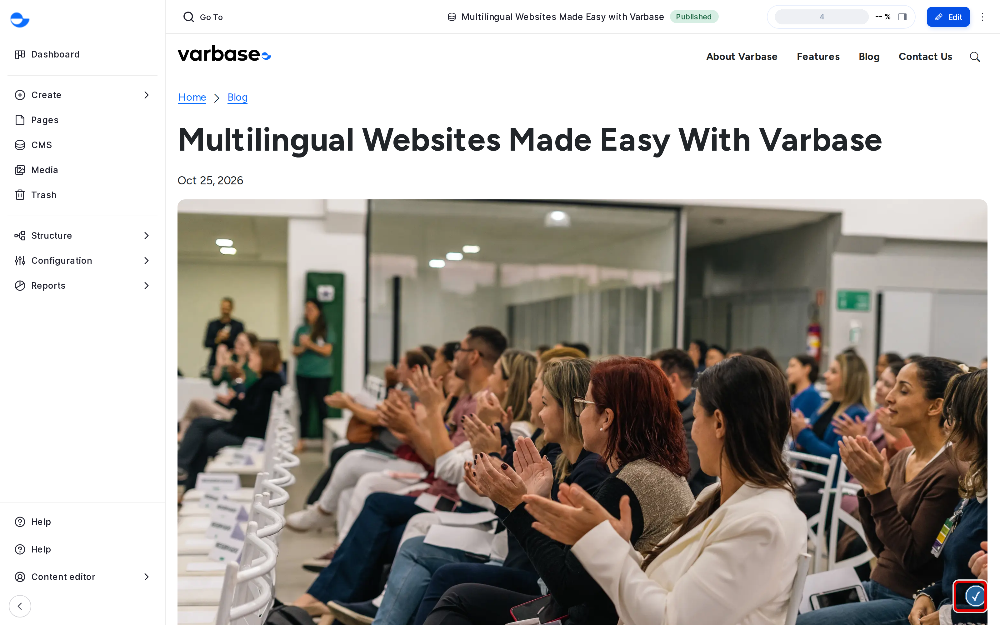
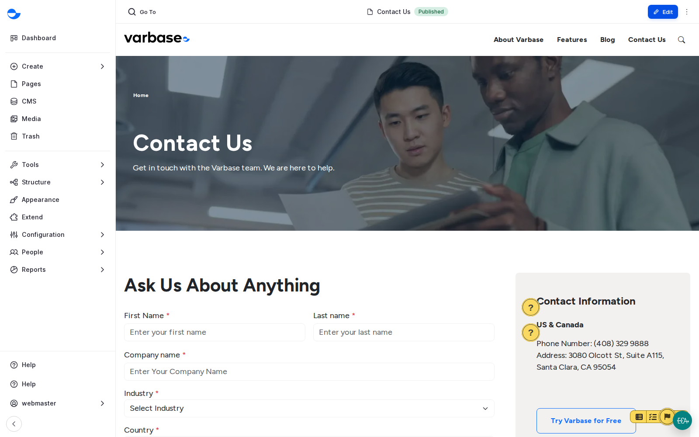
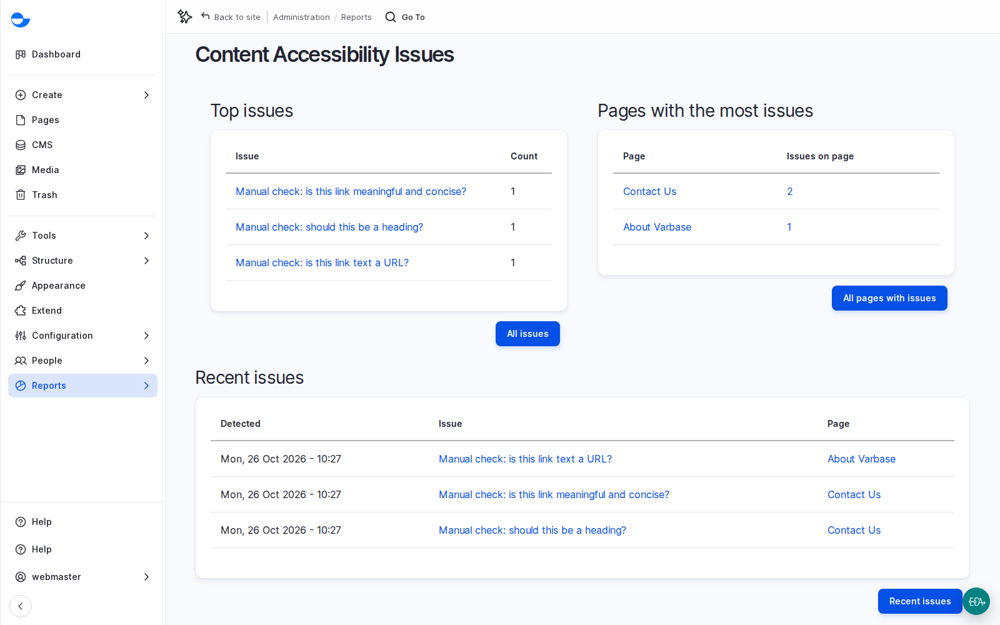

# Accessibility

Accessibility means a website that works for everyone, including people who use screen readers, keyboards, zoom or captions. It is partly theme and partly content: Varbase builds the theme, components and admin area with accessibility in mind, and checks your content as you work with **Editoria11y**, which points to each problem on the page and explains how to fix it. This page shows how to use the checker and the habits that prevent most problems.

<!-- TODO(lesson-16-video): when the unlisted upload exists, replace the hint block below with an embed block for its https://youtu.be/ link, captioned "Lesson 16: Accessibility (Video)". -->

**Lesson 16 video: coming soon.** It will appear here and in the [Varbase: Content Designers playlist](https://www.youtube.com/playlist?list=PLRf-g9-Bc-LI).


## Why It Matters

- **The law**: many countries require public-sector and many private-sector sites to meet accessibility standards. Most contracts ask for **WCAG** level AA (content must be perceivable, operable, understandable and robust).
- **Reach**: an inaccessible site turns away a real share of its audience.
- **Quality**: what helps screen reader users (clear headings, plain words, good link text) helps every reader, search engines and AI tools too.
- **Cost**: issues caught before publishing are cheap to fix.

## Where the Checker Appears

When you are logged in and view a page on the site, the checker scans it and shows its button in the corner of the page. If it finds a problem, the button shows the number of issues and markers appear next to each one.

<figure><figcaption>
The Accessibility Checker on a Page
</figcaption></figure>

Visitors never see the checker.

<figure><figcaption>
Editoria11y Markers on the Contact Us Page
</figcaption></figure>

The dashboard's **Pages with accessibility alerts** block lists pages with issues, so problems are seen every day, not once a year in an audit.

## Fixing a Problem

1. Click a marker on the page, or use the arrows in the panel to go from one issue to the next.
2. Read the explanation, for example that an image has no alternative text.
3. Edit the content and fix it, then view the page again: the issue disappears.

Some alerts are manual checks: the checker asks whether a link's text is meaningful, or whether a bold line should be a heading. If the answer is that it is fine, a role allowed to dismiss alerts marks it as checked, and the dismissal is recorded with the person's name.

## Scenario: Fix a Link That Is a Web Address

On the course's demo site, the checker found a link on the **About Varbase** page whose text was a web address. A screen reader reads it letter by letter.

1. Open the page and click the marker to read the alert.
2. Edit the page and change the link text to words, such as "the Varbase documentation".
3. Publish and view the page again: the alert is gone.

## Common Problems

| Problem | Fix |
| --- | --- |
| Image has no alternative text | Add alt text to the image in the **Media Library**. |
| Heading levels skipped | Use **Heading 2**, then **Heading 3**, without jumping levels. |
| Link text is not clear, such as "click here" | Write link text that says where the link goes. |
| Text formatted to look like a heading | Use a real heading from the **Heading** list. |
| Table without headers | Mark the first row or column as headers. |

## The Site-Wide Report

A **Super Admin** can see every issue found across the site at **Reports** \ **Content Accessibility** (`/admin/reports/editoria11y`): top issues, pages with the most issues, and recent issues and dismissals. Ask them for the list when you plan an accessibility clean-up. The top issues are the best training topics; checking the issue counts each month gives a simple trend for the client's accessibility lead.

<figure><figcaption>
The Content Accessibility Issues Report
</figcaption></figure>

## What a Checker Cannot Do

A checker can tell that an image has alt text, not whether it is accurate. It cannot judge reading order, clear instructions, or whether a video's captions are right. Automated checks find a share of issues; plan manual tests and, for regulated clients, an independent audit.

## Habits Worth Teaching

1. **Headings in order**: the page title is the main heading, then **Heading 2**, **Heading 3**, without skipping. On Drupal Canvas pages, check the order across stacked patterns.
2. **Alternative text** that says what the image shows, never a file name.
3. **Link text** that makes sense on its own: "Read the annual report", never "click here" or a web address.
4. **Structure**: tables for data with a header row, real lists, and never colour alone to carry meaning.
5. **Forms**: a visible label for every field and error messages that say how to fix the problem. **Webform** supports this.
6. **Plain language**: short sentences, common words, the main point first, abbreviations explained.
7. **Video and audio**: checked captions and transcripts; no autoplay with sound.
8. **Documents**: publish the content as a page where possible; never a scanned PDF alone.

Each translation declares its language automatically, so screen readers use the right voice. With the AI recipes, AI can suggest alt text and simplify text; a person still checks both.

## Who Sees the Checker

The **Content editor**, **Content Admin**, **SEO Admin** and **Site Admin** roles. On a new site, only a **Super Admin** can mark an issue as checked or hide it.

## Questions Clients Ask

- **Do accessible sites have to look plain?** No. Good design and accessibility work together.
- **Is the site accessible once it passes the checker?** No. The checker covers common content problems; plan keyboard, zoom and screen reader tests too.

## Planning Notes

- Put accessibility in the contract: the target level, which pages and components are covered, how acceptance is tested, and who owns content accessibility after launch.
- Build it into every phase: contrast, font sizes and focus styles in design; keyboard and screen reader support for every new component (test in Storybook); editor training in content.
- New components carry the cost; reuse existing ones where possible.
- A simple test plan: key pages with a keyboard only, browser zoom at 200%, the automated checks, then specialists with assistive technology.
- Many organisations must publish an accessibility statement: the target, known issues and how to report a problem. The client writes it, often with the agency's help.
- If the client's content lead should see the site-wide report, plan that permission change.
- After launch: editors fix alerts as they appear, a lead reviews the report monthly, an independent check once a year.

## Tips

- Fix issues when you publish, not later: it takes a minute then and much longer in a clean-up.
- The checker finds common problems, not all of them. Also check that the page makes sense with images off and read aloud.


**Check Yourself**

1. Why is a skipped heading level a problem for screen reader users?
2. What can an automated checker not tell you about alternative text?
3. Where would you look to choose the topic of an editors' refresher training?

