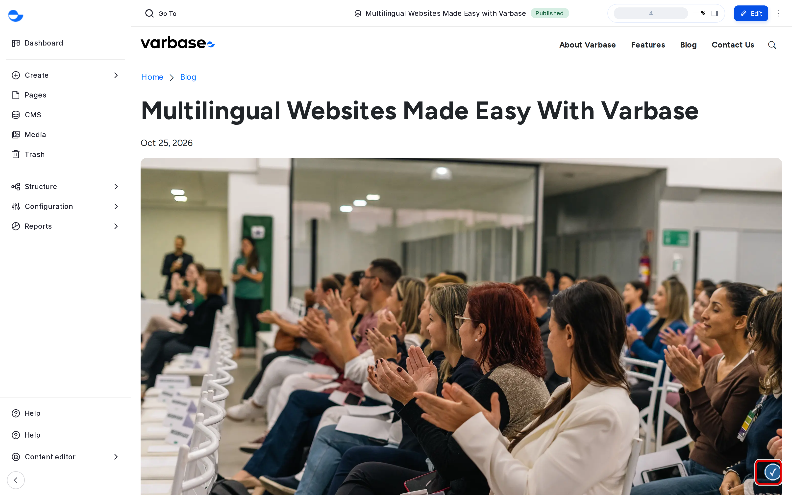

# Accessibility

Accessibility means a website that works for everyone, including people who use screen readers, keyboards, zoom or captions. It is partly theme and partly content: Varbase builds the theme, components and admin area with accessibility in mind, and checks your content as you work with **Editoria11y**, which points to each problem on the page and explains how to fix it. This page shows how to use the checker and the habits that prevent most problems.

## Why It Matters

- **The law**: many countries require public-sector and many private-sector sites to meet accessibility standards. Most contracts ask for **WCAG** level AA (content must be perceivable, operable, understandable and robust).
- **Reach**: an inaccessible site turns away a real share of its audience.
- **Quality**: what helps screen reader users (clear headings, plain words, good link text) helps every reader, search engines and AI tools too.
- **Cost**: issues caught before publishing are cheap to fix.

## Where the Checker Appears

When you are logged in and view a page on the site, the checker scans it and shows its button in the corner of the page. If it finds a problem, the button shows the number of issues and markers appear next to each one.

<figure><figcaption>
The Accessibility Checker on a Page
</figcaption></figure>

Visitors never see the checker.

The dashboard's **Pages with accessibility alerts** block lists pages with issues, so problems are seen every day, not once a year in an audit. On a new Varbase Starter site it lists **Contact Us** and **About Varbase**, whose alerts are typical, easy fixes. See [Fix an Accessibility Alert](fix-an-accessibility-alert.md).

## Common Tasks

- [Fix an Accessibility Alert](fix-an-accessibility-alert.md): read a marker on the page and fix the content, with the most common problems.
- [Review the Site-Wide Accessibility Report](review-the-site-wide-accessibility-report.md): every issue across the site, for a clean-up or a monthly trend.

## What the Checker Looks For

The checker runs a set of tests on every page an editor views, including:

- images without alt text, or with alt text that is meaningless or just a file name;
- empty headings and empty links, and skipped heading levels;
- link text that is only a web address, and links that open a new window;
- tables without headers;
- embedded video or audio that may need captions or a transcript.

On a new Varbase site every test is on. A **Super Admin** can switch off a test that does not apply, under **Configuration** \ **Content authoring** \ _**Editoria11y**_ (`/admin/config/content/editoria11y`), in **Turn off specific tests**. Do it rarely, and record why.

## What a Checker Cannot Do

A checker can tell that an image has alt text, not whether it is accurate. It cannot judge reading order, clear instructions, or whether a video's captions are right. Automated checks find a share of issues; plan manual tests and, for regulated clients, an independent audit.

## Habits Worth Teaching

1. **Headings in order**: the page title is the main heading, then **Heading 2**, **Heading 3**, without skipping. On Drupal Canvas pages, check the order across stacked patterns.
2. **Alternative text** that says what the image shows, never a file name.
3. **Link text** that makes sense on its own: "Read the annual report", never "click here" or a web address.
4. **Structure**: tables for data with a header row, real lists, and never colour alone to carry meaning.
5. **Forms**: a visible label for every field and error messages that say how to fix the problem. **Webform** supports this.
6. **Plain language**: short sentences, common words, the main point first, abbreviations explained.
7. **Video and audio**: checked captions and transcripts; no autoplay with sound.
8. **Documents**: publish the content as a page where possible; never a scanned PDF alone.

Each translation declares its language automatically, so screen readers use the right voice. With the AI recipes, AI can suggest alt text and simplify text; a person still checks both.

## Who Sees the Checker

The **Content editor**, **Content Admin**, **SEO Admin** and **Site Admin** roles, on the pages they can edit, so each editor sees the problems on their own content rather than the whole site's backlog. For a manual check, these roles can click **Mark as ignored**, which hides the alert for them only. On a new site, only a **Super Admin** can click **Mark as OK**, which hides it for all editors, and open the site-wide report.

## Questions Clients Ask

- **Do accessible sites have to look plain?** No. Good design and accessibility work together.
- **Does it only help a few people?** No. It helps people who use screen readers, keyboards, zoom or captions, people reading in a second language, and everyone on a phone in bright sun.
- **Is it a one-time task?** No. Every new page and every new component can add or remove barriers, so checks continue after launch.
- **Is the site accessible once it passes the checker?** No. The checker covers common content problems; plan keyboard, zoom and screen reader tests too.

## Planning Notes

- Put accessibility in the contract: the target level, which pages and components are covered, how acceptance is tested, and who owns content accessibility after launch.
- Build it into every phase: contrast, font sizes and focus styles in design; keyboard and screen reader support for every new component (test in Storybook); editor training in content.
- New components carry the cost; reuse existing ones where possible.
- A simple test plan: key pages with a keyboard only, browser zoom at 200%, the automated checks, then specialists with assistive technology.
- Many organisations must publish an accessibility statement: the target, known issues and how to report a problem. The client writes it, often with the agency's help.

## In This Section

- [Fix an Accessibility Alert](fix-an-accessibility-alert.md)
- [Review the Site-Wide Accessibility Report](review-the-site-wide-accessibility-report.md)

## Tips

- Fix issues when you publish, not later: it takes a minute then and much longer in a clean-up.
- The checker finds common problems, not all of them. Also check that the page makes sense with images off and read aloud.
