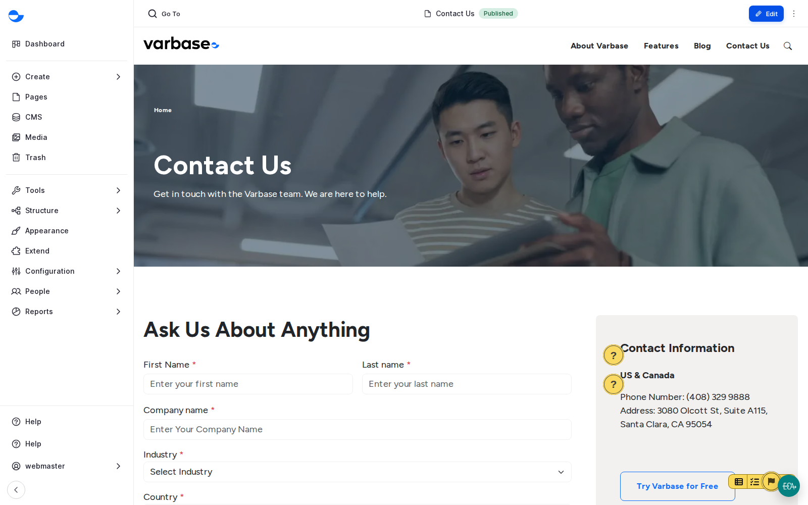

# Fix an Accessibility Alert

When you view a page while logged in, the accessibility checker marks each problem it finds. Most take a minute to fix at the time, and much longer in a clean-up later.

## Steps

1. View the page on the site while logged in. If the checker finds a problem, its button in the corner shows the number of issues and markers appear next to each one.
2. Click a marker, or use the arrows in the panel to go from one issue to the next.
3. Read the explanation, for example that an image has no alternative text.
4. Edit the content and fix it, then view the page again: the issue disappears.

<figure><figcaption>
Editoria11y Markers on the Contact Us Page
</figcaption></figure>

Some alerts are manual checks: the checker asks whether a link's text is meaningful, or whether a bold line should be a heading. On the **Contact Us** page of a new Varbase Starter site, for example, it asks **Manual check: is this link meaningful and concise?**, **Manual check: should this be a heading?** and **Manual check: is opening a new window expected?**. If the answer is that it is fine, dismiss the alert, and the dismissal is recorded with the person's name:

- **Mark as ignored** hides the alert for you only. The editorial roles can do this.
- **Mark as OK** hides it for all editors. On a new site, only a **Super Admin** can do that.

Dismiss honestly: a dismissed problem is still a problem for the visitor.

## Example: a Link That Is a Web Address

On a new Varbase Starter site, the checker finds a link on the **About Varbase** page whose text is a web address, and asks **Manual check: is this link text a URL?**. A screen reader reads it letter by letter.

1. Open the page and click the marker to read the alert.
2. Edit the page and change the link text to words, such as "the Varbase documentation".
3. Publish and view the page again: the alert is gone.

## Common Problems

| Problem | Fix |
| --- | --- |
| Image has no alternative text | Add alt text to the image in the **Media Library**. |
| Heading levels skipped | Use **Heading 2**, then **Heading 3**, without jumping levels. |
| Link text is not clear, such as "click here" | Write link text that says where the link goes. |
| Text formatted to look like a heading | Use a real heading from the **Heading** list. |
| Table without headers | Mark the first row or column as headers. |


On some sites, inserting the **Feature Cards** pattern in Drupal Canvas shows one accessibility alert straight away, from the pattern's sample content. Read the marker and fix the content as usual; if the alert stays after you replace the sample content, tell your development team.

