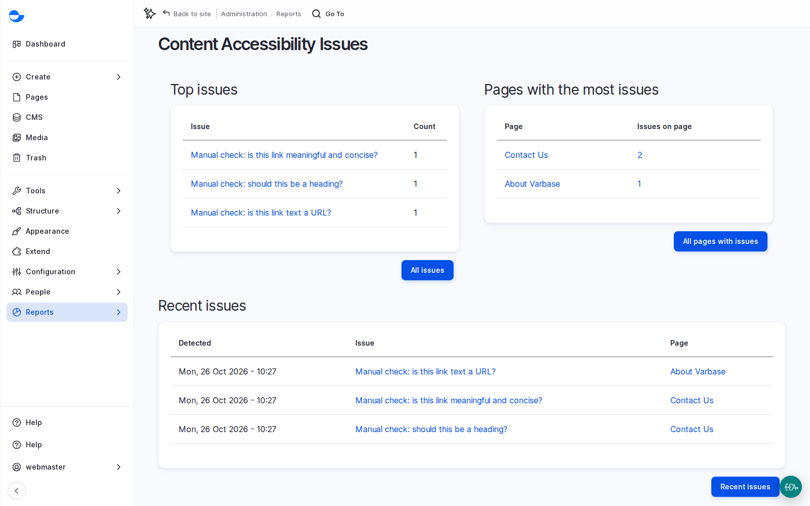

# Review the Site-Wide Accessibility Report

The **Content Accessibility** report collects every issue the checker has found across the site. Use it to plan a clean-up, choose training topics, and show the client's accessibility lead a trend month by month.

## Steps

1. As a **Super Admin**, go to **Reports** \ _**Content Accessibility**_ (`/admin/reports/editoria11y`).
2. Read **Top issues**: the most common problems are the best training topics.
3. Open a page from **Pages with the most issues** and fix its alerts. See [Fix an Accessibility Alert](fix-an-accessibility-alert.md). Click **All pages with issues** for the full table; checking it each month gives a simple trend.
4. Check **Recent issues** and the dismissals, to see who marked what as checked.
5. Export the results as spreadsheets (a summary, the issues, and the dismissals) to report progress.

<figure><figcaption>
The Content Accessibility Issues Report
</figcaption></figure>

Other roles see the dashboard's **Pages with accessibility alerts** block instead, and can ask a **Super Admin** for the full list.

## Planning Notes

- If the client's content lead should see the site-wide report, plan that permission change.
- After launch: editors fix alerts as they appear, a lead reviews the report monthly, an independent check once a year.
