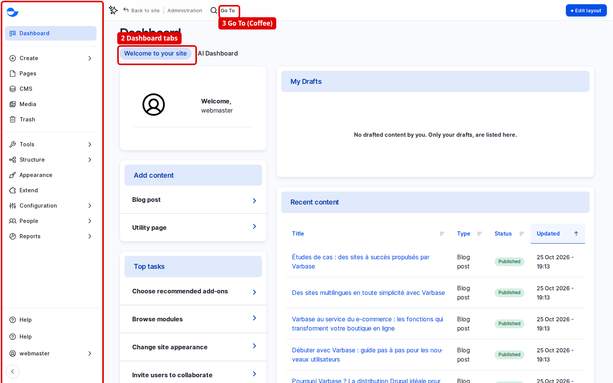
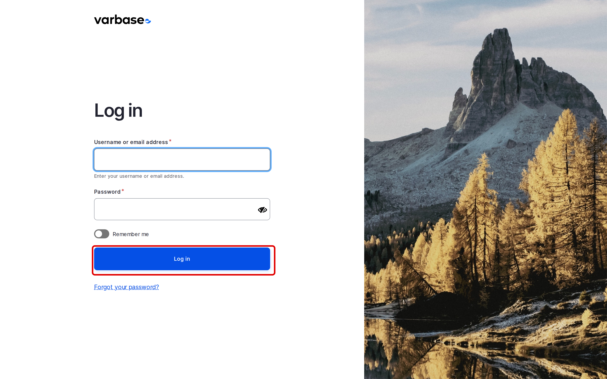
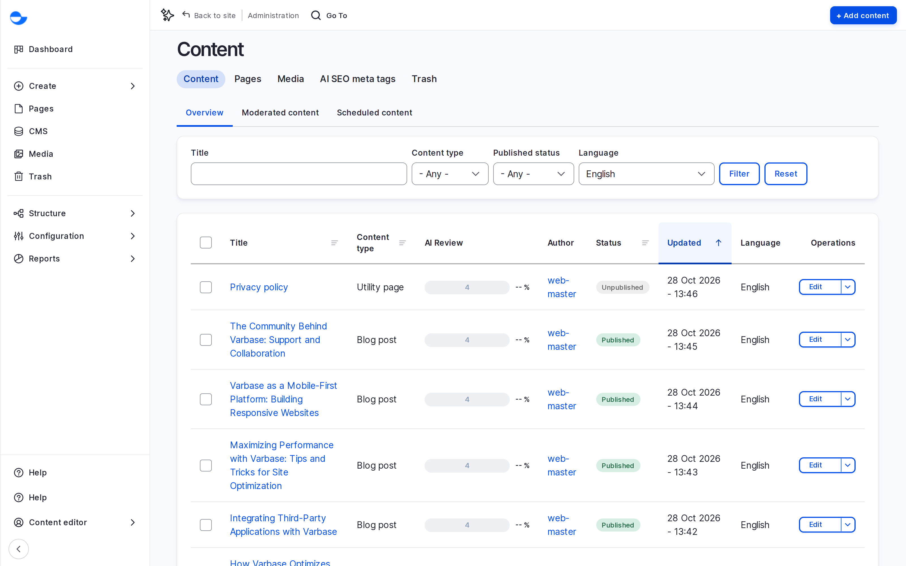
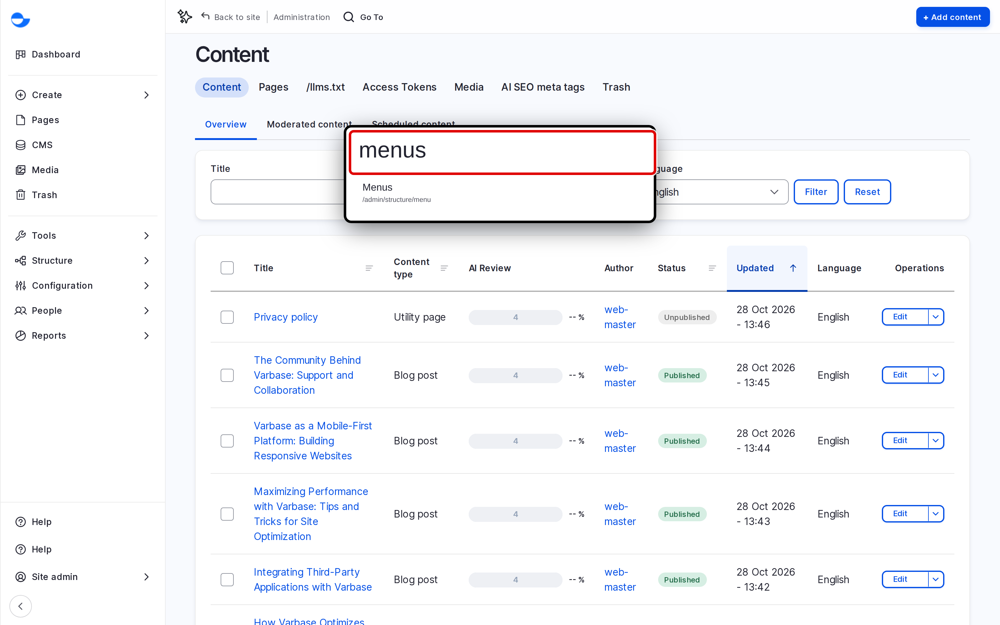
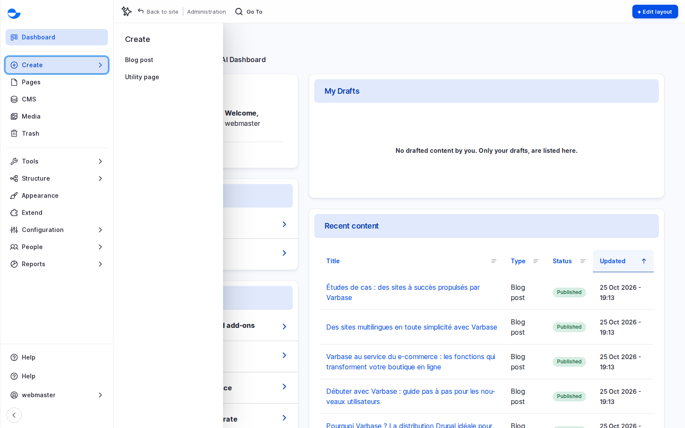

# Accessing the Administration Area

The administration area is where you manage your Varbase site: pages, blog posts, media, menus, users and settings. This page shows you how to log in, what you see first, and the quickest ways to get around. It answers most of a new editor's questions in their first week.

Watch the lesson: [Finding Your Way](../varbase-content-designers-course/lesson-03-finding-your-way.md) in the [Varbase: Content Designers Course](../varbase-content-designers-course/).

## What It Is

- **The login page** at `/user/login`, in the same **Gin** design as the admin area. It accepts a username or an email address.
- **The Dashboard**: blocks that answer the questions of the morning. What can I create, what did I leave unfinished, what changed, what is scheduled, and which pages have accessibility alerts. See [Dashboard](dashboard/).
- **The Navigation sidebar**: the map of everything you may do, showing each person only what their role allows. See [Navigation Sidebar](navigation-sidebar.md).
- **Coffee** (**Go To**): jump to any admin page by typing its name. See [Coffee](coffee.md).
- **The content listing** (`/admin/content`): filters and tabs where most daily work begins.

<figure><figcaption>
The Navigation Sidebar, the Dashboard Tabs and Go To
</figcaption></figure>

## Why It Matters

- Editors find things without training on where Drupal keeps them, so training time drops.
- The dashboard shows each person their own drafts, so work in progress does not get lost.
- Each role sees a shorter, safer admin area, which makes it safe to hand the site to a large editorial team.

## Logging In

1. Go to `/user/login` on your site (for example, `https://example.com/user/login`).
2. Enter your **Username or email address** and your **Password**.
3. Click **Log in**.

<figure><figcaption>
The Login Page
</figcaption></figure>

After you log in, Varbase opens the **Dashboard**. If you open an administration page such as `/admin/content` while logged out, Varbase shows the login form in its place.


What you can see and do depends on your role. A **Content editor** sees fewer menu items than a **Site Admin**. See [Default Roles and Site Personas](../user-management/default-roles-and-site-persons/) for what each role can do.


## The Administration Screen

Every administration page has the same three parts:

- **The Navigation sidebar** on the left, with **Dashboard**, **Create**, **Pages**, **CMS**, **Media**, **Trash** and the **Administration** menu. See [Navigation Sidebar](navigation-sidebar.md).
- **The page header**, with the page title, its tabs, and the main action button for the page, such as **Add content**.
- **The page content**: a form, a list of items with filters, or a report.

<figure><figcaption>
The Parts of an Administration Page
</figcaption></figure>

Varbase uses the **Gin** administration theme for these pages. It works on desktop, tablet and mobile screens.

## Jumping to a Page With Coffee

**Coffee** lets you open any administration page by typing its name.

1. Press **Alt + D** (on a Mac, **Option + D**), or click **Go To** in the bar at the top of the page.
2. Start typing the page name, for example `menus`.
3. Use the arrow keys to pick a result, then press **Enter**.

<figure><figcaption>
Searching for a Page With Coffee
</figcaption></figure>

Press **Esc** to close the search box. Coffee lists only the pages your role can open.

## Reading the Messages

After most actions, Varbase shows a short message at the top of the page. A **status** message confirms that something worked, a **warning** asks for attention, and an **error** says that something did not happen. Pause for a second after each save and read it: many support requests start with a message nobody read.

## Finding Content Fast

The content listing (**CMS** in the sidebar, `/admin/content`) has filters for **Title**, **Content type**, **Published status** and **Language**, and columns you can sort by clicking their heading. Tabs above it open **Pages** (Drupal Canvas pages), **Media** and **Trash**; below them, **Moderated content** and **Scheduled content** list what is not yet published or waiting for a date.

Combine the filters: blog posts in Arabic, sorted by **Updated**, shows the translations that most need attention. Sorting by the oldest update is a simple way to plan a content review.

Each content item has its own tabs: **View**, **Edit**, **Revisions**, **Translate**, **Duplicate** and, with the AI recipes, **AI Review**. The same tabs appear above the item when you visit it on the site while logged in, so you can fix a typo the moment you see it.

<figure><figcaption>
Create Lists the Content Types You May Add
</figcaption></figure>

## Scenario: Check What a Role Sees Before Handover

Log in as each role before launch and check that every person sees what they need and nothing more.

1. Ask your site administrator for a one-time login link for a test account of the role, for example **Content editor**. Never share passwords.
2. Open the link in a private window. Varbase opens the **Dashboard**.
3. Compare the sidebar with a **Site Admin**'s. A **Content editor** has no **Tools**, **Appearance**, **Extend** or **People**, and **Configuration** holds only **URL aliases**, **URL redirects** and the taxonomy manager.
4. Note anything a person needs but cannot reach, and agree the change with the client.
5. Log out of the private window.

See [What Each Role Sees](../user-management/default-roles-and-site-persons/what-each-role-sees.md).

## Scenario: A First-Week Checklist for Editors

If an editor can do these five things, they are ready for daily work:

1. Log in, and check which environment you are on (see [Website Environments](website-environments.md)).
2. Find your drafts in **My Drafts** on the dashboard.
3. Open **Coffee** with **Alt + D** and jump to the content listing.
4. Filter the listing to your own content type and language.
5. Open one of your posts on the site, then edit it from its tabs.

## Getting Help Inside the Site

Every editorial role can open **Help** at the bottom of the **Navigation** sidebar (`/admin/help`). It explains many of the site's modules in plain words and is a good first stop before asking a developer. For tasks, the Content Designers section of this documentation is free to share with a client's editors after their training.

## Logging Out

Open your user menu at the bottom of the **Navigation** sidebar and click **Log out**. Varbase returns you to the login page.

## Questions Clients Ask

- **Can we brand the admin area?** Partly. The **Gin** admin theme has an accent colour and a light or dark mode, the sidebar can show the client's logo (see [Navigation Settings](../site-configuration/user-interface/navigation-settings.md)), and the login page carries the site's logo. Changing the admin theme settings is a **Super Admin** task. A full re-skin of the admin area is not recommended.
- **Can each team see a different dashboard?** Yes. A site can hold several dashboards, each shown to chosen roles. See [Dashboard](dashboard/).

## Planning Notes

- A dashboard per team (newsroom, marketing) is a small configuration task with a daily return. Collect what editors want to see during training. Assumption: about a day per extra dashboard; confirm with the developer lead.
- Email delivery must work on each environment, or password reset links never arrive.
- On multilingual sites, decide whether each person chooses their admin language on their profile, or the language follows the address (the default).
- Only the **Super Admin** opens the **Status report**. Run demos of that screen as Super Admin.

## Tips

- Bookmark `/user/login` for each site you manage, so you always log in to the right one. See [Website Environments](website-environments.md).
- If a page you expect is missing from the menu, your role probably does not include it. Ask your site administrator.
- Use **Coffee** for pages you open often; it is faster than browsing the menus.
