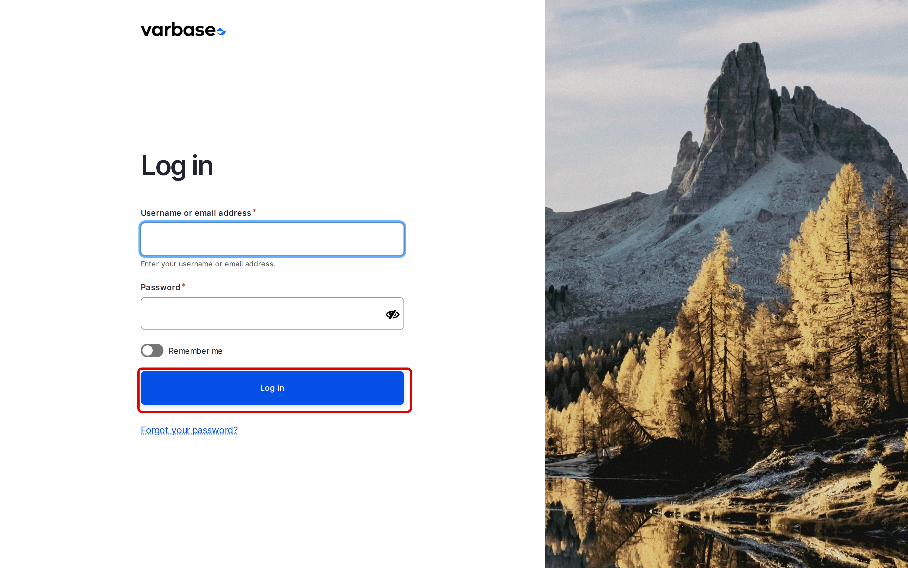
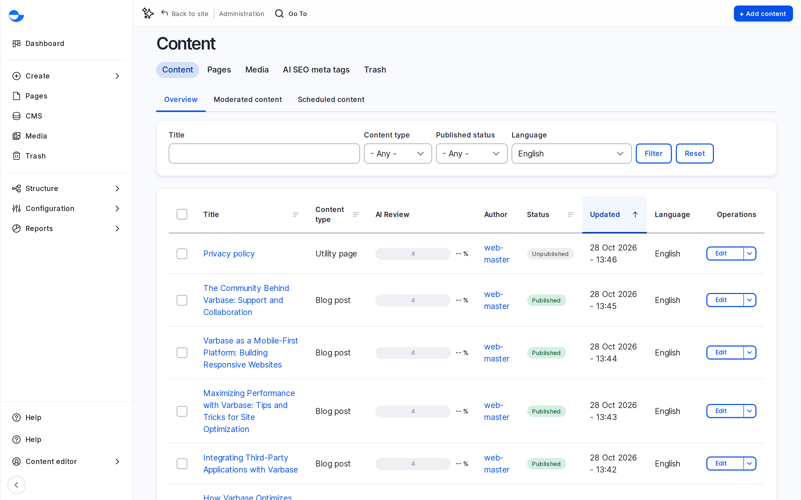
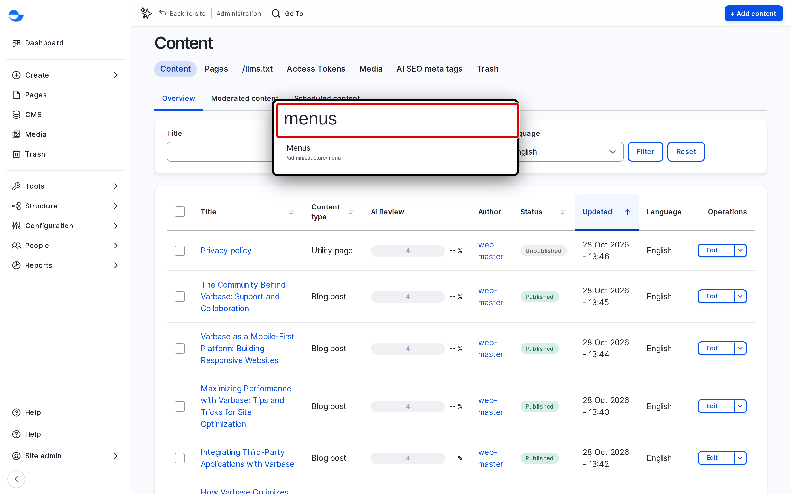

# Accessing the Administration Area

The administration area is where you manage your Varbase site: pages, blog posts, media, menus, users and settings. This page shows you how to log in, what you see first, and the quickest ways to get around.

## Logging In

1. Go to `/user/login` on your site (for example, `https://example.com/user/login`).
2. Enter your **Username or email address** and your **Password**.
3. Click **Log in**.

<!-- <figure><figcaption>
The Login Page
</figcaption></figure> -->

After you log in, Varbase opens the **Dashboard**. If you open an administration page such as `/admin/content` while logged out, Varbase shows the login form in its place.


What you can see and do depends on your role. A **Content editor** sees fewer menu items than a **Site Admin**. See [Default Roles and Site Personas](../user-management/default-roles-and-site-persons/) for what each role can do.


## The Administration Screen

Every administration page has the same three parts:

- **The Navigation sidebar** on the left, with **Dashboard**, **Create**, **Pages**, **CMS**, **Media**, **Trash** and the **Administration** menu. See [Navigation Sidebar](navigation-sidebar.md).
- **The page header**, with the page title, its tabs, and the main action button for the page, such as **Add content**.
- **The page content**: a form, a list of items with filters, or a report.

<!-- <figure><figcaption>
The Parts of an Administration Page
</figcaption></figure> -->

Varbase uses the **Gin** administration theme for these pages. It works on desktop, tablet and mobile screens.

## Jumping to a Page With Coffee

**Coffee** lets you open any administration page by typing its name.

1. Press **Alt + D** (on a Mac, **Option + D**), or click **Go To** in the bar at the top of the page.
2. Start typing the page name, for example `menus`.
3. Use the arrow keys to pick a result, then press **Enter**.

<!-- <figure><figcaption>
Searching for a Page With Coffee
</figcaption></figure> -->

Press **Esc** to close the search box. Coffee lists only the pages your role can open.

## Logging Out

Open your user menu at the bottom of the **Navigation** sidebar and click **Log out**. Varbase returns you to the login page.

## Tips

- Bookmark `/user/login` for each site you manage, so you always log in to the right one. See [Website Environments](website-environments.md).
- If a page you expect is missing from the menu, your role probably does not include it. Ask your site administrator.
- Use **Coffee** for pages you open often; it is faster than browsing the menus.
