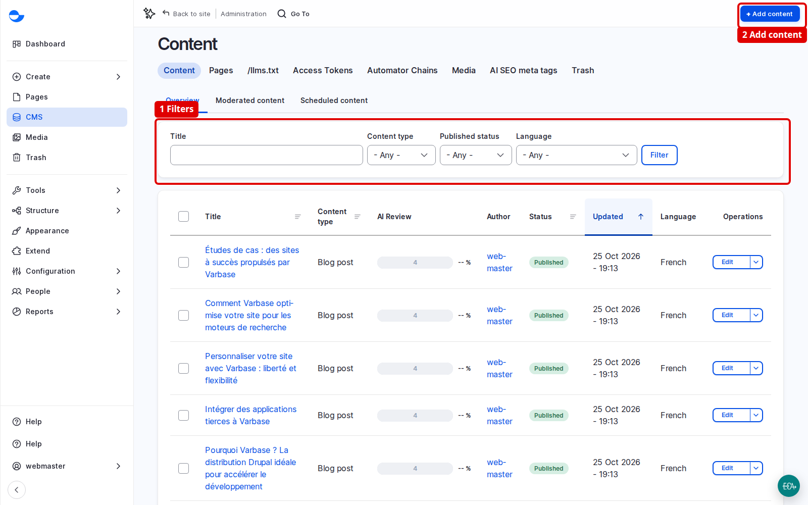

# Find Content Fast

Most daily work starts on the content listing. A few filters and a sort take you to the right item in seconds, and the tabs on each item take you straight to the task.

## Steps

1. Click **CMS** in the **Navigation** sidebar (`/admin/content`).
2. Narrow the list with the filters: **Title**, **Content type**, **Published status** and **Language**. Click **Filter**.
3. Sort by clicking a column heading, such as **Updated**.
4. Click the title of the item to open it, or **Edit** in the **Operations** column.

<figure><figcaption>
The Filters Above the Content List
</figcaption></figure>

Combine the filters: blog posts in Arabic, sorted by **Updated**, shows the translations that most need attention. Sorting by the oldest update is a simple way to plan a content review.

## Other Lists

The tabs above the listing open **Pages** (Drupal Canvas pages), **Media** and **Trash**. Below them, **Moderated content** and **Scheduled content** list what is not yet published or is waiting for a date.

## Tabs on Each Item

Each content item has its own tabs: **View**, **Edit**, **Revisions**, **Translate**, **Duplicate** and, with the AI recipes, **AI Review**. The same tabs appear above the item when you visit it on the site while logged in, so you can fix a typo the moment you see it.

## Tips

- Use **Coffee** (**Alt + D**) to jump to the listing from anywhere. See [Coffee](coffee.md).
- If you cannot find an item you expect, check the **Published status** and **Language** filters first.
