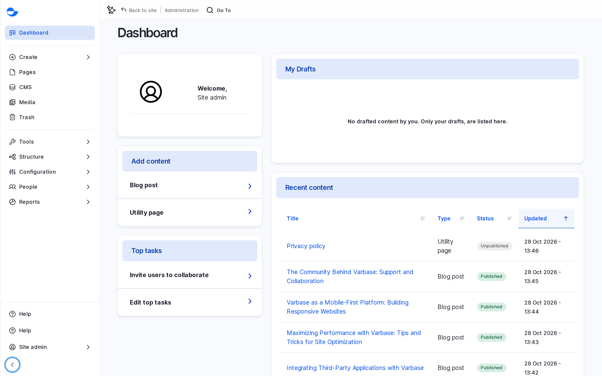
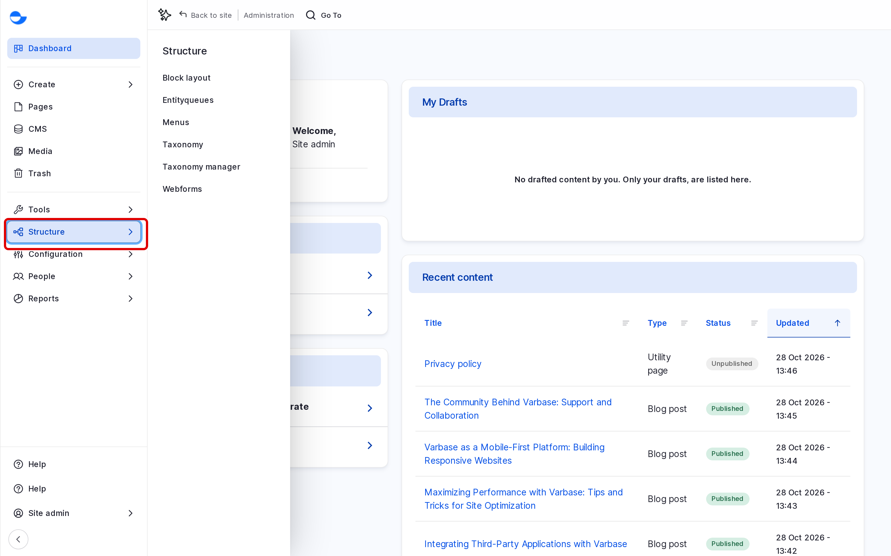
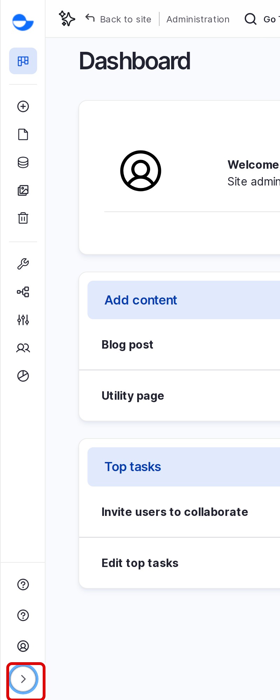

# Navigation Sidebar

The **Navigation** sidebar on the left of every administration page is how you move around Varbase. It puts the everyday content tasks at the top and the full administration menu below them. This page explains each part of the sidebar.

## Parts of the Sidebar

<!-- <figure><figcaption>
The Navigation Sidebar
</figcaption></figure> -->

### Content Tasks

| Item | What it opens |
| --- | --- |
| **Dashboard** | Your starting page. See [Dashboard](../dashboard/). |
| **Create** | A list of the content types you can add, such as **Blog post** and **Utility page**. |
| **Pages** | The list of pages built with **Drupal Canvas** (`/admin/content/pages`). |
| **CMS** | The list of all other content, such as blog posts and utility pages (`/admin/content`). |
| **Media** | The list of images, videos, documents and other media (`/admin/content/media`). |
| **Trash** | Deleted items you can still restore (`/admin/content/trash`). See [Trash](../content-workflow/trash.md). |

### Administration

The **Administration** menu holds the full site menu: **Content**, **Structure**, **Appearance**, **Extend**, **Configuration**, **Reports**, **People**, **Help** and **Tools**. Click an item to open its sub-menu, then click the page you want.

<!-- <figure><figcaption>
A Sub-Menu Open in the Administration Menu
</figcaption></figure> -->

You see only the items your role can use. A **Content editor**, for example, does not see **Extend** or **Appearance**.

**Tools** has shortcuts such as **Flush all caches** and **Run cron**, for roles allowed to use them. See [Clearing Cache](../site-configuration/system/clearing-cache.md).

### Your User Menu

At the bottom of the sidebar, click your name to open **View profile**, **Edit profile** and **Log out**.

## Collapsing and Expanding the Sidebar

1. Click **Collapse sidebar** (the arrow button at the bottom of the sidebar) to shrink it to icons only.
2. Click **Expand sidebar** to show the labels again.

<!-- <figure><figcaption>
The Collapsed Sidebar
</figcaption></figure> -->

Varbase remembers your choice in your browser. On a small screen the sidebar is hidden behind a menu button at the top of the page.

## The Top Bar

On pages for a single item, such as a blog post, a bar at the top of the page shows the item's title and status, its actions (such as **Edit** and **Delete**), and **Go To**, which opens the **Coffee** page search. See [Accessing the Administration Area](README.md#jumping-to-a-page-with-coffee).

## Tips

- Use **Create** for a new blog post or utility page, and **Pages** for a new Drupal Canvas page.
- Collapse the sidebar when you need more room, for example in a wide table.
- If a menu item you need is missing, your role does not include it. Ask your site administrator.


Site administrators can change the sidebar logo at **Configuration** \ **User interface** \ **Navigation** (`/admin/config/user-interface/navigation/settings`). See [Navigation Settings](../site-configuration/user-interface/navigation-settings.md).

