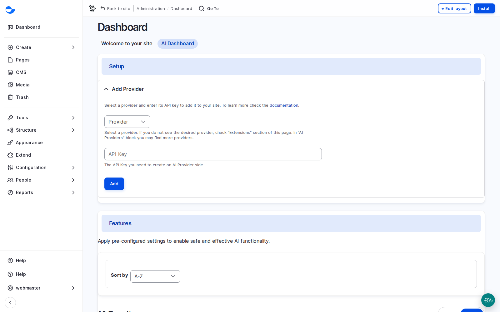
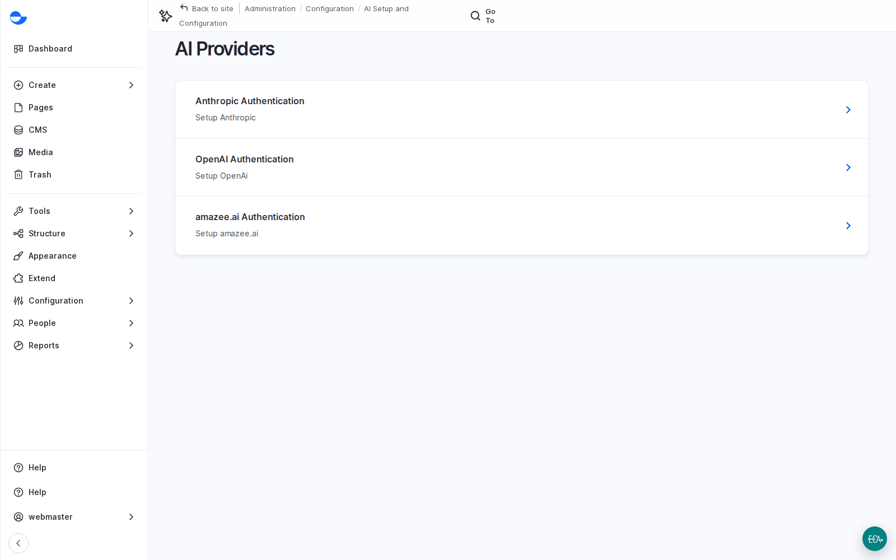
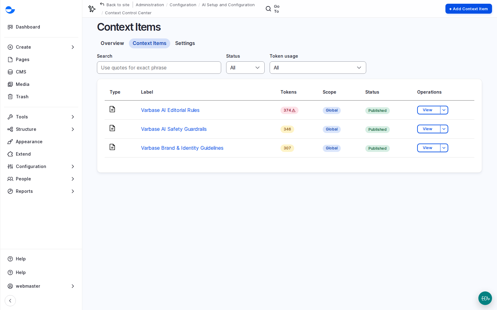
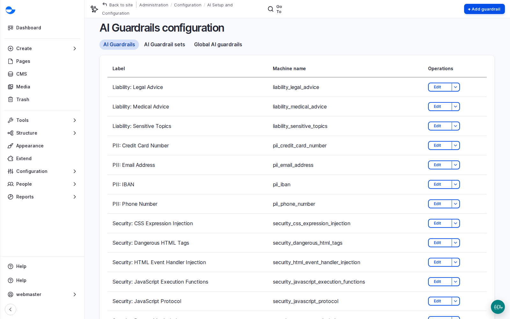
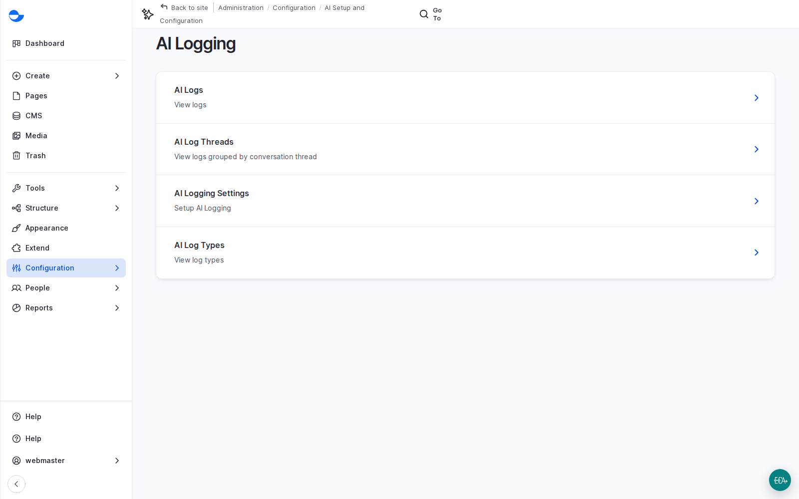

# AI in Varbase

Varbase adds AI where it helps the people who write and publish, with the controls that keep it safe and on brand. This page covers how AI is added to a site, the help it gives editors every day, and the governance around it: providers, context, guardrails, logs and consent. [AI Agents, Answers and Automation](ai-agents-answers-and-automation.md) covers the AI that acts: agents, answers for visitors, the Canvas AI builder, MCP and automation.

<!-- TODO(lesson-18-video): when the unlisted upload exists, replace the hint block below with an embed block for its https://youtu.be/ link, captioned "Lesson 18: AI in Varbase, Part 1 (Video)". -->

**Lesson 18 video: coming soon.** It will appear here and in the [Varbase: Content Designers playlist](https://www.youtube.com/playlist?list=PLRf-g9-Bc-LI).


## Four Principles

1. **Optional**: each AI feature is a recipe, applied only if the client wants it.
2. **The provider is the client's choice**, and can change later.
3. **People decide**: AI suggests; a person accepts, edits or rejects.
4. **Governed**: context, guardrails, logs and consent around every request.

## What It Is

- **Varbase AI Base** connects the providers and brings the editor assistant, image alt text, taxonomy tagging, AI context and safety. Other recipes add SEO, search, answers, chat, review and more. See [Varbase AI Recipes](../../developers/understanding-varbase/varbase-ai-recipes/).
- **Providers** do the work; a site can connect several (the course's demo site uses Anthropic, OpenAI and amazee.io) and pick a default model per task: writing, describing images, searching by meaning. Keys are stored as secrets, never in content, email or tickets, and the provider account belongs to the client.
- **Editor help**: the writing assistant in the editor, **Suggest tags**, AI SEO titles and descriptions that fill only empty fields, and an automator that can fill almost any field from other fields. See [AI Tools in the Editor](ai-tools-in-the-editor.md).
- **Image help**: alt text on request, in a house style; an image description and up to five image tags on save; a bulk alt text tool; and a safety check that refuses unsuitable uploads.
- **AI Setup and Configuration** is its own group under **Configuration**: infrastructure (providers, models, vector databases), tools and automation, and safety and compliance.

<figure><figcaption>
The AI Dashboard
</figcaption></figure>

<figure><figcaption>
AI Providers Connected to the Site
</figcaption></figure>

## Why It Matters

- Faster publishing with consistent quality: alt text, tags and SEO text stop being the step people skip.
- Control: provider choice, brand context, guardrails and logs answer most governance questions.
- No feature in this part publishes anything by itself; suggestions land in fields an editor reviews.

## Context: Teaching the AI About the Client

AI models know a lot about the world and nothing about the client. The **context control center** (**Configuration** \ **AI Setup and Configuration** \ _**Context Control Center**_) holds plain-language guidance every AI feature receives: brand and identity guidelines, editorial rules and safety guidelines. An item can apply everywhere or only to one use case, language or part of the site, and has a status, so it can be drafted before it goes live.

<figure><figcaption>
AI Context Items: Editorial Rules, Safety Guidelines and Brand Guidelines
</figcaption></figure>

### Scenario: Show a Client What Context Changes

1. Write a brand context item with the client, adapted from their brand and style guides: voice and tone, words to use and avoid, do's and don'ts.
2. Ask for the same thing twice, such as alt text for one image: once with the item in draft, once published.
3. Compare the tone and format. It shows the client why the context is worth their time.

## Guardrails, Logs and Consent

- **Guardrails** check what goes into the AI and what comes out: personal data (email addresses, card numbers, bank account numbers, phone numbers), risky topics (legal, medical, sensitive) and security checks (injection and jailbreak attempts). They are grouped in sets; a regulated client can add its own.
- **Logs** record each request: what was asked, what came back, which provider and model, and how much it used. They help explain answers, control cost and review use; they may contain personal data, so agree who sees them and how long they are kept.
- **Consent**: where AI processes something a person provides, such as an image or a chatbot question, the consent manager asks first. See [Cookie Consent](../security-and-privacy/cookie-consent.md).

<figure><figcaption>
AI Guardrails
</figcaption></figure>

<figure><figcaption>
AI Logging
</figcaption></figure>

## Scenario: Run an AI Pilot

1. Pick one team and two or three features, such as tag suggestions and alt text.
2. Agree the provider, where data may be processed, and a monthly budget.
3. Write the brand and editorial context with the client.
4. Train editors: where the AI help is, what it is good at, where it goes wrong, and the rule that the editor is responsible for everything published.
5. Run it for a few weeks and measure: time per task before and with AI, how often editors changed the suggestion, cost, and whether editors want to keep it.
6. Decide what to extend.

## Questions Clients Ask

- **Where does our data go?** To the provider the client chooses, for the feature in use. Read its terms for three things: is data used for training, where is it processed and stored, and how long is it kept. Pick a provider with suitable business terms, or a self-hosted model.
- **What does it cost?** Most providers charge per use. Small features cost very little; bulk runs, such as alt text for a thousand images, cost more and should be planned. Budget it as a running cost.
- **Will AI publish anything by itself?** Not in this part. Suggestions land in fields an editor reviews.

## Planning Notes

- Five questions: which provider and where may data be processed; the monthly budget; which roles use which features; who writes and owns the context; who reviews the AI's work and how often.
- Be honest: AI saves time on routine work (tags, descriptions, first drafts); it does not replace editorial judgement, subject knowledge or legal review, and its quality depends on the context the client gives it.
- Assumption: provider usage for editorial help is low; measure it in the pilot month.


**Check Yourself**

1. Why does Varbase keep the AI provider as a setting rather than building it into each feature?
2. What does the context control center do, and who should write its content?
3. Name two kinds of guardrails.

