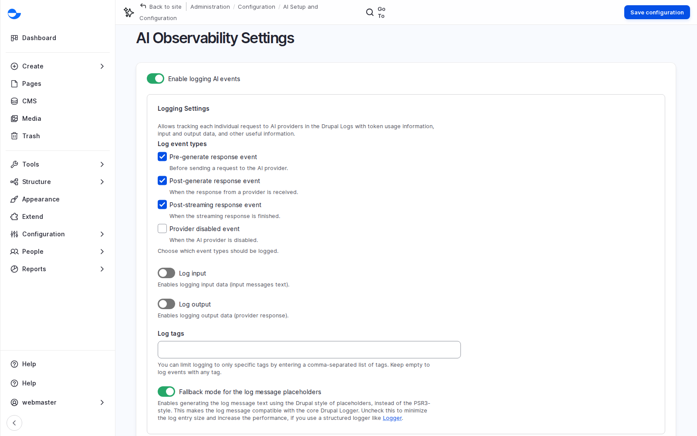

# AI in Varbase

Varbase adds AI where it helps the people who write and publish, with the controls that keep it safe and on brand. This page covers how AI is added to a site, the help it gives editors every day, and the governance around it: providers, context, guardrails, logs and consent. [AI Agents, Answers and Automation](ai-agents-answers-and-automation.md) covers the AI that acts: agents, answers for visitors, the Canvas AI builder, MCP and automation.

Watch the lessons: [AI in Varbase: Recipes, Writing Help, Images and Guardrails](../varbase-content-designers-course/lesson-18-ai-recipes-writing-help-images-and-guardrails.md) and [AI in Varbase: Answers, Reviews, Assistants and Automation](../varbase-content-designers-course/lesson-19-ai-answers-reviews-assistants-and-automation.md) in the [Varbase: Content Designers Course](../varbase-content-designers-course/).

## Four Principles

1. **Optional**: each AI feature is a recipe, applied only if the client wants it.
2. **The provider is the client's choice**, and can change later.
3. **People decide**: AI suggests; a person accepts, edits or rejects.
4. **Governed**: context, guardrails, logs and consent around every request.

## What It Is

- **Varbase AI Base** connects the providers and brings the editor assistant, image alt text, taxonomy tagging, AI context and safety. Other recipes add SEO, search, answers, chat, review and more. See [Varbase AI Recipes](../../developers/understanding-varbase/varbase-ai-recipes/).
- **Providers** do the work; a site can connect several (for example Anthropic, OpenAI and amazee.io) and pick a default model per task: writing, describing images, searching by meaning. Keys are stored as secrets, never in content, email or tickets, and the provider account belongs to the client.
- **Editor help**: the writing assistant in the editor, **Suggest tags**, AI SEO titles and descriptions that fill only empty fields, and an automator that can fill almost any field from other fields. See [AI Tools in the Editor](ai-tools-in-the-editor.md).
- **Image help**: alt text on request, in a house style; an image description and up to five image tags on save; a bulk alt text tool; and a safety check that refuses unsuitable uploads.
- **Not applied by default**: generating images and SVG graphics in the media library (**Varbase AI Media Base**) and turning Figma designs into pages (**Varbase AI Figma**). Both are optional recipes for a client who asks.
- **AI Setup and Configuration** is its own group under **Configuration**: infrastructure (providers, models, vector databases), tools and automation, and safety and compliance.

<figure><figcaption>
The AI Dashboard
</figcaption></figure>

<figure><figcaption>
AI Providers Connected to the Site
</figcaption></figure>

## Why It Matters

- Faster publishing with consistent quality: alt text, tags and SEO text stop being the step people skip.
- Control: provider choice, brand context, guardrails and logs answer most governance questions.
- No feature in this part publishes anything by itself; suggestions land in fields an editor reviews.

## Context: Teaching the AI About the Client

AI models know a lot about the world and nothing about the client. The **context control center** (**Configuration** \ **AI Setup and Configuration** \ _**Context Control Center**_) holds plain-language guidance every AI feature receives: brand and identity guidelines, editorial rules and safety guidelines. An item can apply everywhere or only to one use case, language or part of the site, and has a status, so it can be drafted before it goes live.

<figure><figcaption>
AI Context Items: Editorial Rules, Safety Guidelines and Brand Guidelines
</figcaption></figure>

Start with a few global items, and add targeted ones as needs appear: for example a house style for alt text that applies only to image tasks, or a stricter tone that applies only to press releases. Writing and changing context items is a **Super Admin** task on a new site, so agree who on the client side owns the wording.

### Tuning the Assistant's Prompts

Each action of the writing assistant sends a prepared instruction, called a prompt. The prompts are listed under **Configuration** \ **AI Setup and Configuration** \ _**Prompt Library**_ (`/admin/config/ai/prompts`): modify, reformat, fix spelling, summarize, change tone and translate, including the actions that are switched off in the editor. A **Super Admin** can adjust them, for example to always use British spelling or to keep summaries under fifty words. Small changes make the assistant feel made for the client.

To see the difference context makes, see [Show a Client What Context Changes](show-a-client-what-context-changes.md).

## Guardrails, Logs and Consent

- **Guardrails** check what goes into the AI and what comes out: personal data (email addresses, card numbers, bank account numbers, phone numbers), risky topics (legal, medical, sensitive) and security checks (injection and jailbreak attempts). They are grouped in sets; a regulated client can add its own.
- **Logs** record each request: what was asked, what came back, which provider and model, and how much it used. They help explain answers, control cost and review use; they may contain personal data, so agree who sees them and how long they are kept.
- **Consent**: where AI processes something a person provides, such as an image or a chatbot question, the consent manager asks first. See [Cookie Consent](../security-and-privacy/cookie-consent.md).

<figure><figcaption>
AI Guardrails
</figcaption></figure>

### How Long Logs Are Kept

The **Varbase AI Safety** recipe keeps AI logs for 90 days, and at most 1,000 entries, after which older ones are deleted automatically (**AI Logging Settings**). The client's privacy team should agree the period, the same way they do for form submissions. **AI Observability** (`/admin/config/ai/observability`) decide which AI events are logged, whether the text sent and received is kept (off by default), and whether AI activity is also sent to the client's own monitoring tools. Both are **Super Admin** settings.

<figure><figcaption>
AI Observability Settings
</figcaption></figure>

<figure><figcaption>
AI Logging
</figcaption></figure>

## Questions Clients Ask

- **Where does our data go?** To the provider the client chooses, for the feature in use. Read its terms for three things: is data used for training, where is it processed and stored, and how long is it kept. Pick a provider with suitable business terms, or a self-hosted model.
- **What does it cost?** Most providers charge per use; budget it as a running cost. See [Run an AI Pilot](run-an-ai-pilot.md).
- **Will AI publish anything by itself?** Not in this part. Suggestions land in fields an editor reviews.

## Planning Notes

- Start with a pilot. See [Run an AI Pilot](run-an-ai-pilot.md).
- Be honest: AI saves time on routine work (tags, descriptions, first drafts); it does not replace editorial judgement, subject knowledge or legal review, and its quality depends on the context the client gives it.

## In This Section

- [AI Tools in the Editor](ai-tools-in-the-editor.md)
- [AI Agents, Answers and Automation](ai-agents-answers-and-automation.md)
- [Show a Client What Context Changes](show-a-client-what-context-changes.md)
- [Run an AI Pilot](run-an-ai-pilot.md)
- [Generate Alt Text for Many Images](../media-management/generate-alt-text-for-many-images.md)
