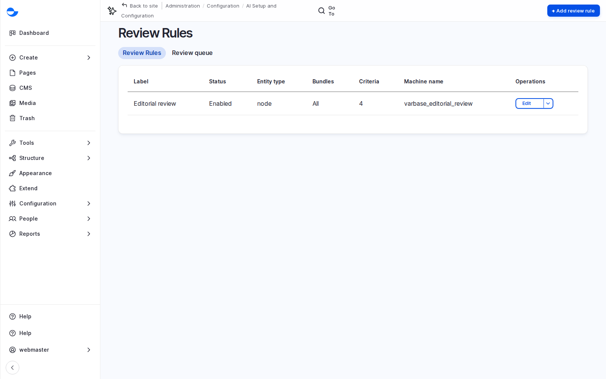
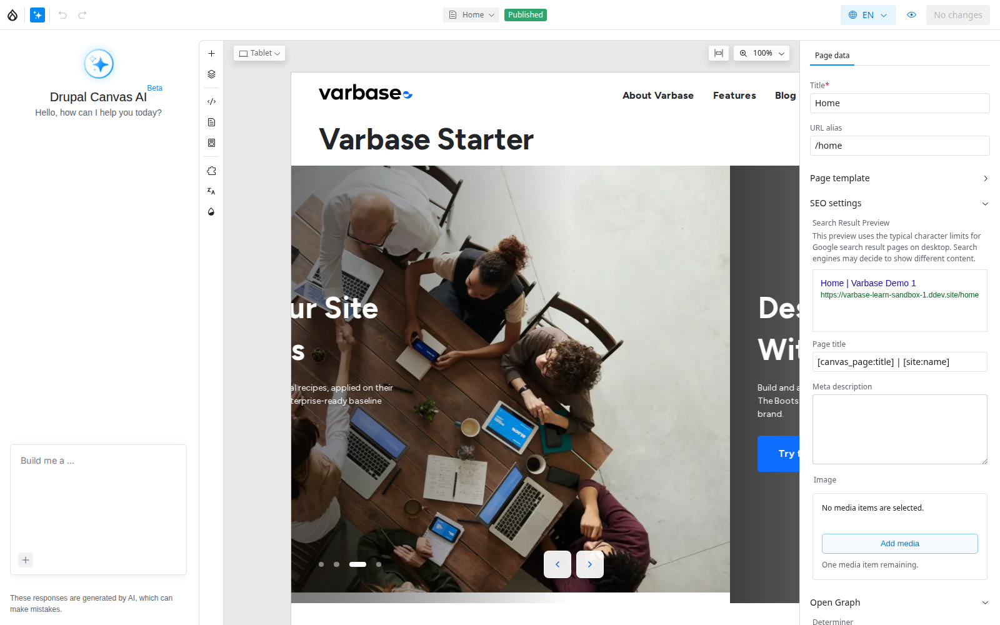
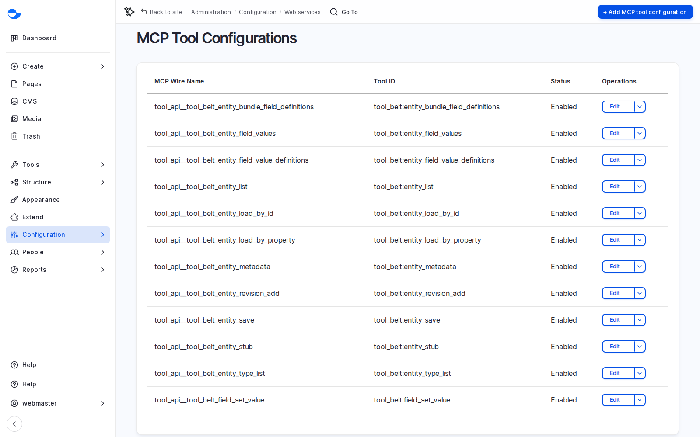
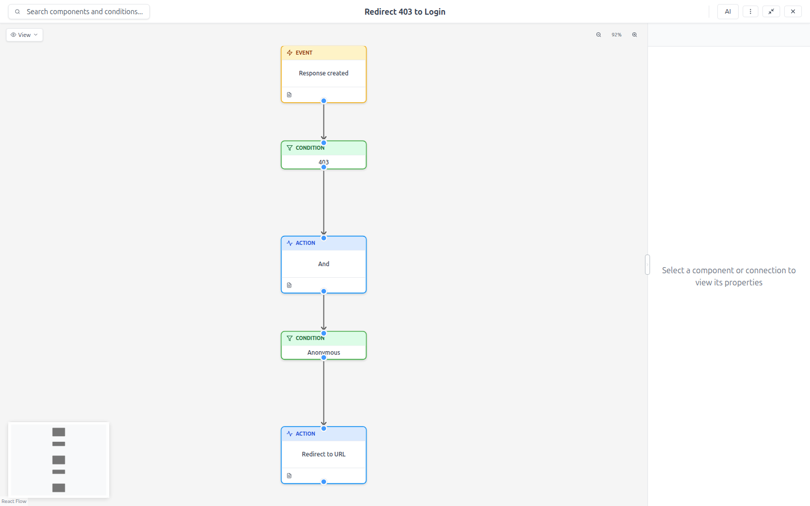
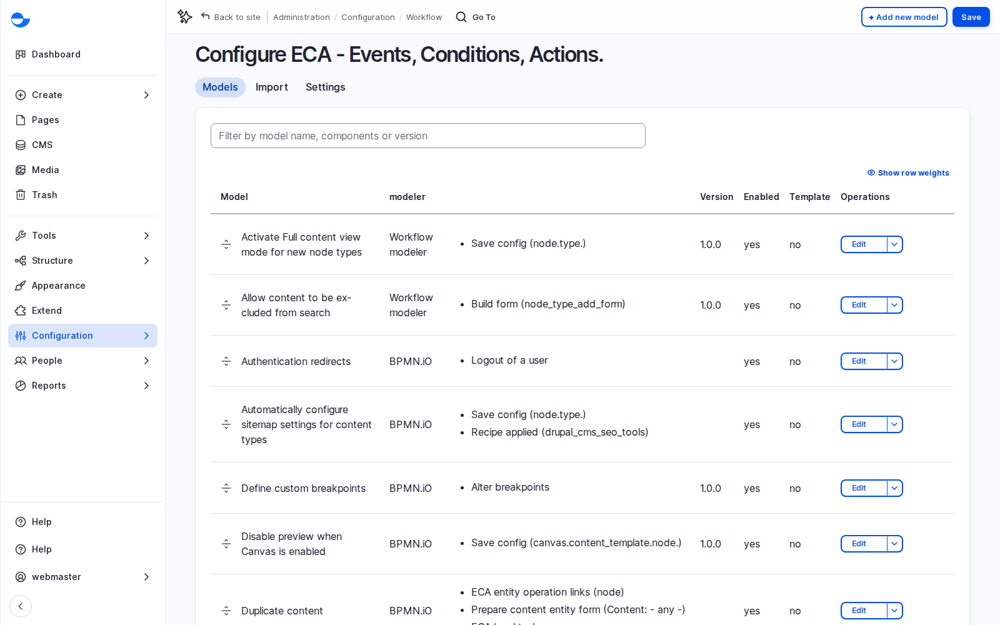
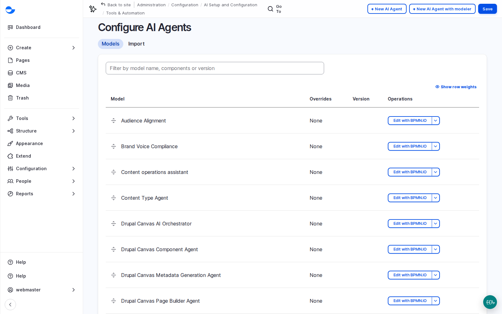

# AI Agents, Answers and Automation

[AI in Varbase](./) covered AI help for editors and the controls around it. This page covers the larger features: answers for visitors, AI review of content, an assistant for editors, the Drupal Canvas AI agent that drafts pages, connections to outside AI assistants through MCP, and no-code automation with ECA. Most of these are early releases; position them as pilots.

<!-- TODO(lesson-19-video): when the unlisted upload exists, replace the hint block below with an embed block for its https://youtu.be/ link, captioned "Lesson 19: AI in Varbase, Part 2 (Video)". -->

**Lesson 19 video: coming soon.** It will appear here and in the [Varbase: Content Designers playlist](https://www.youtube.com/playlist?list=PLRf-g9-Bc-LI).


## Why It Matters

- Visitors get answers grounded in the client's own content, with sources.
- Marketing gets a first draft of a landing page in minutes, built from approved components.
- Automation replaces small custom modules with visible, editable models.

## Ask AI: Answers for Visitors

**Search by meaning** matches ideas, not just words, so a question about protecting a site finds a post about security. Varbase keeps a second, vector index of the content for this. On top of it, **Ask AI** (Varbase AI Answers Base) answers a visitor's question in plain words using only what it found, with numbered citations and source cards. It answers in the visitor's language, and says so when the site has no answer.

- It is placed with the **Ask AI (cited answers)** pattern in Drupal Canvas, on a help or support page.
- Answers are only as good as the content: clear headings, accurate and current pages. Visitor feedback on answers is a list of content to improve.
- Each question costs one search and one AI call.
- A **visitor chatbot** answers from the same index in a conversation and asks for consent before it loads. On sites where every page is a Drupal Canvas page, its block cannot yet be placed as a component.

## AI Content Review

Each content item has an **AI Review** tab. Four reviewers score it from 0 to 100, with a pass, warning or fail, an explanation and specific suggestions: **editorial quality**, **brand voice**, **prohibited terminology** and **audience alignment**. Nothing changes until an editor applies a suggestion.

- The **Editorial review** rule applies to every content type, passing at 70 and warning at 50. Every review is stored with its score, date and who ran it.
- The content list shows each item's review result in the **AI Review** column. Content Admins can run reviews in batches, which makes a quick audit of a whole section; plan the cost first.
- A practical habit: review before sending to review, so the human reviewer starts from a cleaner draft.

<figure><figcaption>
Content Review Rules
</figcaption></figure>

See [AI Tools in the Editor](ai-tools-in-the-editor.md#reviewing-a-post-before-publishing).

## The Content Operations Assistant

A chat for editors in the admin area that audits, reports on and updates content: for example "which blog posts have no SEO description?". It works with the editor's own permissions, shows every change first, saves only what the editor approves as a new revision with a note, and never deletes content or changes users or settings. A separate set-up assistant from Drupal CMS helps administrators with site settings; use it on a test site first.

## The Drupal Canvas AI Agent

In the Canvas editor, the AI panel drafts whole pages from a description, or from a picture of a layout such as a mockup, a sketch or a screenshot of a page the client likes.

<figure><figcaption>
The Drupal Canvas AI Panel in the Editor
</figcaption></figure>

### Scenario: Draft a Webinar Landing Page

1. Open a new, unpublished page in the editor and open the AI panel.
2. Describe the page: "A landing page for a training webinar: a hero with the date and a register button, three cards on what attendees learn, questions and answers, and a call to action." Or attach a picture of the layout.
3. Wait for the draft. It is made of normal components, such as a hero, cards, an accordion and a call to action.
4. Review it like any page: every fact, number and link, images and their alt text, heading order, the phone view, and whether it sounds like the client.
5. Change any word or image, reorder sections, then publish through **Review changes**.

The agent can only use components and variants that exist in the design system, so the result stays on brand. On a new site only the **Super Admin** may use it; each draft uses several AI calls. See [Building Pages With the Drupal Canvas AI Agent](../../developers/theme-development-with-varbase/drupal-canvas/building-pages-with-the-drupal-canvas-ai-agent.md).

## MCP: Connecting Outside AI Assistants

**MCP** (the Model Context Protocol) is a standard way to connect an AI assistant, such as Claude, to other systems. Varbase's MCP server lets an outside assistant read the site and save drafts.

- A person connects their assistant, logs in to the site and approves it through a standard secure sign-in (OAuth). Without approval, access is refused.
- The assistant acts with the **MCP agent** role: it may create and edit drafts of posts and pages, and it can never publish.
- Each capability is a tool (list and read content, read field definitions, create or update drafts); an administrator decides which tools are available.

<figure><figcaption>
MCP Tool Configurations
</figcaption></figure>

## ECA: No-Code Automation

**ECA** stands for event, condition, action: when something happens and a condition is true, the site acts. Models are drawn in the **Workflow Modeler** as small diagrams that read like flowcharts.

A Varbase site already runs about fifteen models behind the scenes, for example: set up SEO fields and sitemap settings for new content types, answer page not found for unpublished content, turn on consent when remote video is first used, power the **Duplicate** tab, redirect access denied to the login page, and generate SEO meta tags with AI.

<figure><figcaption>
An ECA Model in the Workflow Modeler
</figcaption></figure>

Automations clients often ask for: notify a reviewer when content is sent to review, remind authors about drafts older than two weeks, tag content on save, send a welcome email to new accounts. An automation can also call AI, such as running an AI review when a post is sent to review and emailing the result.

Govern automation: every model has an owner and a description, changes are tested on staging (a model runs every time its event happens), and a model can be disabled with one switch. See [Varbase ECA](../../developers/varbase-eca/).

<figure><figcaption>
ECA Models
</figcaption></figure>

## What to Promise, What to Pilot

| Mature, simple to rely on | Early releases, best as pilots |
| --- | --- |
| Writing help, alt text, tag suggestions, guardrails, logging, ECA automation | Ask AI, the chatbot, AI content review, the content operations assistant, the MCP server, the readable files (alpha); the Canvas AI agent (beta) |

Early-release recipes are not covered by Drupal security advisories. Run them as a pilot on a non-production environment first.

A sensible roadmap for many clients has three phases: help for editors with context and guardrails in place; then review and the content assistant for the editorial team; then answers for visitors and outside assistants, once content quality is proven.

<figure><figcaption>
AI Agents on the Site
</figcaption></figure>

## Planning Notes

- AI search needs a vector database (MariaDB or Milvus) and an embeddings provider; include indexing in the content migration plan.
- Write evaluation questions with the client and track answer quality as an acceptance criterion.
- Assumption: a scoped AI pilot (one feature, one content area, evaluation) is 1 to 2 weeks including client review.


**Check Yourself**

1. What does Ask AI do when the site has no answer to a question?
2. What may an outside AI assistant connected through MCP never do?
3. Name two automations a Varbase site already runs with ECA.

