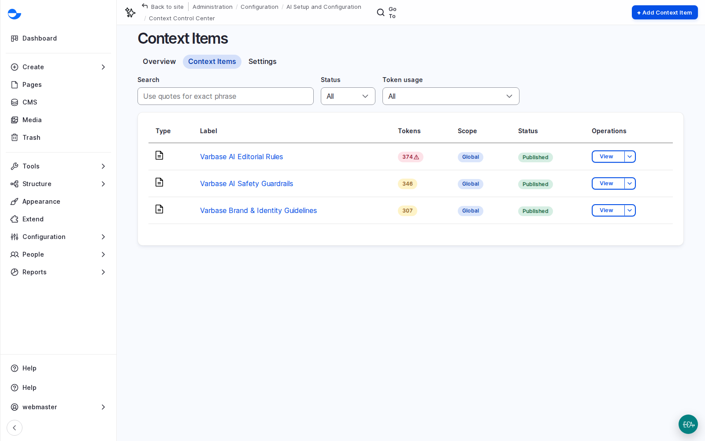

# Show a Client What Context Changes

AI context items teach every AI feature about the client: their brand, their editorial rules, their safety rules. The quickest way to show why that is worth their time is to ask for the same thing with and without it.

## Steps

1. Write a brand context item with the client, adapted from their brand and style guides: voice and tone, words to use and avoid, do's and don'ts. Context items are under **Configuration** \ **AI Setup and Configuration** \ _**Context Control Center**_.
2. Ask for the same thing twice, such as alt text for one image: once with the item in draft, once published.
3. Compare the tone and format with the client.

<figure><figcaption>
AI Context Items: Editorial Rules, Safety Guidelines and Brand Guidelines
</figcaption></figure>

## Planning Notes

- Writing and changing context items is a **Super Admin** task on a new site, so agree who on the client side owns the wording.
- Start with a few global items, and add targeted ones (one task, language or part of the site) as needs appear.
