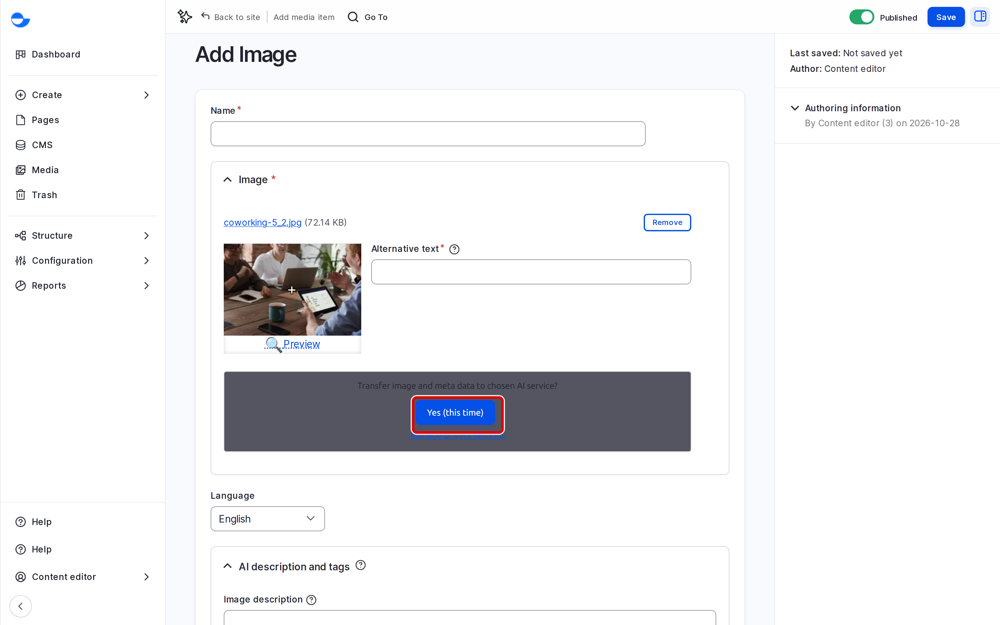
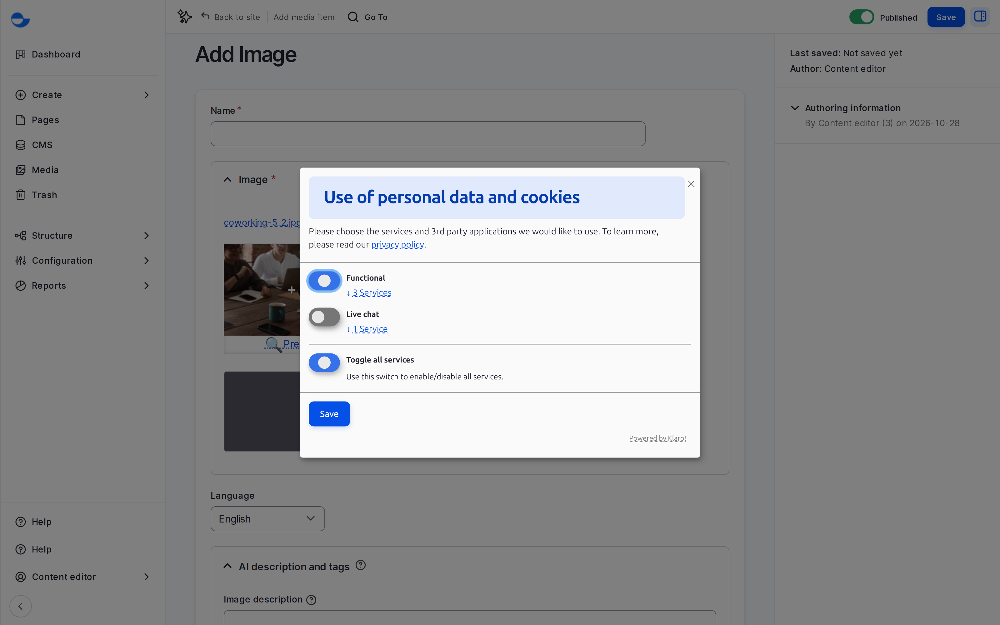
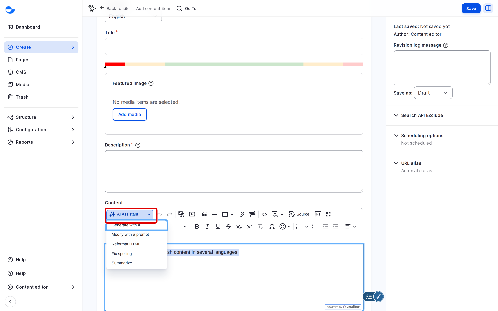
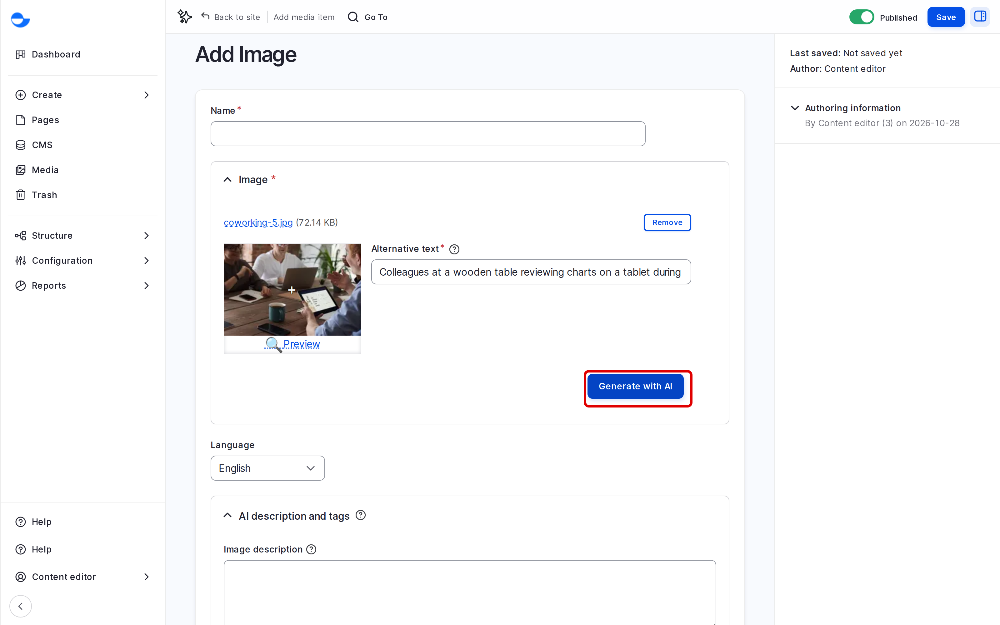
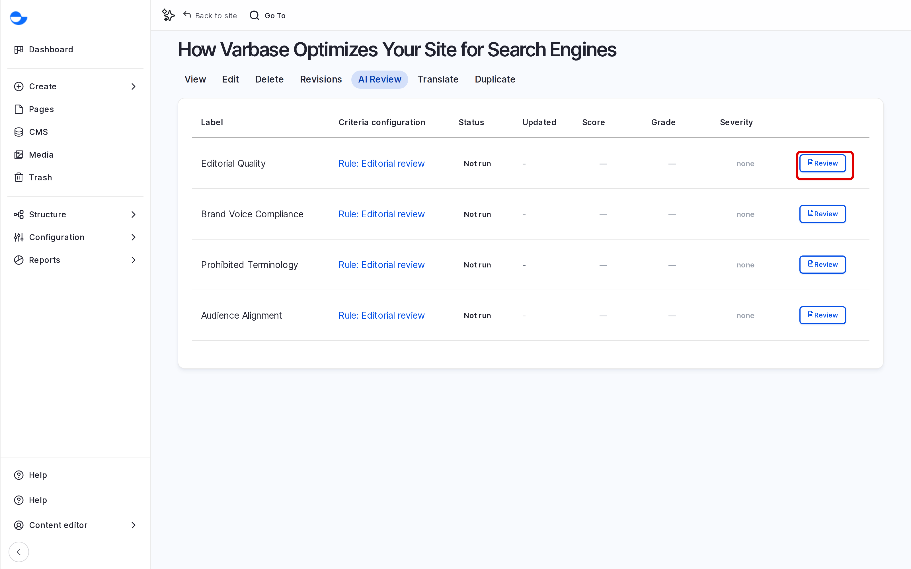

# AI Tools in the Editor

Varbase includes AI tools that help you write and check content: drafting and editing text in the rich-text editor, suggesting alt text for images, and reviewing a post before it is published. You stay in charge: every suggestion is yours to accept, change or discard. This page shows each tool.


Writing With the AI Assistant (Video)


If the video does not play, open [Writing With the AI Assistant (MP4)](<../.gitbook/assets/cd-clip-14-ai-draft.mp4>). Captions: [cd-clip-14-ai-draft.vtt](<../.gitbook/assets/cd-clip-14-ai-draft.vtt>).


The AI tools work only after your site administrator connects an AI provider. If a button gives an error, ask them whether AI is set up on your site.


## The Privacy Prompt

The first time you use an AI tool, Varbase asks for your consent, because the tool sends your text or image to an outside AI service. For example, **Generate with AI** for alt text is replaced by the question **Transfer image and meta data to chosen AI service?**

- Click **Yes (this time)** to allow it for this visit only.
- Click **Manage privacy settings** to turn each AI service on or off for good. You can change this at any time.

<figure><figcaption>
The Privacy Prompt Before an AI Tool Runs
</figcaption></figure>

<figure><figcaption>
Managing Your Privacy Settings
</figcaption></figure>

## Writing With the AI Assistant

In the **Rich editor** text format, used for blog posts, the toolbar has an **AI Assistant** button.

1. Select the text to work on, or place the cursor where new text should go.
2. Click **AI Assistant** and choose an action:

| Action | What it does |
| --- | --- |
| **Generate with AI** | Writes new text from your instructions. |
| **Modify with a prompt** | Changes the selected text the way you describe, for example "make it shorter". |
| **Reformat HTML** | Tidies the formatting of the selected text. |
| **Fix spelling** | Corrects spelling and punctuation. |
| **Summarize** | Writes a summary of the selected text. |

3. Read the result in the dialog, then insert it or try again.

<figure><figcaption>
The AI Menu in the Editor
</figcaption></figure>

The **Content** format of utility pages has no **AI Assistant** button. For the full list and the actions that are off by default, see [Varbase AI Editor Assistant](../developers/understanding-varbase/varbase-ai-recipes/varbase-ai-editor-assistant.md).

## Suggesting Alt Text for Images

When you add an image, click **Generate with AI** next to **Alternative text**. Varbase describes the image in the language of the content. Check the suggestion: the AI does not know why you chose the image. See [Image](media-management/uploading-media-files/image.md).

<figure><figcaption>
Alt Text Suggested by AI
</figcaption></figure>

## Reviewing a Post Before Publishing

The **AI Review** tab on a blog post or utility page checks it against your site's **Editorial review** rules and lists suggestions.

1. Open the item and click the **AI Review** tab.
2. Run the review and wait for the results.
3. Read each suggestion, and apply or dismiss it.

<figure><figcaption>
An AI Review of a Blog Post
</figcaption></figure>

The **AI Review** column on the **CMS** list shows the latest result of each item.

## Building Pages With the Canvas AI Agent

The Drupal Canvas editor can also draft a page from a short request. On a new site this is limited to the **Super Admin**. See [Building Pages With the Drupal Canvas AI Agent](../developers/theme-development-with-varbase/drupal-canvas/building-pages-with-the-drupal-canvas-ai-agent.md).

## Who Can Use the Tools

| Tool | Roles |
| --- | --- |
| AI button in the editor | **Content editor**, **Content Admin**, **SEO Admin**, **Site Admin** |
| Alt text suggestions | **Content editor**, **Content Admin**, **SEO Admin**, **Site Admin** |
| AI Review | **Content editor**, **Content Admin**, **Site Admin** |
| Canvas AI agent | **Super Admin** |

## Tips

- Treat AI text as a first draft. Check facts, names and numbers before publishing.
- Do not paste private or personal information into an AI request.
- Say what you want in plain words, for example "rewrite for a general audience, under 80 words".
