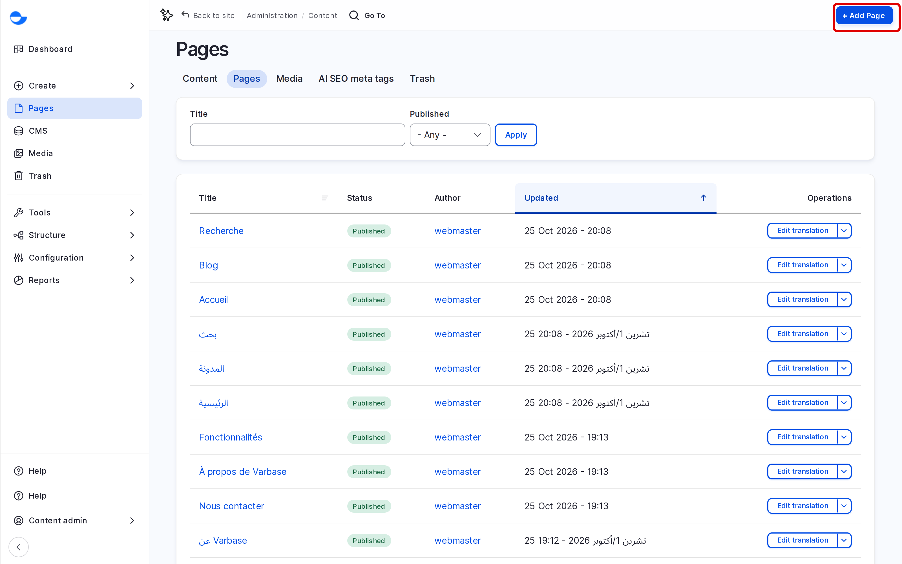
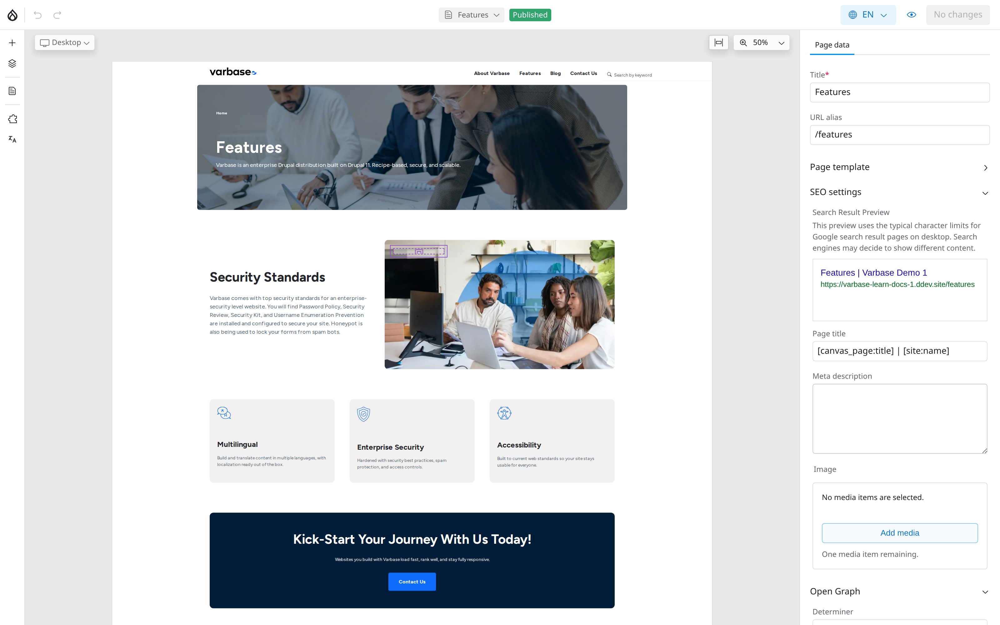

# Building Pages With Drupal Canvas

**Drupal Canvas** is the page builder in Varbase. You build a page by placing ready-made components, such as headings, images, cards and sliders, and editing them where they appear on the page. This section shows you how to create pages, work in the editor and publish your changes.


Finding Your Way in Drupal Canvas (Video)


If the video does not play, open [Finding Your Way in Drupal Canvas (MP4)](<../../.gitbook/assets/cd-clip-04-canvas-editor-tour.mp4>). Captions: [cd-clip-04-canvas-editor-tour.vtt](<../../.gitbook/assets/cd-clip-04-canvas-editor-tour.vtt>).

## What You Build With Drupal Canvas

- **Pages**: landing pages and other designed pages. The **Home**, **About Varbase**, **Features**, **Blog** and **Contact Us** pages of a new site are Drupal Canvas pages.
- **Content templates**: the layout of a content type, such as how every blog post looks. See [Content Templates](content-templates.md).
- **Page templates**: the header and footer around every page. See [Page Templates](page-templates.md).

Blog posts and utility pages are still filled in through a form. See [Content Management](../content-management/).

## The Pages List

Click **Pages** in the **Navigation** sidebar (`/admin/content/pages`) to see every Drupal Canvas page with its **Title**, **Status**, **Author** and **Updated** date.

<figure><figcaption>
The Pages List
</figcaption></figure>

## Creating a Page

1. On the **Pages** list, click **Add Page**.
2. Varbase creates an unpublished page called **Untitled page** and opens it in the editor.
3. In the **Page data** panel on the right, enter the **Title**.
4. Add components. See [Adding and Arranging Components](adding-and-arranging-components.md).
5. Publish the page. See [Preview and Publish](preview-and-publish.md).

## The Editor

Click **Edit** next to a page to open it in the editor.

<figure><figcaption>
The Drupal Canvas Editor
</figcaption></figure>

| Area | What it holds |
| --- | --- |
| **Top bar** | The page name (click it to switch pages), **Undo** and **Redo**, **Preview**, and the review button, which shows how many changes you have made, for example **Review 3 changes**. |
| **Left toolbar** | **Library** (components and patterns), **Layers** (the outline of the page), **Pages**, **Templates** (for roles that manage templates) and **Translate**. |
| **Page (middle)** | The page as visitors will see it. Click a component to select it. The controls under the page change the screen size (**Mobile**, **Tablet**, **Desktop**, **Large Desktop**) and the zoom. |
| **Right panel** | **Page data** for the page itself, and **Settings** for the component you selected. |

### Page Data

**Page data** holds the page's own details:

| Field | What it is for |
| --- | --- |
| **Title** | The page name, shown in the browser tab and in lists. |
| **Meta description** | The summary search engines show under the title. |
| **URL alias** | The page address, such as `/about-us`. |
| **Image** | The picture used when the page is shared or shown as a card. |
| **Page template** | Which page template (header and footer) the page uses. |
| **Metatags** | Detailed search and social sharing settings. See [Meta Tags](../search-engine-optimization/meta-tags.md). |

## Who Can Do What

| Task | Content editor | Content Admin | Site Admin |
| --- | --- | --- | --- |
| Create and edit pages | Yes | Yes | Yes |
| Publish changes | No | Yes | Yes |
| Delete pages | Yes | No | Yes |
| Create patterns | No | Yes | Yes |
| Edit content templates and page templates | No | No | Yes |
| Translate pages | Yes | Yes | Yes |

A **Super Admin** can do all of these. The **SEO Admin** role cannot edit pages, but can translate them.


A **Content editor** prepares changes and asks a **Content Admin** or **Site Admin** to review and publish them.


## In This Section

- [Adding and Arranging Components](adding-and-arranging-components.md)
- [Patterns](patterns.md)
- [Content Templates](content-templates.md)
- [Page Templates](page-templates.md)
- [Preview and Publish](preview-and-publish.md)
- [Translating a Page](translating-a-page.md)

## Tips

- Start from a pattern rather than a blank page; it is faster and stays on brand.
- Your work is saved as you go. Nothing is live until it is published.
- The [Drupal Canvas guides for developers](../../developers/theme-development-with-varbase/drupal-canvas/) show more examples, such as accordions and hero sliders.
