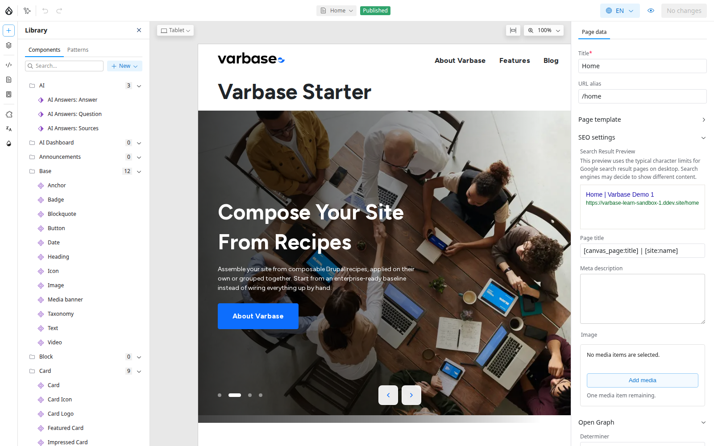
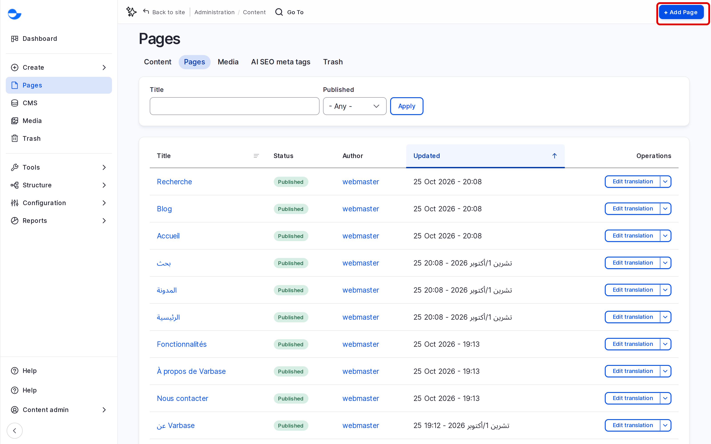
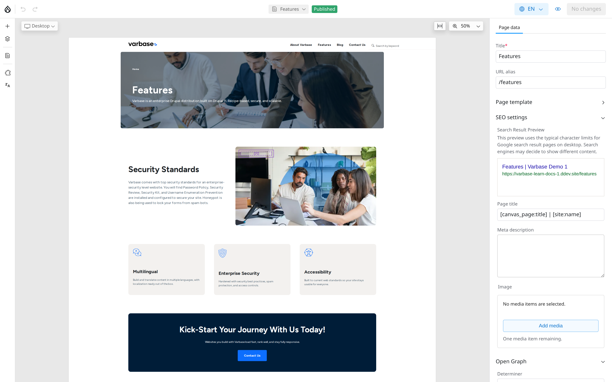
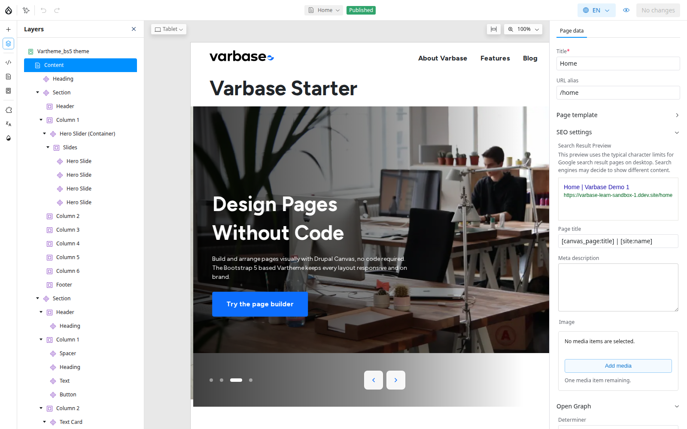

# Building Pages With Drupal Canvas

**Drupal Canvas** is the page builder in Varbase. You build a page by placing ready-made components, such as headings, images, cards and sliders, and editing them where they appear on the page. It is the feature to lead with when a client's marketing team will own the site. This section shows how to create pages, work in the editor, use every component, and publish your changes.


Lesson 8: Pages With Drupal Canvas, Part 1 (Video)


## Why It Matters

- Marketing builds and changes landing pages without a developer ticket. Developers still decide which components exist.
- Components come from the design system, so pages stay on brand however many people build them.
- Every change is a private draft until someone publishes it, so a live page can be reworked safely.

## Components and Patterns

- A **component** is one ready-made piece: a heading, text, an image, a button, a card, an accordion, a video. Each comes from the theme, so it already looks right. See the [Component Catalog](component-catalog/) for every component and its settings.
- A **pattern** is a whole section built from components and filled with starter content, such as a page intro banner, feature cards or a call to action. Inserting a pattern is the fastest way to a good page. See [Patterns](patterns.md).
- **Live components** show content from elsewhere, such as the latest blog posts or a webform, and update themselves. See [Live Components](component-catalog/live-components.md).

<figure><figcaption>
The Component Library, Grouped by Family
</figcaption></figure>

## What You Build With Drupal Canvas

- **Pages**: landing pages and other designed pages. The **Home**, **About Varbase**, **Features**, **Blog** and **Contact Us** pages of a new site are Drupal Canvas pages.
- **Content templates**: the layout of a content type, such as how every blog post looks. See [Content Templates](content-templates.md).
- **Page templates**: the header and footer around every page. See [Page Templates](page-templates.md).

Blog posts and utility pages are still filled in through a form. See [Content Management](../content-management/).

## The Pages List

Click **Pages** in the **Navigation** sidebar (`/admin/content/pages`) to see every Drupal Canvas page with its **Title**, **Status**, **Author** and **Updated** date.

<figure><figcaption>
The Pages List
</figcaption></figure>

## Creating a Page

1. On the **Pages** list, click **Add Page**.
2. Varbase creates an unpublished page called **Untitled page** and opens it in the editor.
3. In the **Page data** panel on the right, enter the **Title**.
4. Add components. See [Adding and Arranging Components](adding-and-arranging-components.md).
5. Publish the page. See [Preview and Publish](preview-and-publish.md).

## The Editor

Click **Edit** next to a page to open it in the editor. Nothing you do there is visible to visitors until you publish.


Finding Your Way in Drupal Canvas (Video)


<figure><figcaption>
The Drupal Canvas Editor
</figcaption></figure>

| Area | What it holds |
| --- | --- |
| **Top bar** | The page name (click it to switch pages), **Undo** and **Redo**, **Preview**, and the review button, which shows how many changes you have made, for example **Review 3 changes**. |
| **Left toolbar** | **Library** (components and patterns), **Layers** (the outline of the page), **Pages**, **Templates** (for roles that manage templates) and **Translate**. |
| **Page (middle)** | The page as visitors will see it. Click a component to select it. The controls under the page change the screen size (**Mobile**, **Tablet**, **Desktop**, **Large Desktop**) and the zoom. |
| **Right panel** | **Page data** for the page itself, and **Settings** for the component you selected. |

### Page Data

**Page data** holds the page's own details:

| Field | What it is for |
| --- | --- |
| **Title** | The page name, shown in the browser tab and in lists. |
| **Meta description** | The summary search engines show under the title. |
| **URL alias** | The page address, such as `/about-us`. |
| **Image** | The picture used when the page is shared or shown as a card. |
| **Page template** | Which page template (header and footer) the page uses. |
| **Metatags** | Detailed search and social sharing settings. See [Meta Tags](../search-engine-optimization/meta-tags.md). |

<figure><figcaption>
Layers: the Page as a Tree of Sections, Columns and Components
</figcaption></figure>

## Scenario: Build a Programme Page From Patterns

This is how the course builds a page about a training programme, from an empty page to published, without code.

1. On the **Pages** list, click **Add Page**. In **Page data**, enter the **Title**; the **URL alias** follows it. Add a **Meta description** and an **Image** for sharing.
2. Open **Library** \ _**Patterns**_ and insert **Page Intro Banner**. Select its heading and type your title, change the intro line, and pick an image from the media library.
3. Insert **Feature Cards** for the three parts of the programme, **FAQ Accordion** for dates and requirements, and **Call to Action Banner** to invite people to register.
4. Fill the cards: a title, a short line and an icon each. Keep the three titles parallel and the lines a similar length.
5. Add a single **Button** to the call to action, labelled "Register for the programme", linking to the contact page.
6. Use **Layers** to select small items and reorder sections; use the component menu to **Duplicate** or **Delete**, and **Undo** for mistakes.
7. Check headings are in order and every image has alt text, then switch the preview to **Mobile**.
8. Click **Review changes**, select the page's changes, and **Publish**. Only **Content Admin**, **Site Admin** and **Super Admin** can publish; a **Content editor** asks one of them. See [Preview and Publish](preview-and-publish.md).

Give each section one message: the banner says what the page is about, the cards what is inside, the questions remove doubts, and the call to action says what to do next.

## Page Actions

The **Pages** panel in the editor offers actions on whole pages: **Duplicate page** (a quick start for a series of similar pages), **Set as homepage**, **Unpublish page** and **Delete page**. Keep setting the home page and deleting pages for senior roles. A section that works well can be saved as a new pattern for other editors; managing patterns needs the **Administer patterns** permission.

## Who Can Do What

| Task | Content editor | Content Admin | Site Admin |
| --- | --- | --- | --- |
| Create and edit pages | Yes | Yes | Yes |
| Publish changes | No | Yes | Yes |
| Delete pages | Yes | No | Yes |
| Create patterns | No | Yes | Yes |
| Edit content templates and page templates | No | No | Yes |
| Translate pages | Yes | Yes | Yes |

A **Super Admin** can do all of these. The **SEO Admin** role cannot edit pages, but can translate them.


A **Content editor** prepares changes and asks a **Content Admin** or **Site Admin** to review and publish them.


## Questions Clients Ask

- **Can editors break the design?** Less than with free-form builders: they choose from approved components and the variants the design system allows. Permissions decide who edits patterns, templates and code components.
- **Is Layout Builder gone?** It is still present for older content, but new pages in Varbase Starter are Drupal Canvas pages. Plan new builds on Canvas.

## Planning Notes

- Walk the client's designs and the pattern list side by side. Sort each section into existing patterns, patterns to restyle, and new patterns. The new ones are where design and development time goes.
- Count unique components in the design, not pages; that drives front-end effort.
- Agree the publishing split: editors build pages, a **Content Admin** or above publishes them.
- Drupal Canvas pages get no automatic URL alias and are not in the XML sitemap on Varbase 11.0. Plan each page's address and how landing pages reach search engines.
- Train in two sessions: a real page from patterns only first, then single components, **Layers** and review. Leave templates to a smaller group.

## Common Mistakes

- Too many sections, because adding is easy and removing feels like a loss.
- Mixed card styles on one page.
- Publishing without checking the phone view. A short review checklist before every publish prevents all three.

## In This Section

- [Component Catalog](component-catalog/)
- [Adding and Arranging Components](adding-and-arranging-components.md)
- [Patterns](patterns.md)
- [Templates, Page Types and Consistency](templates-and-page-types.md)
- [Content Templates](content-templates.md)
- [Page Templates](page-templates.md)
- [Preview and Publish](preview-and-publish.md)
- [Translating a Page](translating-a-page.md)

## Tips

- Start from a pattern rather than a blank page; it is faster and stays on brand.
- Your work is saved as you go. Nothing is live until it is published.
- The [Drupal Canvas guides for developers](../../developers/theme-development-with-varbase/drupal-canvas/) show more examples, such as accordions and hero sliders.


**Check Yourself**

1. What is the difference between a component and a pattern?
2. Why are editors limited to the variants the design system allows, and why is that good for a client?
3. What does **Review changes** let an editor do before publishing?

