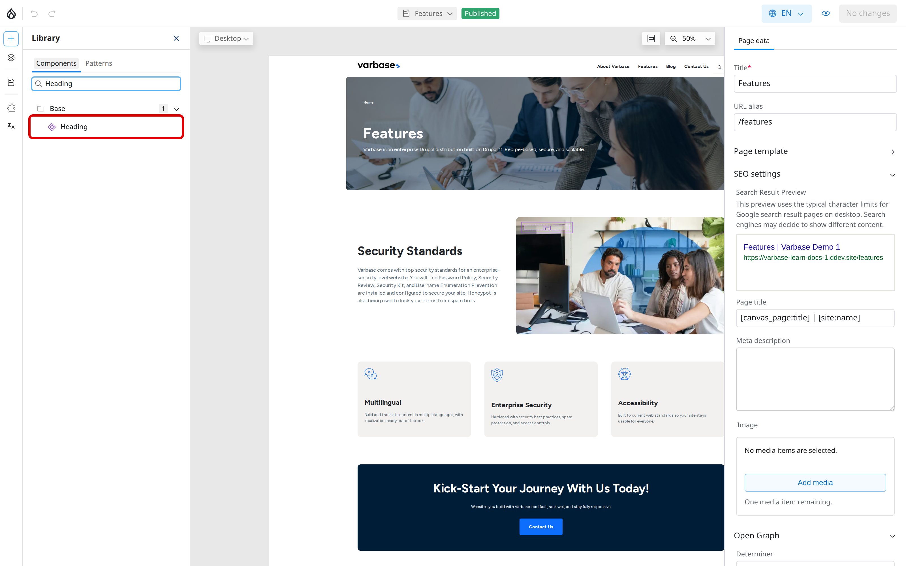
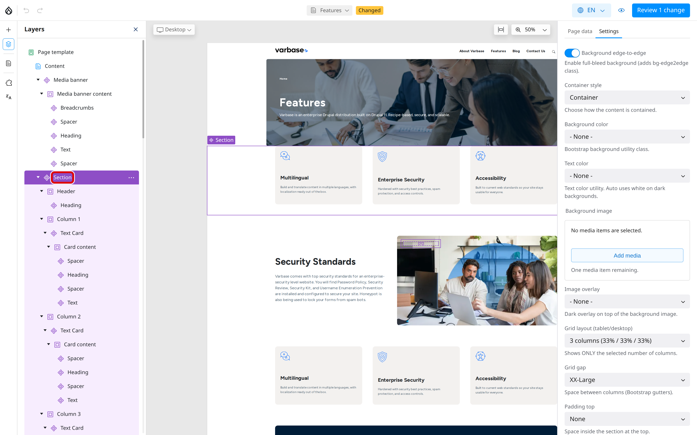
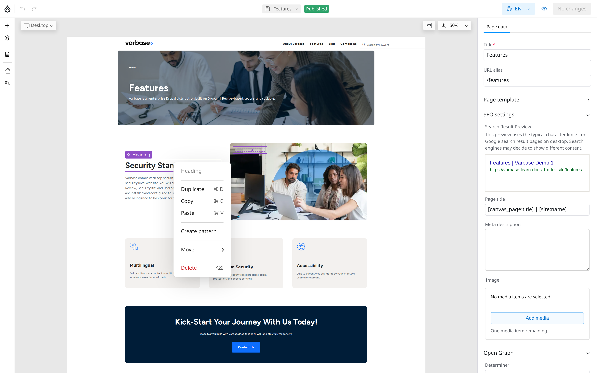

# Adding and Arranging Components

A Drupal Canvas page is a stack of components: sections, columns, headings, text, images, buttons, cards and more. This page shows you how to add components, change their content, and move, copy or remove them.

## Adding a Component

1. Open the page in the editor.
2. In the left toolbar, click **Library**. The **Components** tab lists every component, grouped in folders.
3. Type in **Search…** to find one, for example `Heading`.
4. Drag the component onto the page. A line shows where it will drop.

   You can also right-click the component in the **Library** and choose **Insert**. It is added next to the selected component, or into the page if nothing is selected.

<!-- <figure><figcaption>
Adding a Component From the Library
</figcaption></figure> -->


Layout components such as **Section** and **Columns** hold other components. Add the layout first, then drop components into it.


## Changing a Component

1. Click the component on the page. A frame shows it is selected.
2. Change its content and options on the **Settings** tab of the right panel, for example the heading text, the heading level or the link of a button.

<!-- <figure><figcaption>
Changing a Component's Settings
</figcaption></figure> -->

The page updates as you type.

## Arranging Components With Layers

**Layers** in the left toolbar shows the page as an outline: every component, and the components inside it.

<!-- <figure><figcaption>
The Layers Panel
</figcaption></figure> -->

- Click a layer to select that component on the page.
- Drag a layer up or down, or into another layer, to move the component.
- Click the arrow next to a layer to show or hide what is inside it.

Use **Layers** when components are small or nested and hard to click on the page.

## Moving, Copying and Removing

Right-click a component on the page or in **Layers** to open its menu:

| Item | What it does |
| --- | --- |
| **Duplicate** | Adds a copy straight after it. |
| **Copy** and **Paste** | Copies it, then pastes it after the selected component. |
| **Create pattern** | Saves it as a reusable pattern (for roles that manage patterns). See [Patterns](patterns.md). |
| **Move** | **Move up**, **Move down**, or into another container. |
| **Delete** | Removes it from the page. |

<!-- <figure><figcaption>
The Component Menu
</figcaption></figure> -->

With a component selected, you can also press **Ctrl + C** and **Ctrl + V** to copy and paste, and **Delete** to remove it (on a Mac, use **Cmd**). **Undo** (**Ctrl + Z**) and **Redo** in the top bar take back a step.

## Adding Images and Links

- An image setting opens the **Media Library**: pick an image or upload one, and fill in its alt text. See [Media Management](../media-management/).
- A link setting accepts a page on your site (start typing its title) or a full web address.

## Tips

- Build with layout first: a **Section**, then **Columns**, then content.
- Keep headings in order on the page (a **Heading 2** before any **Heading 3**).
- Check the page at the **Mobile** size before publishing; columns stack on small screens.
