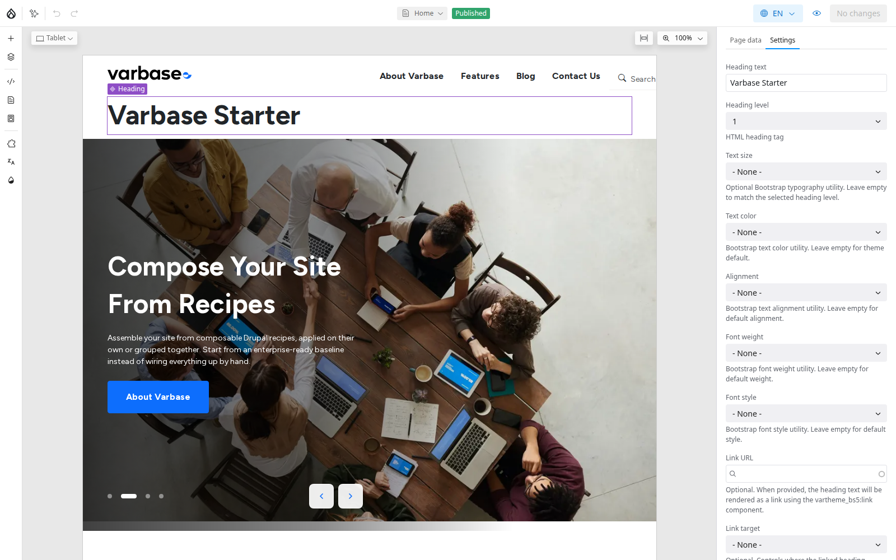

# Component Catalog

Every page you build in **Drupal Canvas** is made of components from the **Vartheme BS5** design system. This catalog lists each one: what it is for, the settings you see in the right panel when you select it, and the slots it offers for other components. Use it when you plan a page, or when you are not sure which component fits.

## Settings and Slots

- **Settings** (Drupal Canvas also calls them props) are the options in the right panel: a heading's text, a button's link, a card's image. Many settings are lists of choices from the design system, so pages stay on brand.
- **Slots** are spaces inside a component where you drop other components, such as the columns of a **Section** or the content area of a **Featured Card**.

A page is a tree: sections hold columns, and columns hold headings, text, cards and buttons. The **Layers** panel shows that tree. See [Adding and Arranging Components](../adding-and-arranging-components.md).

<figure><figcaption>
A Selected Component Shows Its Settings on the Right
</figcaption></figure>

## Families

| Family | Components | Page |
| --- | --- | --- |
| Layout | **Section**, **Row**, **Column**, **Container**, **Group**, **Spacer**, **Divider**, **Divider Vertical**, **Anchor** | [Layout Components](layout-components.md) |
| Text | **Heading**, **Text**, **Rich Text**, **Plain Text**, **Blockquote**, **Badge**, **Date**, **Taxonomy**, **HTML Code** | [Text Components](text-components.md) |
| Buttons, icons and navigation | **Button**, **Icon**, **Icon Toggle**, **Share**, **Dropdown menu**, **Navbar brand** | [Buttons, Icons and Navigation](buttons-icons-and-navigation.md) |
| Images and video | **Image**, **Figure**, **Video**, **Media banner** | [Image and Video Components](image-and-video-components.md) |
| Cards | **Card**, **Featured Card**, **Card Icon**, **Impressed Card**, **Card Logo**, **Overlay Card**, **Pricing card**, **Testimonial card**, **Text Card** | [Card Components](card-components.md) |
| Heroes | **Hero Card**, **Hero CTA**, **Hero Blog**, **Hero side by side**, **Hero Slider (Container)**, **Hero Slide** | [Hero Components](hero-components.md) |
| Accordions and tabs | **Accordion container**, **Accordion**, **Tabs** | [Accordions and Tabs](accordions-and-tabs.md) |
| Live components | Blog lists, search, menus, breadcrumbs, language switcher, webforms, AI answers | [Live Components](live-components.md) |

The catalog matches a Varbase Starter site on Vartheme BS5. A site template, or your own theme, can add or restyle components; the **Library** panel always shows what your site has. To see every variation of a component, open your project's Storybook (see [Integration of Varbase With Storybook](../../../developers/theme-development-with-varbase/integration-of-varbase-with-storybook.md)).

## Choosing a Component

- **A whole section, already designed?** Start with a pattern instead. See [Patterns](../patterns.md).
- **Several items side by side?** A **Section** with columns, then one component per column.
- **A picture, a title, a line and a link?** A card. Use one card style per row.
- **The first thing on the page?** A hero or a **Media banner**.
- **Content that updates itself?** A live component, such as **Blog: Latest blog posts**.

## Tips

- Settings offer only the choices the design system allows. That is deliberate: many people can build pages and every page still looks like the same brand.
- Images come from the media library, so their alt text comes with them. Check it.
- Check the phone view in the editor before you publish. Columns stack and cards resize there.
