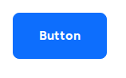
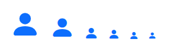
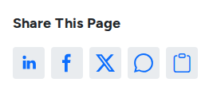

# Buttons, Icons and Navigation

These components invite visitors to act and help them move around the site.

## Button

A link styled as a button, such as **Register** or **Get a quote**.

<figure><figcaption>
A Button
</figcaption></figure>

- **Key settings**: **Label**, **Link URL (optional)**, **Link target** (same tab or new tab), **Variant**, **Outline**, **Size**, **Icon (optional)** with **Change icon position to left**, **Alignment** (inline, left, center, right), **Full width** and **Border radius**.
- **Tip**: write labels that say what happens: "Register for the programme", never "Click here". For two buttons side by side, set **Alignment** to **Inline** and put them in a **Group**.

## Icon

A single icon from the theme's icon set.

<figure><figcaption>
An Icon in Its Sizes
</figcaption></figure>

- **Key settings**: **Icon** (the icon name), **Icon size** and **Color**.
- **Tip**: an icon alone carries no words for screen readers. Put a heading or text next to it.

## Icon Toggle

An icon button, usually in the header, that opens a small panel with whatever you drop into it, such as a search form.

- **Key settings**: **Icon**, **Label** and **Open state label** (read by screen readers), **Panel alignment**, **Panel style** (boxed popover or inline bar), and **Expand in Canvas editor** to edit the panel's content.
- **Slots**: **Content**.

## Share

Buttons that let visitors share the page on social networks, plus the phone's own share menu.

<figure><figcaption>
Share Buttons
</figcaption></figure>

- **Key settings**: **Title** and **Display title**, **Heading level**, **Alignment**, **Orientation**, **Mobile visibility**, **Show native share button**, **Placement** (inline, or a rail at the end of the content), and optional **Share URL**, **Share title** and **Share text**.
- **Tip**: blog posts already show share buttons through their content template.

## Dropdown Menu and Navbar Brand

Building blocks of the header in the page template: **Navbar brand** shows the site logo, and **Dropdown menu** holds a menu that opens on click. Most editors never place them; they are edited with the header. See [Page Templates](../page-templates.md).
