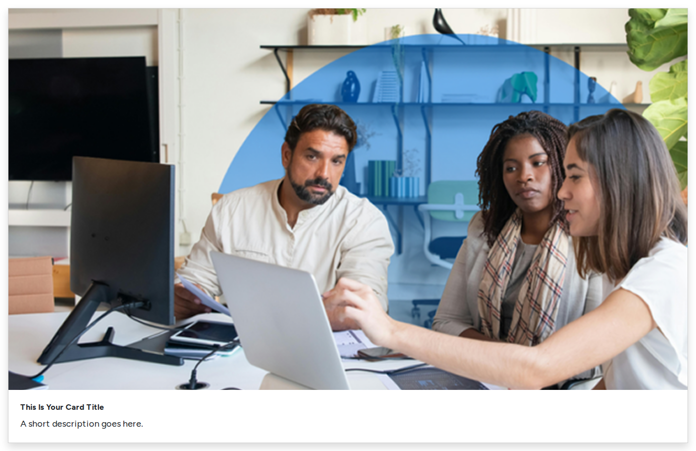
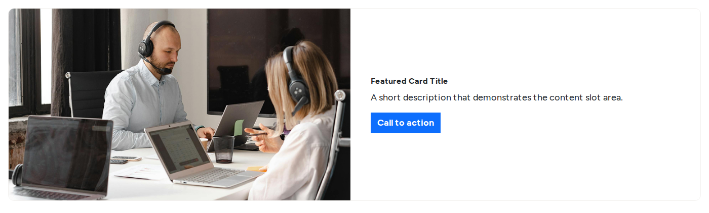
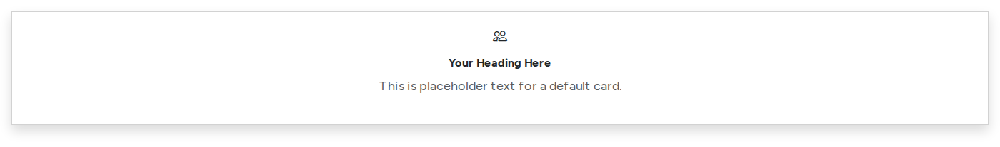
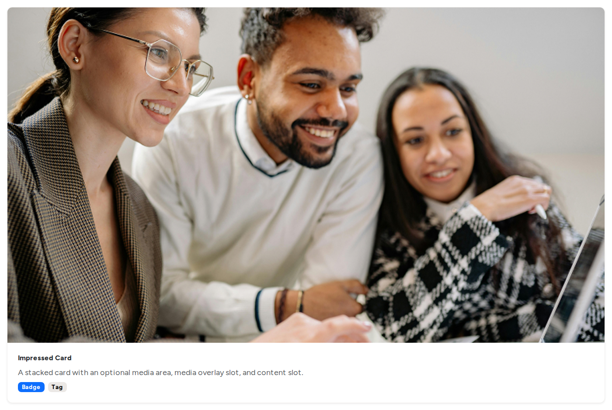
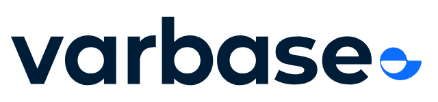
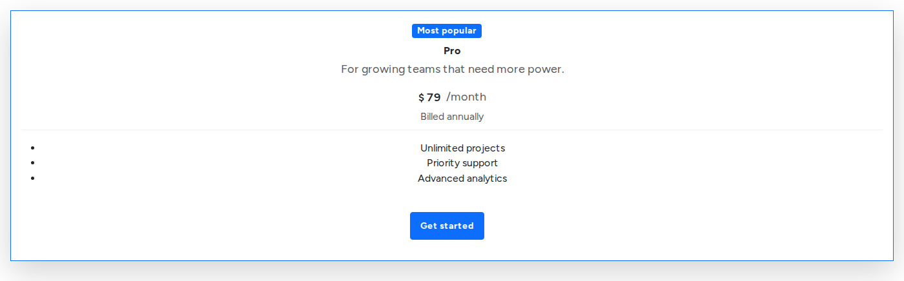
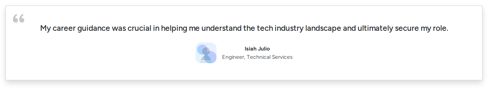
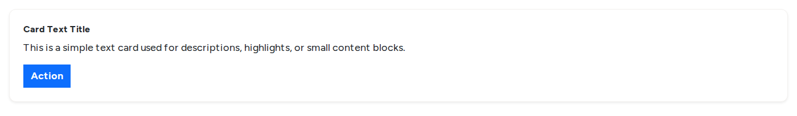

# Card Components

Cards combine a picture, a heading, a line of text and a link. They are the most used components on landing pages. Use one card style per row, and keep the text of cards in a row the same length.

| Card | Best for |
| --- | --- |
| **Card** | A simple picture, title, text and link |
| **Featured Card** | A large image beside free content, for one highlight |
| **Card Icon** | Services or features with an icon instead of a photo |
| **Impressed Card** | Stacked image and content, with a label over the image |
| **Card Logo** | Partner and client logos |
| **Overlay Card** | Text over a full image |
| **Pricing card** | Plans and prices |
| **Testimonial card** | Customer quotes |
| **Text Card** | Short text blocks, optionally with a small icon image |

## Card

<figure><figcaption>
A Card With the Image on Top
</figcaption></figure>

- **Key settings**: **Layout** (image on top, start, end or bottom), **Heading**, **Description**, **Image** and **Image ratio**, **Background theme**, **Shadow**, **Add padding**, **Link URL (optional)**, **Button label (optional)** and **Button style**.
- **Tip**: with a **Link URL** and no button label, the whole card is the link. Add a button label to show a button instead.

## Featured Card

<figure><figcaption>
A Featured Card
</figcaption></figure>

- **Key settings**: **Media position** (start, end or no media), **Media upload**, **Image ratio (crop)**, **Image fit**, **Card Border**, **Border radius**, **Padded**, **Equal height**, **Stretched link** with **Card link URL**, **Content vertical alignment**, **Gutters Between**, and the image and content split for each screen size (such as 50% and 50%, or 33% and 67%).
- **Slots**: **Media overlay** (a badge over the image) and **Card content** (headings, text, buttons).

## Card Icon

<figure><figcaption>
A Card Icon
</figcaption></figure>

- **Key settings**: **Heading**, **Description**, **Text alignment**, **Icon (optional)** and **Icon size**, **Background theme**, **Shadow**, **Add padding**, **Link URL (optional)**, **Button label (optional)** and **Button style**.
- **Tip**: the **Feature Cards** pattern is a ready row of three.

## Impressed Card

<figure><figcaption>
An Impressed Card
</figcaption></figure>

- **Key settings**: **Media position** (top or bottom), **Media upload**, **Image ratio (crop)**, **Image fit**, **Card border**, **Background color**, **Padded**, **Shadow**, **Corner style**, **Equal height**, **Stretched link** with **Card link URL**.
- **Slots**: **Media overlay** and **Card content**.

## Card Logo

<figure><figcaption>
A Card Logo
</figcaption></figure>

- **Key settings**: **Logo image**, **Link URL (optional)**, **Shadow**, **Alignment**.
- **Tip**: give each logo alt text with the organisation's name.

## Overlay Card

<figure><figcaption>
An Overlay Card
</figcaption></figure>

- **Key settings**: **Media upload**, **Image ratio (crop)**, **Image fit**, **Padded**, **Shadow**, **Overlay color** and **Overlay opacity**, **Horizontal alignment** and **Vertical alignment**, **Equal height**, **Stretched link** with **Card link URL**.
- **Slots**: **Card content**.
- **Tip**: make sure the text stays readable over the lightest part of the image.

## Pricing Card

<figure><figcaption>
A Highlighted Pricing Card
</figcaption></figure>

- **Key settings**: **Badge text (optional)**, **Heading** and **Heading level**, **Description (optional)**, **Price**, **Currency code** or **Currency symbol** and its position, **Price period**, **Price note**, **Features (rich text)**, **Divider above features**, **Shadow**, **Border style**, **Background theme**, **Text alignment**, button settings, and **Highlight card**.
- **Tip**: highlight one plan, such as the most popular, to help visitors decide.

## Testimonial Card

<figure><figcaption>
A Testimonial Card
</figcaption></figure>

- **Key settings**: **Style** (light or dark), **Quote text**, **Author name**, **Author title / role**, **Avatar image**, **Shadow**, **Content alignment**, **Show quote icon**.
- **Tip**: use real quotes with the person's permission.

## Text Card

<figure><figcaption>
A Text Card
</figcaption></figure>

- **Key settings**: **Card border**, **Background color**, **Padded**, **Shadow**, **Border radius**, **Equal height**, **Stretched link** with **Card link URL**, **Icon image** and **Icon alignment**.
- **Slots**: **Card content**.
