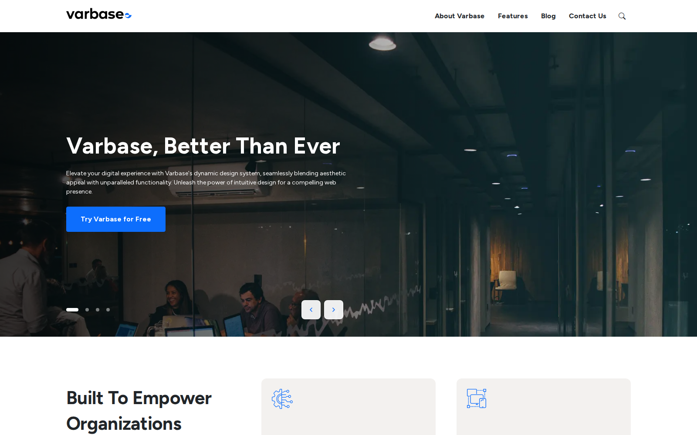
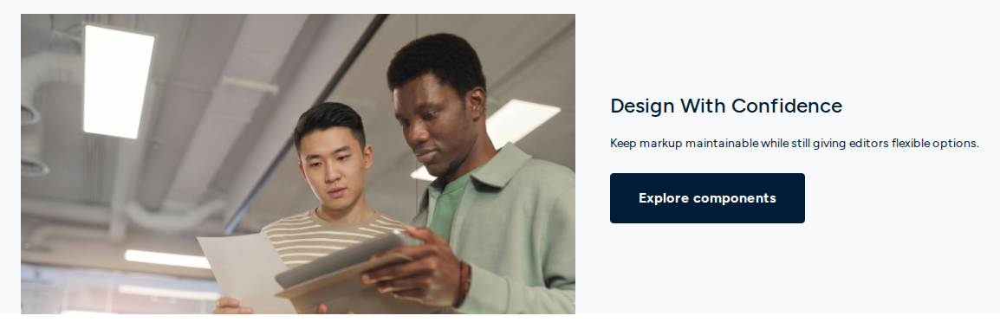
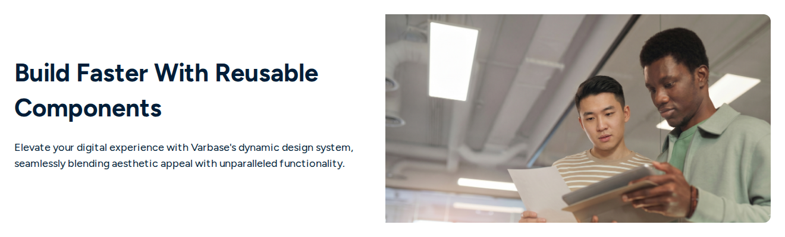
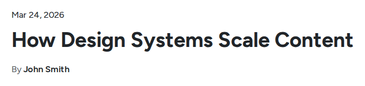

# Hero Components

Heroes open a page with one strong message and, usually, one action. Use one hero per page, at the top.

## Hero Slider (Container) and Hero Slide

A rotating set of large slides. The **Hero Slider (Container)** holds any number of **Hero Slide** components; drag slides in the **Layers** panel to reorder them. The home page of a Varbase Starter site opens with one.

<figure><figcaption>
A Hero Slider on the Home Page
</figcaption></figure>

- **Key settings (container)**: **Transition** (slide or fade), **Autoplay** and **Autoplay interval (ms)**, **Pause on hover**, **Show indicators**, **Show prev/next controls**, **Slider height**, **Controller color**, **Edge-to-edge background**.
- **Key settings (slide)**: **Enabled**, **Active by default**, **Title** and **Title tag**, **Title size**, **Content (rich text)**, **Image**, **Media position (per slide)** (inherit, overlay background, image start, image end, or text only), **Content max width**, **Vertical alignment**, **Text alignment**, **Text color**, overlay settings, and **Button text**, **Button URL** and **Button style**.
- **Slots**: the container has **Slides**.
- **Tip**: three slides at most, each with one message. Many visitors never see the later slides, so put the most important message first.

<figure><figcaption>
A Hero Slide With the Image at the Start
</figcaption></figure>

For a full walkthrough, see [Hero Slider Container and Hero Slide With Drupal Canvas](../../../developers/theme-development-with-varbase/drupal-canvas/hero-slider-container-and-hero-slide-with-drupal-canvas.md).

## Hero Card

A single hero with a title, text, an image and a button, in several layouts.

<figure><figcaption>
A Hero Card With the Image at the End
</figcaption></figure>

- **Key settings**: **Title** and **Heading tag**, **Content (rich text)**, **Media image** and **Media focal position**, **Media position** (background overlay, start, end, above, below, inside the content, or none), **Image fit**, overlay settings, **Container width**, **Edge-to-edge background**, alignment, **Background color**, **Content text color**, and the button's label, URL, style, size and target.
- **Slots**: **Card media (slot)** to use a video instead of an image, and **Actions (slot)** for several buttons.

## Hero CTA

A call to action: a heading, a line of text and a button, often at the end of a page.

<figure><figcaption>
A Hero CTA
</figcaption></figure>

- **Key settings**: **Heading**, **Heading level**, **Heading size**, **Text**, **Background image** and **Background image overlay**, **Background color**, **Content color**, **Text alignment**, **Background edge to edge**, and **Button text**, **Button URL** and **Button style**.
- **Tip**: a campaign page often opens and closes with the same call to action.

## Hero Side by Side

A heading, text and button on one side, an image on the other.

<figure><figcaption>
A Hero Side by Side
</figcaption></figure>

- **Key settings**: **Heading** and **Heading level**, **Description text**, **Image** and **Image position**, **Content alignment**, **Background color**, **Text color**, an optional **Background image** with overlay, **Vertical padding**, and the button's label, link, style, size and target.

## Hero Blog

The top of a blog post: date, title and author, with a slot for the featured image. It is used in the blog post content template.

<figure><figcaption>
A Hero Blog
</figcaption></figure>

- **Key settings**: **Title**, **Heading level**, **Heading size**, **Date**, **Author name**, **Author link**.
- **Slots**: **Blog media**.
