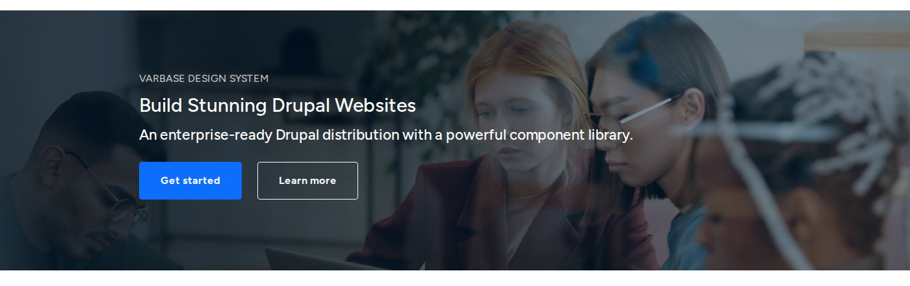

# Image and Video Components

These components show pictures and video from the media library, so alt text and focal points set there come with them. See [Media](../../media-management/).

## Image

A single image from the media library.

- **Key settings**: **Image**, **Image ratio (crop)** (auto, wide 16:9, standard 4:3, square, ultra-wide 21:9), **Image fit** (fill and crop, or fit without cropping), **Alignment**, **Width**, **Border radius**, **Loading behavior**, and an optional **Link URL** with **Link target**.
- **Tip**: use the same ratio for images in one row. The focal point set in the library keeps the important part in view when the image is cropped.

## Figure

An image with a caption underneath. Use it when the picture needs explaining, such as a chart or a photo of a named place.

## Video

A video from the media library, played on the page.

- **Key settings**: **Video (upload/select)**, **Aspect ratio**, **Loading** (lazy or eager).
- **Tip**: long videos belong on a video service as **Remote video**. Players from outside services wait for the visitor's consent. See [Cookie Consent](../../security-and-privacy/cookie-consent.md).

## Media Banner

The intro band at the top of inside pages: a background image with the page title, a line of text and buttons over it.

<figure><figcaption>
A Media Banner
</figcaption></figure>

- **Key settings**: **Background image** and **Background image position**, **Banner height** (ribbon or large), **Content position**, **Content width**, **Overlay background** and **Overlay opacity**, **Container style**, **Background edge-to-edge**, padding and **Border radius**.
- **Slots**: **Media banner content**, for the heading, text and buttons.
- **Tip**: raise **Overlay opacity** until the text is easy to read on every part of the image. The **Page Intro Banner** pattern builds one in a step.
