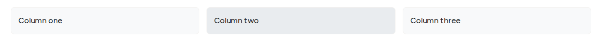
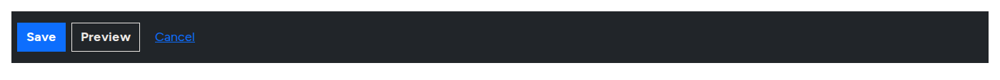
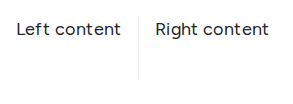

# Layout Components

Layout components decide where everything sits on the page and how it rearranges on a phone. Visitors do not see them, only their effect.

## Section

A full-width band of the page, with up to six columns. Most pages are a stack of sections.

<figure><figcaption>
A Section With Three Columns
</figcaption></figure>

- **Use it for**: each part of the page's story, such as an intro, a row of cards or a call to action.
- **Key settings**: **Grid layout (tablet/desktop)** (one column, two equal columns, three columns, or uneven splits such as 75% and 25%), **Container style** (contained, full width or none), **Background edge-to-edge**, **Background color**, **Background image** with an **Image overlay**, **Text color**, **Grid gap**, and padding and margin for each side.
- **Slots**: **Header**, **Column 1** to **Column 6** (only as many as the grid layout shows), and **Footer**.
- **Tip**: put the section title in the **Header** slot, so it spans all columns.

## Row and Column

A **Row** lines up **Column** components side by side, and lets you choose how many sit in a line on phones and on desktops.

<figure><figcaption>
A Row With Three Columns
</figcaption></figure>

- **Use it for**: grids where the number of items changes, such as logos or team members.
- **Key settings (Row)**: **Columns on mobile** and **Columns on desktop** (items per line), **Grid gap**, **Vertical alignment**, **Horizontal distribution**, **Container**, background and spacing.
- **Slots**: the Row has **Columns**; each Column has **Content**.
- **Tip**: for most pages a **Section** is simpler. Use a Row when you need a different number of items per line on phones.

## Container

A plain wrapper that keeps its content to the page's standard width. It has no visible settings for editors; developers use it inside patterns.

## Group

Stacks items vertically or lines them up horizontally with even spacing, such as two buttons side by side or a row of tags.

<figure><figcaption>
A Horizontal Group of Actions
</figcaption></figure>

- **Key settings**: **Direction** (vertical stack or horizontal row), **Space between items**, **Wrap items**, **Vertical alignment**, **Horizontal distribution**, background, padding, margin and **Border radius**.
- **Slots**: **Content**.

## Spacer

Adds vertical space between components. **Key setting**: **Spacing size**, from none to extra large. Prefer the padding settings of a **Section**; use a spacer only for a one-off gap.

## Divider and Divider Vertical

A horizontal line between blocks of content, or a vertical line between two columns that stretches to their full height.

<figure><figcaption>
A Vertical Divider Between Two Columns
</figcaption></figure>

- **Key settings**: **Thickness**, **Border color**, **Opacity**, and the spacing on each side.

## Anchor

An invisible marker you can link to from the same page, such as a "Pricing" link that jumps down to the pricing section.

- **Key setting**: **ID for in-page link**, in lowercase letters, numbers and hyphens, such as `pricing`. Link to it with `#pricing`.
