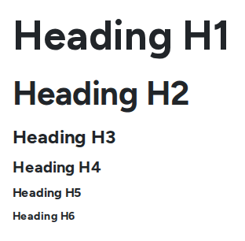
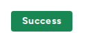
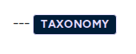

# Text Components

Text components hold the words on a page. Keep headings in order and text short; the design system takes care of the look.

## Heading

A title for the page or a section.

<figure><figcaption>
Heading Levels
</figcaption></figure>

- **Key settings**: **Heading text**, **Heading level**, **Text size**, **Text color**, **Alignment**, **Font weight**, **Font style**, and an optional **Link URL** with **Link target**.
- **Tip**: the level is the structure, the size is the look. Keep one main heading at the top of the page and section headings below it, without skipping levels. If a heading looks too big, change **Text size**, not **Heading level**.

## Text

A paragraph or more of formatted text, written in a small rich-text editor.

- **Key settings**: **Content (rich text)**, **Text size** and **Text color**.
- **Use it for**: the body copy of a section, under a heading.

## Rich Text and Plain Text

Mostly used inside content templates to show a field, such as a post's summary on a card.

- **Key settings**: the text itself, plus **Trim**, **Trim length**, **Trim units** (characters or words), **Suffix** (such as "...") and, for Rich Text, **Strip HTML**.
- **Tip**: use **Trim** on cards so every card's text is the same length.

## Blockquote

A highlighted quotation with the name of the person quoted.

- **Key settings**: **Type** (dark or light), **Quote text**, **Quotee Name and Position**.
- **Tip**: for a customer quote with a photo, use the **Testimonial card** instead. See [Card Components](card-components.md).

## Badge

A small label, such as "New" or "Most popular", optionally linked.

<figure><figcaption>
A Badge
</figcaption></figure>

- **Key settings**: **Label**, **Link (optional)**, **Variant**, **Size**, **Icon (optional)** and **Icon position**, **Border radius**, and a **Notification indicator** (a dot or a count such as 99+).
- **Tip**: drop a badge into the **Media overlay** slot of a card to label its image.

## Date

Shows a date in a format screen readers and search engines understand.

- **Key settings**: **Date**, **Text color** and **Font size**.
- **Tip**: in a content template, connect it to the post's date field.

## Taxonomy

A small tag-style label for a category or tag, optionally linked to its page.

<figure><figcaption>
A Taxonomy Label
</figcaption></figure>

- **Key settings**: **Label**, **Link (optional)**, **Link target**, **Size** (large or small).

## HTML Code

Places a short piece of HTML exactly as written.

- **Key setting**: **HTML code**.
- **Tip**: keep this for trained editors. Do not paste embed codes from outside services: the site cannot ask visitors for consent before they load. See [Cookie Consent](../../security-and-privacy/cookie-consent.md).
