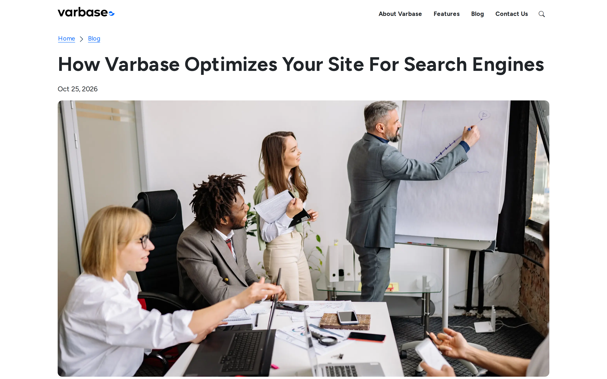
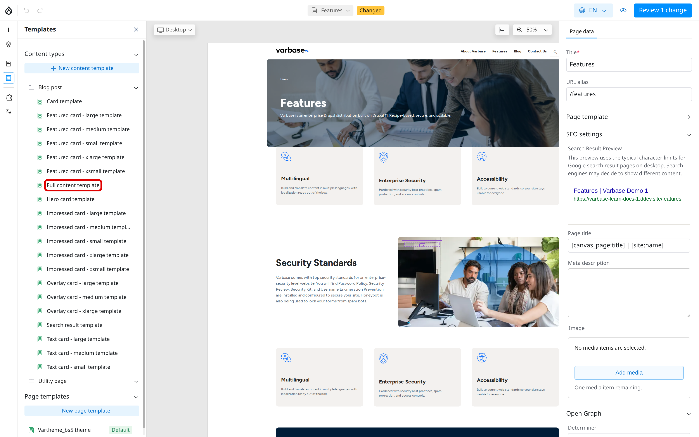

# Content Templates

A content template is the layout Drupal Canvas uses to show every item of a content type. Every blog post on a Varbase site, for example, gets its look from the **Blog post** template: you write the post in its form, and the template decides where the title, image, date and text appear.

## How Content Templates Affect Your Work

- When you write a blog post, you fill in the form only. See [Create Content](../content-management/create-content/).
- The template places your fields on the page. A change to the template changes every blog post at once.
- Blog posts also appear as cards in lists, such as **Latest Blog Posts**. Each card style is a template too.

<figure><figcaption>
A Blog Post Laid Out by Its Content Template
</figcaption></figure>

## Editing a Content Template

Editing templates needs the **Site Admin** or **Super Admin** role (the **Administer content templates** permission). **Content editor** and **Content Admin** write the content but do not change templates.

1. Open any page in the editor.
2. In the left toolbar, click **Templates**.
3. Under **Content types**, open **Blog post** and click **Full content template**.
4. Change the layout the same way as a page: add, move and remove components, and choose which field each one shows.
5. Publish the change. See [Preview and Publish](preview-and-publish.md).

<figure><figcaption>
Content Templates in the Templates Panel
</figcaption></figure>

While you edit a template, the editor shows it filled with a real blog post so you can see the result. Switch the preview to another post to check a long title, a missing image, a very short post, a translation and the phone view. One template serves every language, and Arabic is laid out right to left by itself.


A published template change applies to every item of that content type. Check a few items in preview before you publish.


## One Item With Its Own Layout

Drupal Canvas can let a single item, such as an annual report post, have its own layout instead of the template. Varbase installs this (Canvas Override), but it is switched on for no content type: a content item shows no **Canvas layout** tab, and its Canvas address answers "Access denied" even for the **Super Admin**. A **Super Admin** switches it on per content type (**Enable per-content Canvas layout editing on the full content view mode**), and on a Varbase Starter site only the **Super Admin** can then use it. An item with its own layout no longer follows template changes, so keep it for the one exception.

## Tips

- Ask your **Site Admin** for a template change rather than formatting each post by hand.
- Utility pages do not use a content template; they show their fields in the standard layout.
