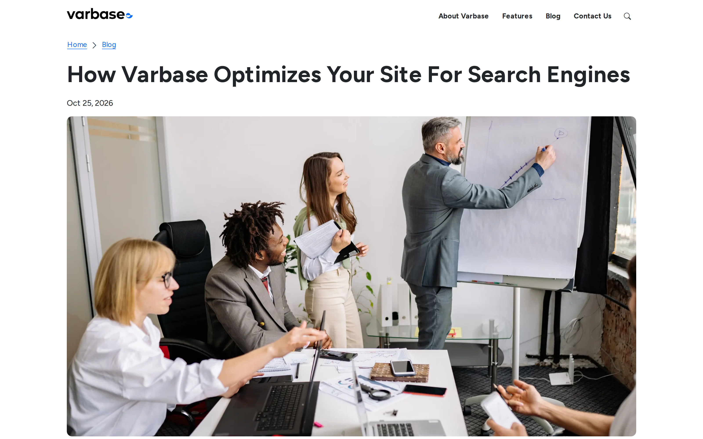
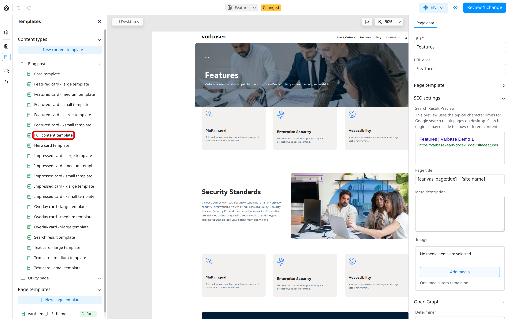

# Content Templates

A content template is the layout Drupal Canvas uses to show every item of a content type. Every blog post on a Varbase site, for example, gets its look from the **Blog post** template: you write the post in its form, and the template decides where the title, image, date and text appear.

## How Content Templates Affect Your Work

- When you write a blog post, you fill in the form only. See [Create Content](../content-management/create-content/).
- The template places your fields on the page. A change to the template changes every blog post at once.
- Blog posts also appear as cards in lists, such as **Latest Blog Posts**. Each card style is a template too.

<!-- <figure><figcaption>
A Blog Post Laid Out by Its Content Template
</figcaption></figure> -->

## Editing a Content Template

Editing templates needs the **Site Admin** or **Super Admin** role.

1. Open any page in the editor.
2. In the left toolbar, click **Templates**.
3. Under **Content types**, open **Blog post** and click the **Full content** template.
4. Change the layout the same way as a page: add, move and remove components, and choose which field each one shows.
5. Publish the change. See [Preview and Publish](preview-and-publish.md).

<!-- <figure><figcaption>
Content Templates in the Templates Panel
</figcaption></figure> -->

While you edit a template, the editor shows it filled with a real blog post so you can see the result.


A published template change applies to every item of that content type. Check a few items in preview before you publish.


## Tips

- Ask your **Site Admin** for a template change rather than formatting each post by hand.
- Utility pages do not use a content template; they show their fields in the standard layout.
