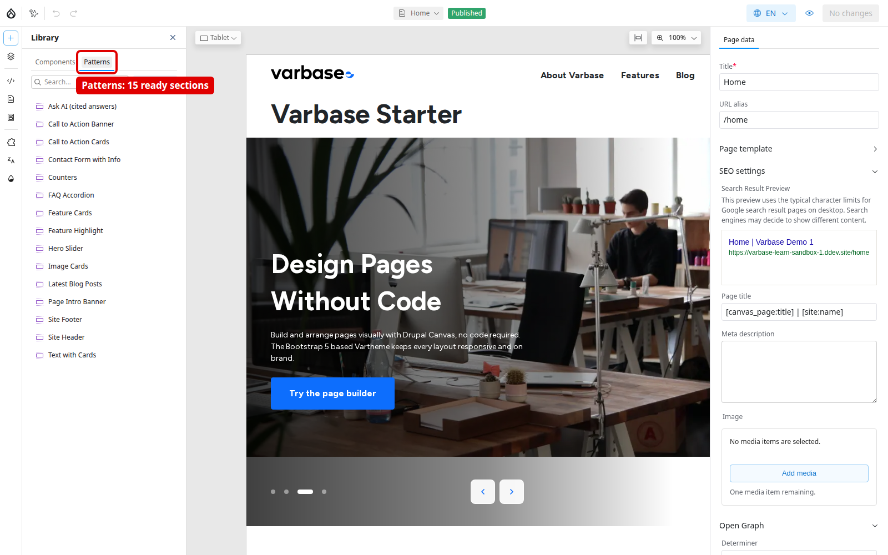

# Create a Page From a Pattern

Patterns are whole sections, already built and filled with starter content. Stacking a few of them is the fastest way from an empty page to a published one that matches the site's design. This example builds a page about a training programme, without code.

## Steps

1. On the **Pages** list, click **Add Page**. In **Page data**, enter the **Title**; the **URL alias** follows it. Add a **Meta description** and an **Image** for sharing.
2. Open **Library** \ _**Patterns**_ and insert **Page Intro Banner**. Select its heading and type your title, change the intro line, and pick an image from the media library.
3. Insert **Feature Cards** for the three parts of the programme, **FAQ Accordion** for dates and requirements, and **Call to Action Banner** to invite people to register.
4. Fill the cards: a title, a short line and an icon each. Keep the three titles parallel and the lines a similar length.
5. Add a single **Button** to the call to action, labelled "Register for the programme", linking to the contact page.
6. Use **Layers** to select small items and reorder sections; use the component menu to **Duplicate** or **Delete**, and **Undo** for mistakes.
7. Check headings are in order and every image has alt text, then switch the preview to **Mobile**.
8. Click **Review changes**, select the page's changes, and **Publish**. Only **Content Admin**, **Site Admin** and **Super Admin** can publish; a **Content editor** asks one of them. See [Preview and Publish](preview-and-publish.md).
9. Open the page's address, such as `/training-programme`, in a private window to see it as a visitor, and check it at a phone width.

<figure><figcaption>
The Patterns Tab of the Library
</figcaption></figure>

Give each section one message: the banner says what the page is about, the cards what is inside, the questions remove doubts, and the call to action says what to do next.

## Common Mistakes

- Too many sections, because adding is easy and removing feels like a loss.
- Mixed card styles on one page.
- Publishing without checking the phone view. A short review checklist before every publish prevents all three.

## Planning Notes

- Train in two sessions: a real page from patterns only first, then single components, **Layers** and review. Leave templates to a smaller group.
- Drupal Canvas pages have no URL alias pattern: the editor fills **URL alias** from the title, and nothing updates it later. They are not in the XML sitemap on Varbase 11.0. Plan each page's address and how landing pages reach search engines.

See [Patterns](patterns.md) for every pattern that comes with Varbase.
