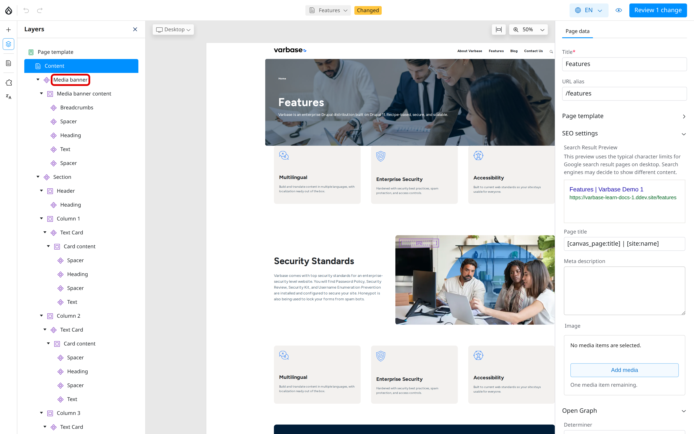
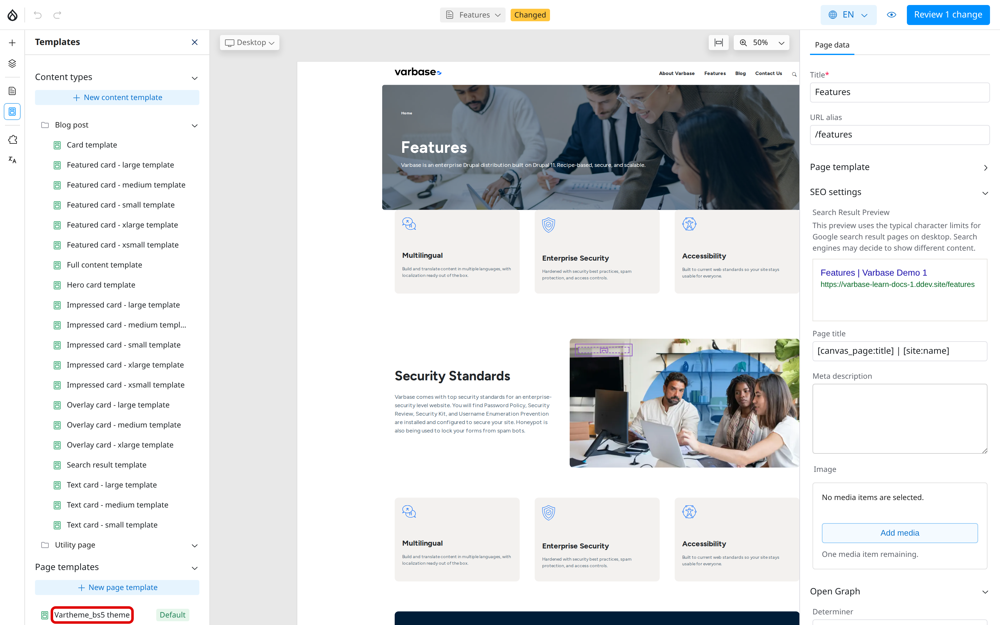

# Page Templates

The header and footer that appear on every page belong to a page template. Changing the page template changes the header and footer everywhere on the site at once. This page explains how page templates work for editors.

## What a Page Template Holds

The Varbase page template, **Vartheme\_bs5 theme**, has three parts:

- **Header**: the logo, the main menu and the search.
- **Page content**: a marker that shows where each page's own content goes.
- **Footer**: the quick links, the social media links and the privacy links.

On a page, the header and footer are shown but locked. You see them while you edit, but you change them only in the page template. In **Layers**, the page template is a locked **Vartheme\_bs5 theme** layer above the page's own **Content**.

Drupal Canvas page templates are switched on in the theme settings: **Use Drupal Canvas for page templates in this theme**, in the **Drupal Canvas** group of the **Vartheme BS5** settings (`/admin/appearance/settings/vartheme_bs5`). It is on by default.

<figure><figcaption>
A Page Inside Its Page Template
</figcaption></figure>

## Choosing the Page Template for a Page

In **Page data**, **Page template** shows which template the page uses. Most sites have one, marked **Default**, and every page uses it.

## Editing the Header or Footer

Editing page templates needs the **Site Admin** or **Super Admin** role (the **Administer page template** permission).

1. Open any page in the editor.
2. Click **Templates** in the left toolbar, then **Vartheme\_bs5 theme** under **Page templates**. You can also click the locked **Vartheme\_bs5 theme** layer in **Layers**. The template opens in its own editor (`/canvas/editor/page_variant/theme_vartheme_bs5`).
3. Select a component in the header or footer and change it, or add one from the **Library**.
4. Switch the preview to **Mobile** and open the menu: on a phone the main menu folds into a button.
5. Click **Review changes**. The template change is listed on its own, apart from page changes, so you can publish one without the other. Publish it, and it appears on every page.


Opening the page template can mark it **Changed**, with **Review 1 change**, before you have edited anything. Check the review list before you publish: if the template is listed and you did not mean to change it, open the menu on that change and choose **Discard changes**, so nobody publishes a change nobody made.


<figure><figcaption>
The Page Template in the Templates Panel
</figcaption></figure>

For a full walkthrough with examples, such as adding a button to the header or a newsletter form to the footer, see [Editing the Header and Footer With Drupal Canvas](../../developers/theme-development-with-varbase/drupal-canvas/editing-the-header-and-footer-with-drupal-canvas.md).

## Tips

- To change the links in the main menu or footer menus, edit the menus rather than the template. The menu component in the header shows a menu but does not hold its links, and editing a menu needs no page template permission. See [Menu Management](../url-management/menu-management/).
- Review a page template change on a few pages and at the **Mobile** size before publishing.
