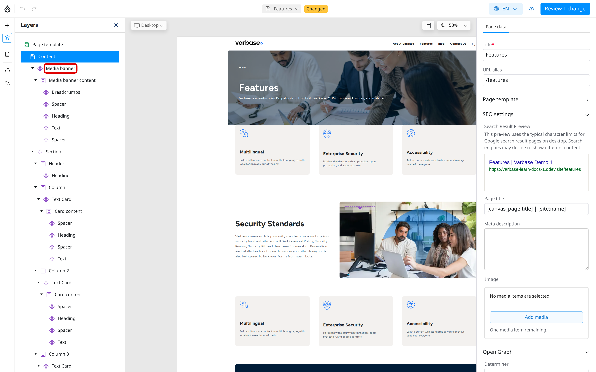
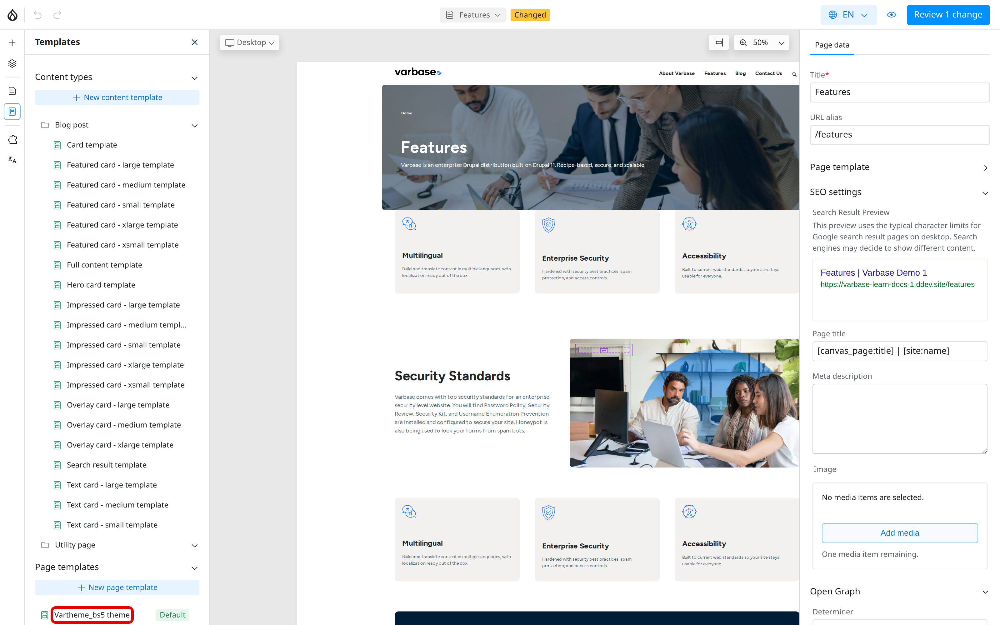

# Page Templates

The header and footer that appear on every page belong to a page template. Changing the page template changes the header and footer everywhere on the site at once. This page explains how page templates work for editors.

## What a Page Template Holds

The Varbase page template, **Vartheme\_bs5 theme**, has three parts:

- **Header**: the logo, the main menu and the search.
- **Page content**: a marker that shows where each page's own content goes.
- **Footer**: the footer menus and the social media links.

On a page, the header and footer are shown but locked. You see them while you edit, but you change them only in the page template.

<!-- <figure><figcaption>
A Page Inside Its Page Template
</figcaption></figure> -->

## Choosing the Page Template for a Page

In **Page data**, **Page template** shows which template the page uses. Most sites have one, marked **Default**, and every page uses it.

## Editing the Header or Footer

Editing page templates needs the **Site Admin** or **Super Admin** role (the **Administer page template** permission).

1. Open any page in the editor.
2. Click **Templates** in the left toolbar, then **Vartheme\_bs5 theme** under **Page templates**.
3. Select a component in the header or footer and change it, or add one from the **Library**.
4. Publish the change. It appears on every page.

<!-- <figure><figcaption>
The Page Template in the Templates Panel
</figcaption></figure> -->

For a full walkthrough with examples, such as adding a button to the header or a newsletter form to the footer, see [Editing the Header and Footer With Drupal Canvas](../../developers/theme-development-with-varbase/drupal-canvas/editing-the-header-and-footer-with-drupal-canvas.md).

## Tips

- To change the links in the main menu or footer menus, edit the menus rather than the template. See [Menu Management](../content-structure/menu-management/).
- Review a page template change on a few pages and at the **Mobile** size before publishing.
