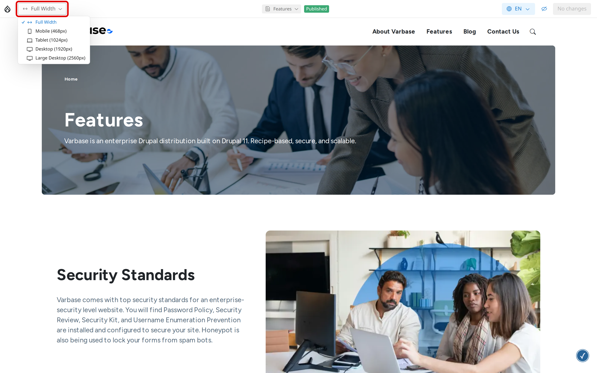
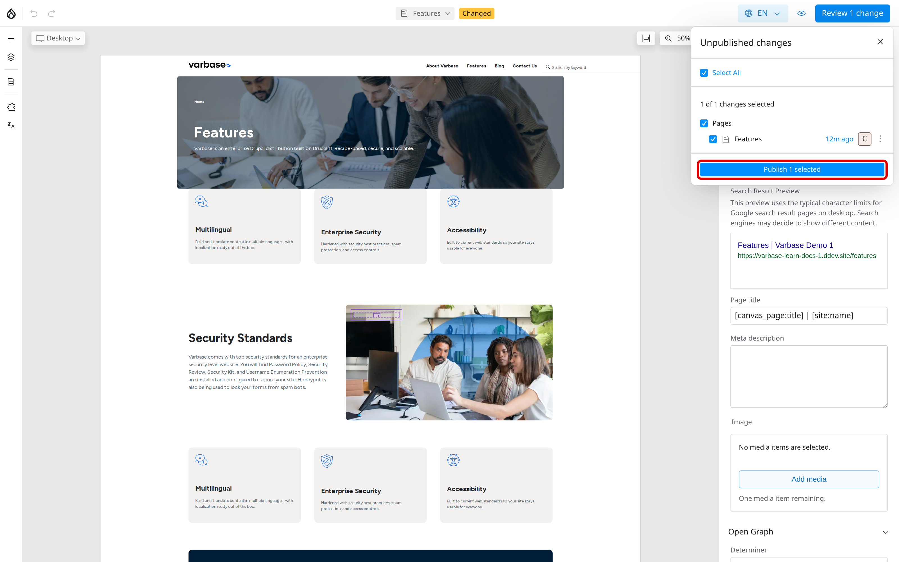

# Preview and Publish

Drupal Canvas saves your work as you go, as a draft that only editors see. Visitors see your changes only after they are published. This page shows how to check a page and publish it.


Reviewing and Publishing a Page (Video)


If the video does not play, open [Reviewing and Publishing a Page (MP4)](<../../.gitbook/assets/cd-clip-07-publish-page.mp4>). Captions: [cd-clip-07-publish-page.vtt](<../../.gitbook/assets/cd-clip-07-publish-page.vtt>).

## Your Changes Are Saved as a Draft

Every change you make in the editor is saved automatically. You can close the editor and come back later: your draft is still there. The review button in the top bar counts your unpublished changes, for example **Review 3 changes**.

## Previewing a Page

1. Click **Preview** (the eye) in the top bar. The editing panels close and you see the page on its own.
2. Open the size list at the top left (it starts on **Full Width**) and choose **Mobile**, **Tablet**, **Desktop** or **Large Desktop** to check the page at each screen size.
3. Click **Exit Preview** to go back to editing.

<figure><figcaption>
Previewing a Page
</figcaption></figure>

## Reviewing and Publishing

Publishing needs the **Content Admin**, **Site Admin** or **Super Admin** role. A **Content editor** sees the review list without the publish button, and asks one of them to publish.

1. Click the review button, for example **Review 3 changes**. The **Unpublished changes** list opens.
2. Tick the changes you want to publish, or click **Select All**. Nothing is ticked until you choose.
3. Click **Publish N selected**, for example **Publish 3 selected**.

<figure><figcaption>
Reviewing Changes Before Publishing
</figcaption></figure>

The list can hold changes to more than one page or template, for example a page and the page template. A new page becomes visible to visitors when it is first published.

## Publishing or Unpublishing a Whole Page

1. Click **Pages** in the left toolbar of the editor.
2. Right-click the page and choose **Publish page** or **Unpublish page**.

The home page cannot be unpublished. To replace it, choose **Set as homepage** on another page first.

## Discarding a Change

Use **Undo** in the top bar while you work. To drop all unpublished changes to one page, open the review list, open the menu on that change and choose **Discard changes**.

## Tips

- Preview at the **Mobile** size before every publish; most visitors use phones.
- Publish related changes together, such as a new page and the menu link to it.
- Untick a change in the review list to keep it as a draft while you publish the rest.
