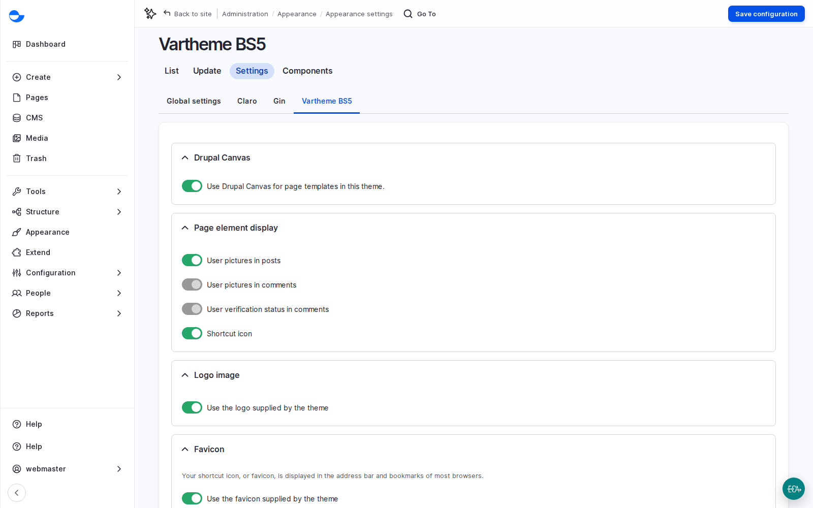
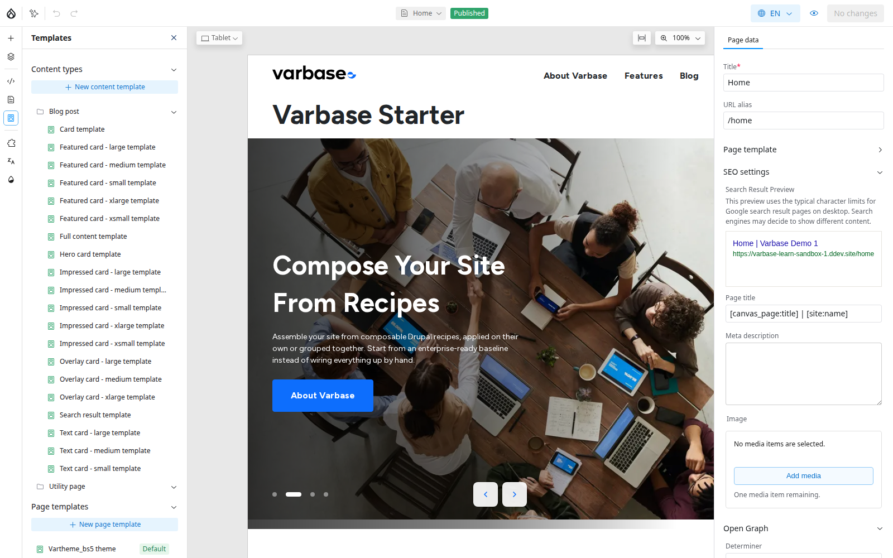
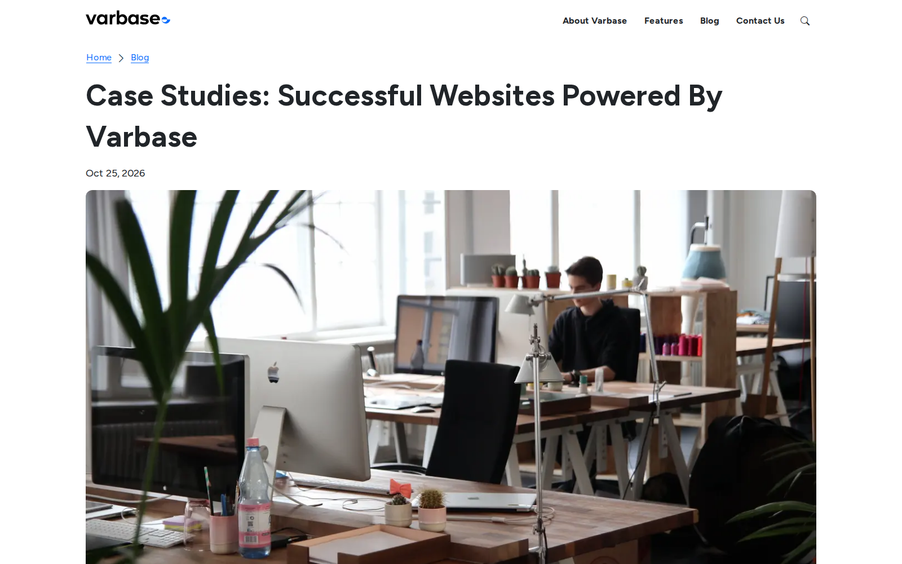

# Templates, Page Types and Consistency

Building one page is the start. This page is about consistency across hundreds of pages: the common page types most clients need, built with one repeatable method; the header and footer every page shares; and content templates, which lay out every blog post and every card without anyone building them one by one.


Lesson 9: Drupal Canvas, Part 2 (Video)


## Why It Matters

- One design change reaches every blog post, card and search result at once.
- Header and footer changes, such as a new button or a campaign banner, do not need a release.
- A labelled list of page types is one of the clearest scope documents you can give a team.

## The Repeatable Method

However different pages look, they are built the same way:

1. Add a **Section**, a full-width band of the page.
2. Split it into one to four columns.
3. Drop components into the columns: headings, text, images, cards, buttons.
4. Repeat for each part of the story, then publish.

Patterns are sections where this work is already done. See the [Component Catalog](component-catalog/).

## Common Page Types

| Page | Shape | Components |
| --- | --- | --- |
| **Services** | Banner, three services, call to action | **Media banner**, three **Card Icon**, **Hero CTA** |
| **Products or plans** | Banner, one card per plan, highlight the most popular | **Pricing card** in a three or four column section |
| **Event** | Hero with date and register button, date and place, agenda, registration form | **Hero Card**, **Text**, **Accordion**, **Webform** |
| **Campaign landing page** | Strong hero and one action, benefits, proof, the same action again | **Hero side by side**, cards, **Testimonial card**, **Hero CTA** |
| **About** | Banner, story in sections with images, numbers | **Featured Card**, **Counters** pattern |
| **Contact** | Form next to contact details | **Contact Form with Info** pattern |
| **Listing** (blog, news, events) | Banner and a live list with filters | **Blog: All blog posts** and its filter |
| **Search** | Search box, results and filters | The search live components |

On a contact page, Canvas decides where the form sits; **Webform** decides what it asks. On listing and search pages, the list fills from content, so nobody edits the page when new content arrives.

If a client runs many events, ask whether events should be content (the **Varbase Events Base** recipe) rather than one Canvas page each.

## Scenario: Launch a Series of Campaign Pages

1. Build one campaign page well, from the shape above.
2. For the next campaign, open the **Pages** panel and use **Duplicate page**. Change the words and images.
3. In **Page data**, write a **Meta description** and choose a sharing **Image**; without them, search results and shared links fall back to generic text.
4. Add the page to a menu if visitors should find it there: a new Canvas page does not appear in menus by itself. See [Menu Management](../url-management/menu-management/).
5. Agree the date the campaign comes down, and who unpublishes it.

## The Header and Footer: the Page Template

The header and footer live in a **page template**, separate from the content of any one page. A change shows on every page that uses the template, which makes it powerful and also the place where a careless change has the widest effect.

- **Turned on in the theme.** **Use Drupal Canvas for page templates in this theme** is on by default in **Vartheme BS5**, and its page template is the default.
- **Who may edit.** The **Administer page template** permission, held by **Site Admin** and **Super Admin** by default. Give it to one or two trusted people.
- **Menus are edited elsewhere.** The menu component in the header shows a menu but does not hold its links. Adding a page to the main menu is a menu task and needs no page template permission.

<figure><figcaption>
Drupal Canvas Page Templates Switched On in the Theme
</figcaption></figure>

### Scenario: Add a Button to the Header

1. In the editor, open **Layers**. Click the locked page template layer at the top, or open **Templates** \ _**Page templates**_, to open the template on its own. A **Page content** marker shows where each page's content goes.
2. Select the header. On a Varbase Starter site it holds the logo, the main menu and the search control.
3. Add a **Button** next to the main menu. Set its label (such as "Donate"), its link and a style.
4. Switch the preview to **Mobile**: the menu folds into a button, and the new button must still fit beside the logo.
5. Open **Review changes**. The header change is listed on its own, so you can publish it, or a page, without the other. Publish when it has been reviewed.

Footer changes work the same way: the copyright line, social links, a newsletter sign-up. Legal links usually come from a menu. See [Page Templates](page-templates.md).

## Content Templates

A **content template** is a Drupal Canvas layout for every item of a content type in one of its views: the full page, cards in several sizes, a hero card, a search result. A Varbase Starter site has about twenty templates for **Blog post**. Change the full template and every post changes, including old ones; change a card template and every list using that card changes.

<figure><figcaption>
The Templates Panel: Content Templates per Content Type, and Page Templates
</figcaption></figure>

In a template, components are connected to the post's fields: the heading shows the title, the image shows the featured image, the text shows the content. The editor arranges; the fields supply the words and pictures. One template serves every language, and Arabic flips right to left by itself.

<figure><figcaption>
A Blog Post Laid Out by Its Full Content Template
</figcaption></figure>

### Scenario: Show Tags at the End of Every Post

1. A **Site Admin** opens **Templates**, chooses **Blog post** and **Full content template**. It opens with a real post as the preview.
2. Add a component below the content and connect it to the post's **Tags**.
3. Test with awkward content: switch the preview to a post with a very long title, one without an image, a very short one, a translated one, and check the phone view.
4. Publish at a quiet time, with someone ready to check the live site straight after. Every post now shows its tags.

Content templates need the **Administer content templates** permission, held by **Site Admin** and **Super Admin** by default. See [Content Templates](content-templates.md).

## Questions Clients Ask

- **Can a single post break out of the template?** Only if per-item layouts are switched on for the content type (in the content type's Canvas settings). They are off on a new Varbase Starter site. Use it for the one exception, such as an annual report summary; an overridden item no longer follows template changes.
- **Who can change the footer?** Roles with **Administer page template**: **Site Admin** and **Super Admin** by default.

## Planning Notes

- Label every page in the client's sitemap: built from existing patterns (editing work), listing pages (need their content type and list), or new patterns and components (design and development time).
- List each content type and the views it needs (full page, cards, search result). Each is a template to design and test: five content types with three views each is fifteen templates. Reusing Varbase's card styles keeps that down.
- Agree header and footer contents in discovery: logo, menu items, one main call to action, search, legal links, social channels, newsletter. Legal and communications people are involved.


**Check Yourself**

1. A client wants a new link in the main menu. Is that a Canvas task, and who can do it?
2. What happens to old blog posts when the full content template changes?
3. When would you give a single post its own layout?

