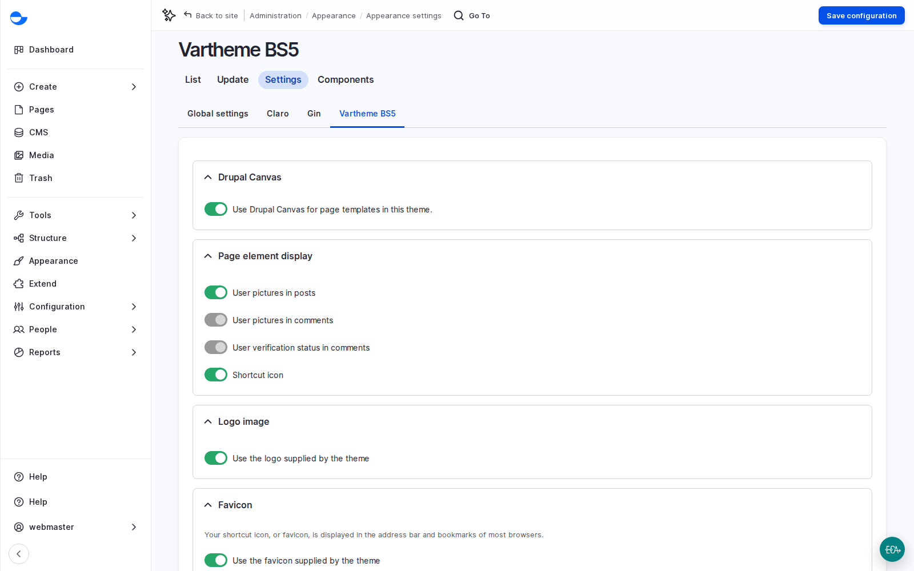

# Add a Button to the Header

The header and footer live in the page template, so a button added there shows on every page. This is how to add one, such as "Donate", and check it before it goes live. It needs the **Administer page template** permission, held by **Site Admin** and **Super Admin** by default.

## Steps

1. In the editor, open **Layers**. Click the locked page template layer at the top, or open **Templates** \ _**Page templates**_, to open the template on its own. A **Page content** marker shows where each page's content goes.
2. Select the header. On a Varbase Starter site it holds the logo, the main menu and the search control.
3. Add a **Button** next to the main menu. Set its label (such as "Donate"), its link and a style.
4. Switch the preview to **Mobile**: the menu folds into a button, and the new button must still fit beside the logo.
5. Open **Review changes**. The header change is listed on its own, so you can publish it, or a page, without the other. Publish when it has been reviewed.

<figure><figcaption>
Drupal Canvas Page Templates Switched On in the Theme
</figcaption></figure>

Footer changes work the same way: the copyright line, social links, a newsletter sign-up. Legal links usually come from a menu. See [Page Templates](../page-templates.md).

## Questions Clients Ask

- **Who can change the footer?** Roles with **Administer page template**: **Site Admin** and **Super Admin** by default.

## Planning Notes

- Agree header and footer contents in discovery: logo, menu items, one main call to action, search, legal links, social channels, newsletter. Legal and communications people are involved.
