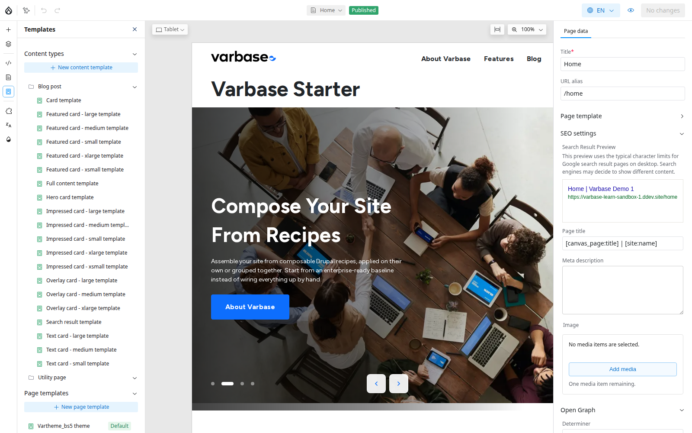

# Show Tags at the End of Every Post

A content template lays out every item of a content type, so one change reaches every post, old and new. This example adds the post's tags below its content. It needs the **Administer content templates** permission, held by **Site Admin** and **Super Admin** by default.

## Steps

1. A **Site Admin** opens **Templates**, chooses **Blog post** and **Full content template**. It opens with a real post as the preview.
2. Add a component below the content and connect it to the post's **Tags**.
3. Test with awkward content: switch the preview to a post with a very long title, one without an image, a very short one, a translated one, and check the phone view.
4. Publish at a quiet time, with someone ready to check the live site straight after. Every post now shows its tags.

<figure><figcaption>
The Templates Panel: Content Templates per Content Type, and Page Templates
</figcaption></figure>

See [Content Templates](../content-templates.md).

## Questions Clients Ask

- **Can a single post break out of the template?** Only if per-item layouts are switched on for the content type (in the content type's Canvas settings). They are installed but switched on for no content type on a new Varbase Starter site, so a post shows no **Canvas layout** tab. See [Content Templates](../content-templates.md#one-item-with-its-own-layout). Use it for the one exception, such as an annual report summary; an overridden item no longer follows template changes.

## Planning Notes

- List each content type and the views it needs (full page, cards, search result). Each is a template to design and test: five content types with three views each is fifteen templates. Reusing Varbase's card styles keeps that down.
