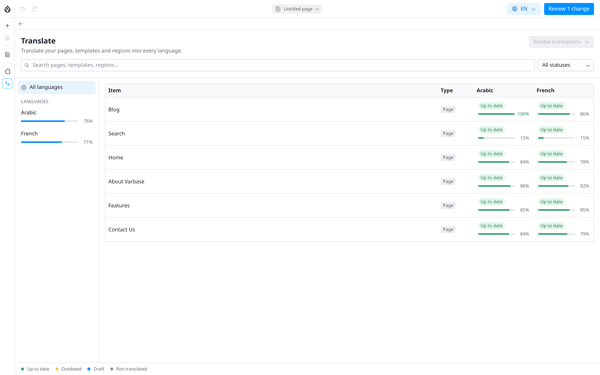

# Translating a Page

On a multilingual site, each Drupal Canvas page can have a version in every site language. You translate a page inside the editor, with the original text beside the translation, and publish the translation when it is ready. Translating does not change the original page.

## Before You Begin

- The site must have more than one language. See [Content Translation](../content-translation/).
- Your role needs the **Translate Canvas content** permission. The **Content editor**, **Content Admin**, **SEO Admin** and **Site Admin** roles have it.

## Opening the Translation Workspace

1. Open any page in the editor.
2. Click **Translate** in the left toolbar.

The **Translate** dashboard lists every page with a status for each language:

| Status | Meaning |
| --- | --- |
| **Not translated** | No translation yet. |
| **Draft** | A translation is started but not published. |
| **Up to date** | The translation is published and matches the original. |
| **Outdated** | The original changed after it was translated. |

<figure><figcaption>
The Translate Dashboard
</figcaption></figure>

Use the filters to show one language or one status.

## Translating a Page

1. In **Translating into**, choose the language, for example **Arabic**.
2. Click the page.
3. For each component, type the translation in the right column. The original text is on the left, for reference.
4. Your translation is saved as a draft as you type.

<!-- <figure><figcaption>
Translating Side by Side
</figcaption></figure> -->

Text you leave untranslated shows the original, so a published page is never half empty.

## Reviewing and Publishing a Translation

1. Click **Review** to see what you translated.
2. Click **Publish**.

Publishing a translation does not publish the original page or other languages, and the **Publish** button for the original page never publishes an unfinished translation.

## Keeping Translations Up to Date

When someone changes the original page, its translations are marked **Outdated**. Open the translation: the editor shows what changed in the original so you can update the translation, then publish it again.

## Tips

- Translate the page title and **Meta description** too, so search results show the right language.
- Check right-to-left languages such as Arabic in **Preview**; the layout mirrors.
- Translate menus and blog posts separately. See [Translating Content](../content-translation/translating-content.md).
