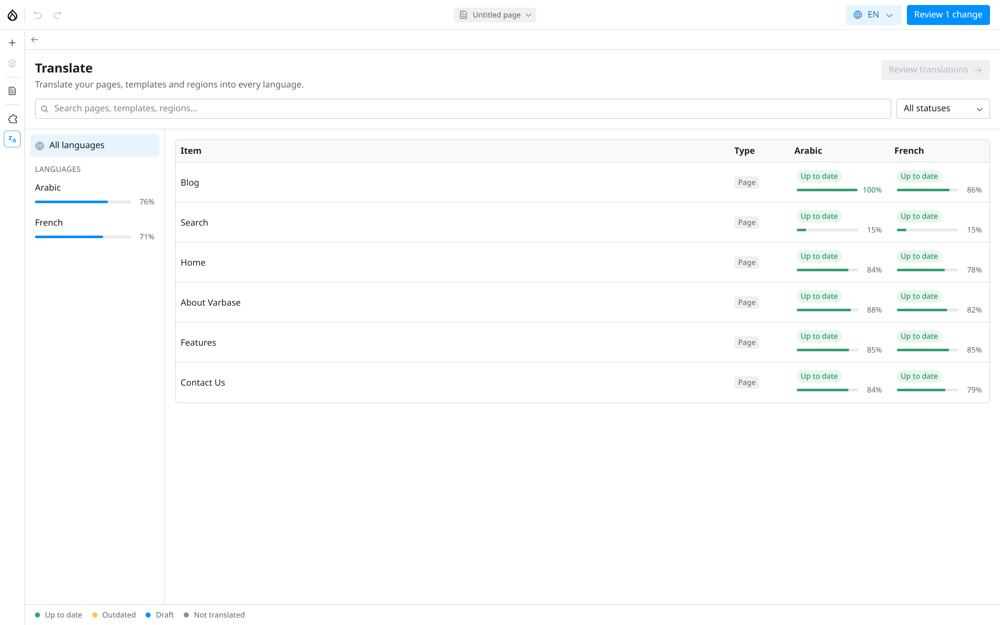
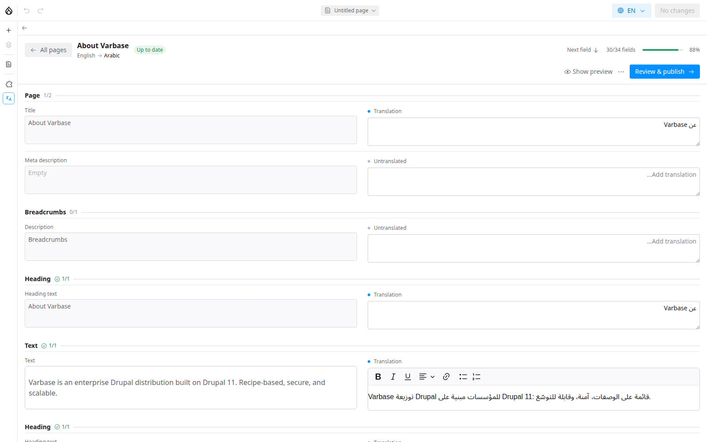

# Translating a Page

On a multilingual site, each Drupal Canvas page can have a version in every site language. You translate a page inside the editor, with the original text beside the translation, and publish the translation when it is ready. Translating does not change the original page.

## Before You Begin

- The site must have more than one language. See [Content Translation](../content-translation/).
- Your role needs the **Translate Canvas content** permission. The **Content editor**, **Content Admin**, **SEO Admin** and **Site Admin** roles have it.

## Opening the Translation Workspace

1. Open any page in the editor.
2. Click **Translate** in the left toolbar. The workspace opens at `/canvas/app/canvas_translate`, headed **Translate your pages**.

The **Translate** dashboard lists every page with a status for each language and how complete each translation is:

| Status | Meaning |
| --- | --- |
| **Not translated** | No translation yet. |
| **Draft** | A translation is started but not published. |
| **Up to date** | The translation is published and matches the original. |
| **Outdated** | The original changed after it was translated. |

<figure><figcaption>
The Translate Dashboard
</figcaption></figure>

Use the filters to show one language or one status.

## Translating a Page

1. In **Translating into**, choose the language, for example **Arabic**.
2. Click the page.
3. For each component, type the translation in the right column. The original text is on the left, for reference. **Next field** jumps to the next field that still needs a translation, and the bar at the top shows how many fields are done.
4. Your translation is saved as a draft as you type. **Show preview** shows the translated page.

<figure><figcaption>
Translating Side by Side
</figcaption></figure>

Text you leave untranslated shows the original, so a published page is never half empty. The layout is shared with the original, so only the words change.


Three known issues in the side-by-side editor on Varbase 11.0:

- For Arabic, the rich text **Translation** field is laid out left to right, so the text starts at the left edge and mixed Arabic and English words can look out of order. The plain text fields beside it are right to left. Check the result in **Show preview**, where the page is right to left.
- While the workspace is open, the page name in the top bar reads **Untitled page**. The page you are translating is the one you opened from the dashboard.
- A **Content editor** can sometimes see a rich text field as raw HTML (`
…
`), with the message "The editor for this text format is not available, so it is edited as HTML." If you see this, ask a **Super Admin** to translate that field; it opens in the rich text editor for them.


## Reviewing and Publishing a Translation

1. Click **Review & publish** to see what you translated. On the dashboard, **Review translations** shows how many translations are waiting to be published.
2. Click **Publish**.

Publishing a translation does not publish the original page or other languages, and the **Publish** button for the original page never publishes an unfinished translation.

## Keeping Translations Up to Date

When someone changes the original page, its translations are marked **Outdated**. Open the translation: the editor shows what changed in the original so you can update the translation, then publish it again. If the translation still holds after the change, click **Mark as reviewed** to clear the **Outdated** status without retyping anything.

## Tips

- Translate the page title and **Meta description** too, so search results show the right language.
- Check right-to-left languages such as Arabic in **Preview**; the layout mirrors.
- Translate menus and blog posts separately. See [Translating Content](../content-translation/translating-content.md).
