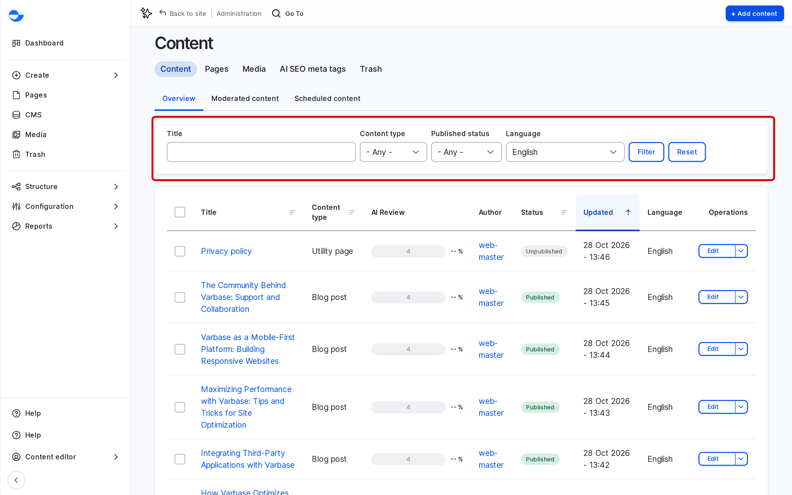

# Content Management

Creating and keeping content up to date is most of an editor's work on a Varbase site. This section covers how to find, create, edit, preview, publish and delete content.

## Kinds of Content

A Varbase site has two kinds of content, each with its own list:

| Kind | What it is for | Where to find it |
| --- | --- | --- |
| **Pages** | Landing pages and other designed pages, built from components with **Drupal Canvas**. | **Pages** in the **Navigation** sidebar (`/admin/content/pages`). See [Building Pages With Drupal Canvas](../building-pages-with-drupal-canvas/). |
| **Content items** | Structured content filled in through a form, such as **Blog post** and **Utility page**. | **CMS** in the **Navigation** sidebar (`/admin/content`). |

On a standard Varbase 11 site the content types are:

- **Blog post**: news and articles shown in the blog, with a featured image, categories and tags.
- **Utility page**: plain text pages such as a privacy policy or terms of use.

Your site may have more content types, added by your development team or a site template.

## The Content List

**CMS** (`/admin/content`) lists every content item.

<figure><figcaption>
The Content List
</figcaption></figure>

- **Filter** the list by **Title**, **Content type**, **Published status** and **Language**, then click **Filter**.
- **Sort** by clicking a column heading, such as **Updated**.
- **Open** an item by clicking its title, or use **Edit** in the **Operations** column.
- **Act on several items** at once with the checkboxes. See [Bulk Edit Content](bulk-edit-content.md).

## Revisions

Every time you save a content item, Varbase keeps the previous version as a revision. You can compare revisions and go back to an earlier one. See [Modify Content](modify-content.md#revisions).

## In This Section

- [Create Content](create-content/)
- [Rich-Text Editor "WYSIWYG"](create-content/rich-text-editor-wysiwyg.md)
- [Modify Content](modify-content.md)
- [Delete Content](delete-content.md)
- [Preview Content](preview-content.md)
- [Bulk Edit Content](bulk-edit-content.md)
- [Publish Content](publish-content.md)
