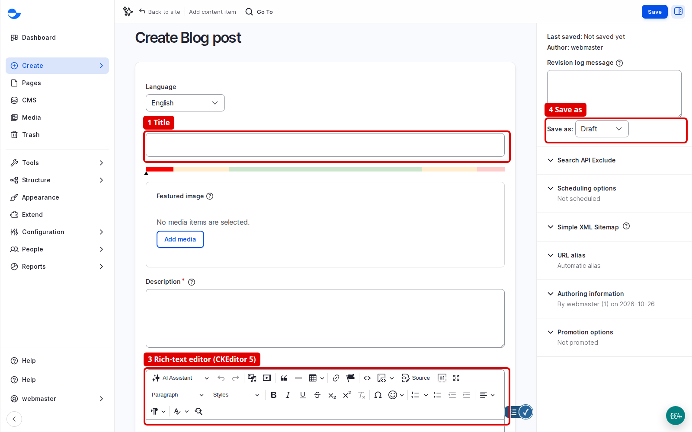
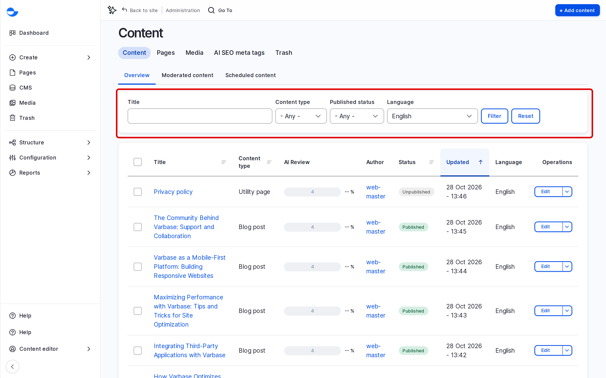
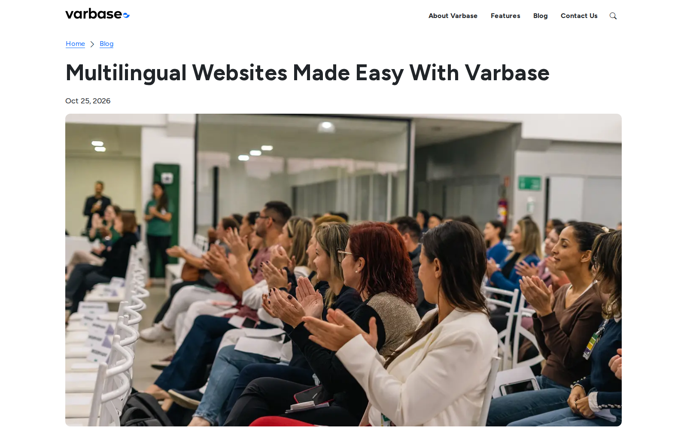
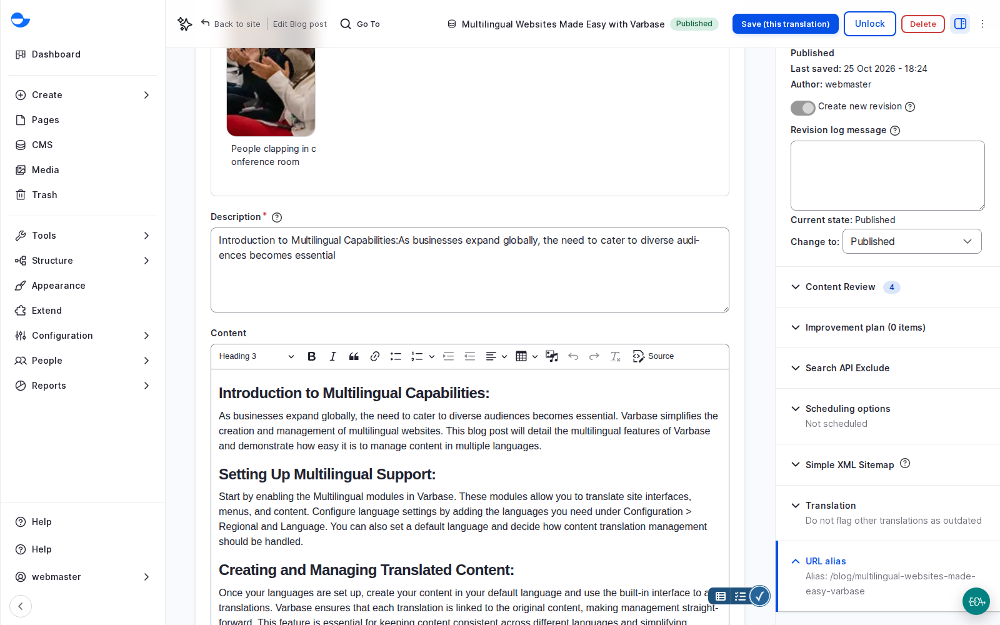

# Creating Content

This is where editors spend their day. Varbase keeps the content form short, puts publishing controls in a sidebar, and uses **CKEditor 5** for rich text. This page follows a blog post from first idea to saved draft, and collects the habits that keep a client's content clean, accessible and consistent.


Lesson 5: Creating Content (Video)


## What It Is

- **The content form**: fields on the left (language, title, featured image, description, content, categories, tags, SEO fields) and a sidebar on the right (revision log, **Save as**, scheduling, sitemap, URL alias, authoring and promotion options).
- **The rich-text editor**: headings, styles, lists, links that find pages by title, tables, images and video from the media library, writing direction, find and replace, and the **AI Assistant**. Pasted text from Word or Google Docs is cleaned automatically. See [Rich-Text Editor "WYSIWYG"](create-content/rich-text-editor-wysiwyg.md).
- **Save as**: the workflow state of this version. Start new content as a **Draft**. See [Editorial Workflow](../content-workflow/).
- **Safety nets**: autosave keeps a backup of the form about every minute, and **content locking** stops two people editing the same item.
- **Preview**: utility pages have a **Preview** button; blog posts do not, because their layout comes from a Drupal Canvas content template, so the saved draft is the preview. See [Preview Content](preview-content.md).

<figure><figcaption>
Creating a Blog Post: the Title, the Rich-Text Editor and Save As
</figcaption></figure>

## Why It Matters

- Clean, structured content with headings and alt text is good for search engines and accessibility at the same time.
- Locking and autosave prevent the most painful support request: lost work.
- A draft of a live post waits for approval, so a team can prepare new prices or dates without showing half-finished text.

## Kinds of Content

A Varbase site has two kinds of content, each with its own list:

| Kind | What it is for | Where to find it |
| --- | --- | --- |
| **Pages** | Landing pages and other designed pages, built from components with **Drupal Canvas**. | **Pages** in the **Navigation** sidebar (`/admin/content/pages`). See [Building Pages With Drupal Canvas](../building-pages-with-drupal-canvas/). |
| **Content items** | Structured content filled in through a form, such as **Blog post** and **Utility page**. | **CMS** in the **Navigation** sidebar (`/admin/content`). |

On a standard Varbase 11 site the content types are:

- **Blog post**: news and articles shown in the blog, with a featured image, categories and tags.
- **Utility page**: plain text pages such as a privacy policy or terms of use.

Your site may have more content types, added by your development team or a site template.

## The Content List

**CMS** (`/admin/content`) lists every content item.

<figure><figcaption>
The Content List
</figcaption></figure>

- **Filter** the list by **Title**, **Content type**, **Published status** and **Language**, then click **Filter**.
- **Sort** by clicking a column heading, such as **Updated**.
- **Open** an item by clicking its title, or use **Edit** in the **Operations** column.
- **Act on several items** at once with the checkboxes. See [Bulk Edit Content](../content-workflow/bulk-edit-content.md).

## Scenario: Write a Blog Post From Start to Draft

1. In the sidebar, click **Create** \ _**Blog post**_ (or **Add content** on the dashboard or the content list).
2. Check the **Language**, then write the **Title**: clear and specific, still meaningful alone in a list of search results. It also becomes the page heading and, by default, the web address.
3. Under **Featured image**, click **Add media** and pick an existing image from the library, or upload one. A reused image already has its alt text and focal point.
4. Write the **Description**: one or two sentences for someone scanning a list of cards.
5. Write the **Content**. Start sub-sections with **Heading 2**, then **Heading 3**, without skipping levels. Make link text describe where it leads. Use **Insert Media** for images and videos.
6. Pick **Categories** and **Tags**. Search for an existing tag before typing a new one.
7. Leave the SEO fields empty unless you need them: Varbase uses sensible defaults. See [Search Engines and AI Readiness](../search-engine-optimization/).
8. Write a one-line **Revision log message**, such as "First draft for the launch campaign".
9. Set **Save as** to **Draft** and click **Save**. Read the message at the top. The post now appears in **My Drafts** on the dashboard.

<figure><figcaption>
The Post as Visitors See It
</figcaption></figure>

## Scenario: Update a Live Post Safely

1. Open the published post and click **Edit**. The post is locked for others while you work; **Unlock** releases it.
2. Make the change, add a revision log message, and set **Change to** to **Draft** (or **In review**).
3. Click **Save**. Visitors keep seeing the published version until the draft is published.

<figure><figcaption>
Editing a Published Post: Content on the Left, State and Options on the Right
</figcaption></figure>

## After Publishing

A published post also appears on the blog listing, the latest updates on the home page, related content and search. Search updates when the site's scheduled tasks run, so a new post may take a few minutes to appear there. For an important post, tour those places and check it on a phone.

To show a draft to someone who never logs in, such as a director, an editor with the permission can create a temporary secret link that works without an account until it expires. Agree with the client who may create these links.

## Revisions

Every time you save a content item, Varbase keeps the previous version as a revision. You can compare revisions and go back to an earlier one. See [Modify Content](modify-content.md#revisions).

## Habits Worth Teaching

1. A clear title and a one-sentence description.
2. Headings in order, starting from **Heading 2**.
3. Link text that describes its destination, never "click here".
4. Images reused from the library, each with good alt text.
5. A short revision note every time you save.

## Questions Clients Ask

- **Can we get track changes and comments like in Word?** **CKEditor 5** premium features (track changes, comments, revision history) are supported when licensed. The licence is a client cost.
- **Can editors paste from Word?** Yes. The editor keeps headings, lists and links and drops hidden styling. Check headings and links after pasting.

## Planning Notes

- Agree text formats per role: advanced tools such as **Source** for experienced editors only.
- Decide whether editors may publish. If every post needs a reviewer, remove the publish transition from the **Content editor** role (see [Editorial Workflow](../content-workflow/)).
- Write a one-page content standards sheet for the client. [Content Uploading Standards](../additional-tips/content-uploading-standards.md) is a good base.

## In This Section

- [Create Content](create-content/)
- [Rich-Text Editor "WYSIWYG"](create-content/rich-text-editor-wysiwyg.md)
- [Modify Content](modify-content.md)
- [Delete Content](delete-content.md)
- [Preview Content](preview-content.md)
- [Bulk Edit Content](../content-workflow/bulk-edit-content.md)
- [Publish Content](../content-workflow/publish-content.md)


**Check Yourself**

1. Why should the first heading inside a post be a heading two?
2. What happens to the live page when an editor saves a change to a published post as a draft?
3. Why is linking to a page by its title better than pasting its address?

