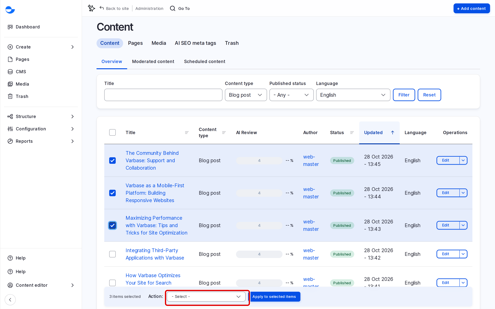

# Bulk Edit Content

The content list lets you apply one action to many items at once, such as deleting old posts or updating their web addresses. This page shows how, and which actions are available.

## Steps

1. Click **CMS** in the **Navigation** sidebar (`/admin/content`).
2. Use the filters to narrow the list, for example **Content type** **Blog post**, then click **Filter**.
3. Tick the items you want. The box in the table heading ticks every item on the page.
4. In **Action**, choose what to do.
5. Click **Apply to selected items**, and confirm if asked.

<figure><figcaption>
Applying an Action to Selected Items
</figcaption></figure>

Varbase shows a message with the result.

## Available Actions

| Action | What it does |
| --- | --- |
| **Delete content** | Moves the items to the **Trash**. See [Delete Content](delete-content.md). |
| **Promote content to front page** / **Remove content from front page** | Sets or clears **Promoted to front page**. |
| **Make content sticky** / **Make content unsticky** | Sets or clears **Sticky at top of lists**. |
| **Update URL alias** | Regenerates the web address of each item from its title. See [URL Aliases](../url-management/url-aliases.md). |
| **Save content** | Saves each item again, for example after a site-wide setting changed. |

The list shows only the actions your role can use.


**Publish content** and **Unpublish content** do not change blog posts or utility pages, because those use the content workflow. Varbase skips them and shows a warning. To publish or unpublish, open each item and change its state, or see [Publish Content](publish-content.md).


## Tips

- Filter first, then tick: it is easy to select the wrong item in a long list.
- Check the result message: it says how many items changed and which were skipped.
- Work in batches of a page or two on a busy live site.
