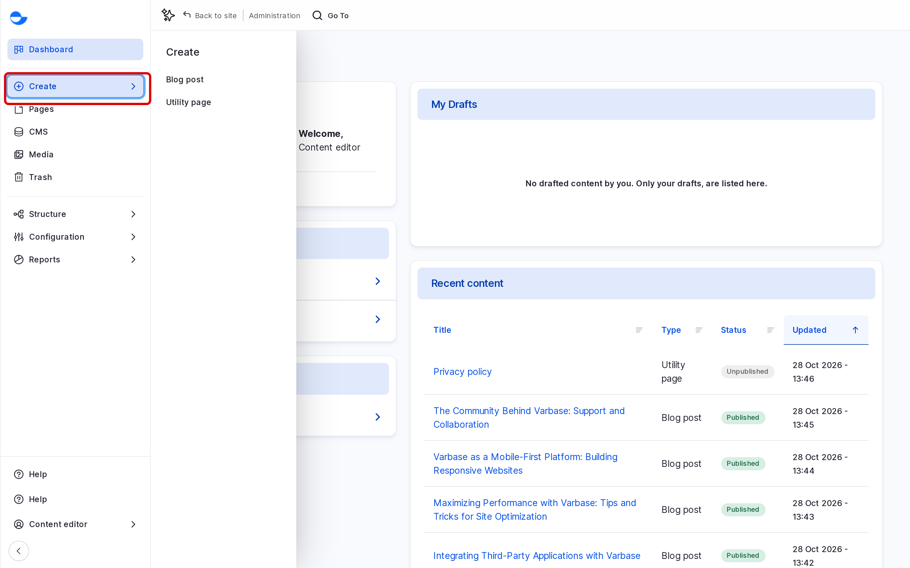
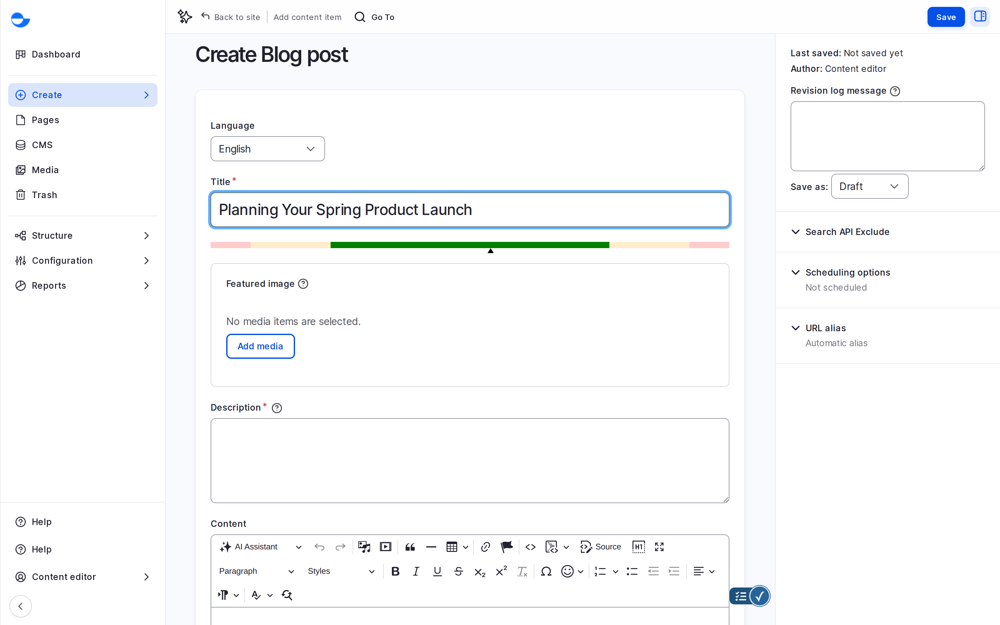
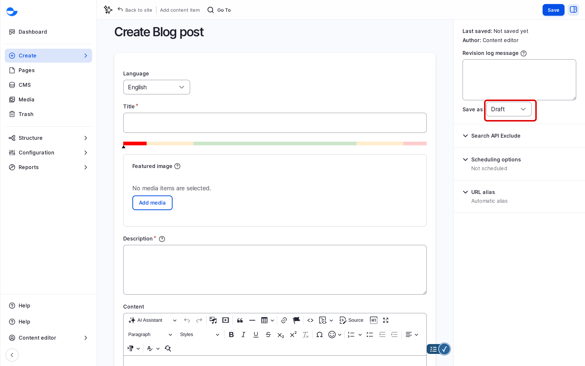

# Create Content

This page shows you how to add a blog post or a utility page. To add a designed page built from components, see [Building Pages With Drupal Canvas](../../building-pages-with-drupal-canvas/).


Creating a Blog Post (Video)


If the video does not play, open [Creating a Blog Post (MP4)](<../../../.gitbook/assets/cd-clip-01-create-blog-post.mp4>). Captions: [cd-clip-01-create-blog-post.vtt](<../../../.gitbook/assets/cd-clip-01-create-blog-post.vtt>).

## Steps to Create Content

1. In the **Navigation** sidebar, click **Create**, then choose the content type, for example **Blog post**. You can also go to `/node/add`.

   <figure><figcaption>
Choosing a Content Type From Create
</figcaption></figure>

2. Fill in the main fields:
   - **Title** (required): a clear, descriptive title.
   - **Featured image**: click **Add media** to pick or upload an image from the **Media Library**.
   - **Description**: a short summary, used in lists and cards.
   - **Content**: the body text, written in the rich-text editor. See [Rich-Text Editor "WYSIWYG"](rich-text-editor-wysiwyg.md).
   - **Categories** and **Tags** (blog posts): choose a category and type tags to group the post with related content.

   <figure><figcaption>
The Create Blog Post Form
</figcaption></figure>

3. For a blog post, open **Search Engine Optimization (SEO) Information** to set the **SEO title**, **SEO description** and **SEO image**, and to read the **SEO analysis**. See [SEO Analysis With Yoast SEO](../../search-engine-optimization/seo-analysis-yoast.md).
4. Check the settings in the sidebar on the right:
   - **URL alias**: leave **Generate automatic URL alias** on to get an address from the title. See [URL Aliases](../../url-management/url-aliases.md).
   - **Scheduling options**: set a future publish or unpublish date. See [Scheduling Content](../../content-workflow/scheduling-content.md).
   - **Authoring information**, **Promotion options** and, for utility pages, **Menu settings**.
5. Under **Save as**, choose **Draft**, **In review** or **Published**. See [Publish Content](../publish-content.md).
6. Optionally, write a **Revision log message** that says what you did.
7. Click **Save**.

   <figure><figcaption>
Choosing the State and Saving
</figcaption></figure>

Varbase saves the item and opens it.


While you work, Varbase saves a copy of your changes in the background. If the browser closes, it offers to restore them the next time you open the form. See [Content Workflow](../../content-workflow/#content-locking-and-autosave).


## Tips

- Add alt text to every image you upload, so screen reader users know what it shows.
- Start with **Draft** and publish when the item is ready.
- Write the **Description** for people scanning a list: one or two sentences.
- On a multilingual site, add translations after you save the original. See [Content Translation](../../content-translation/).
