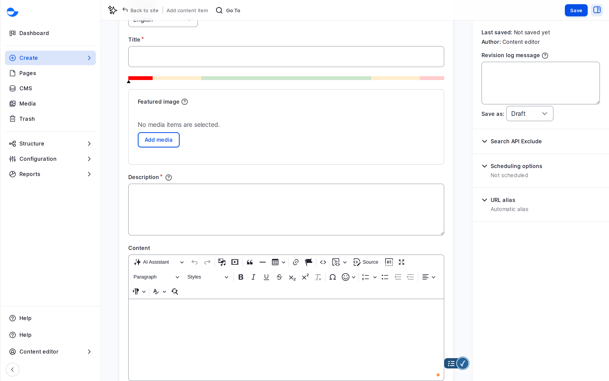
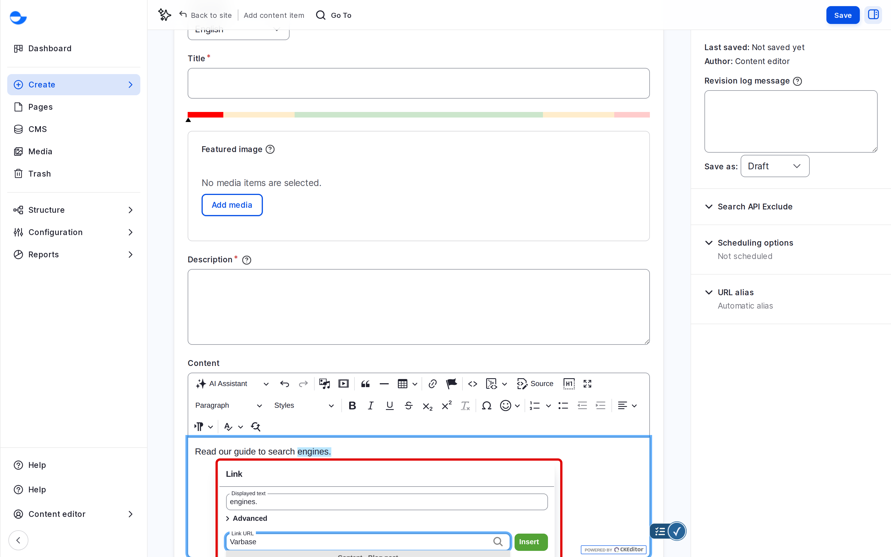
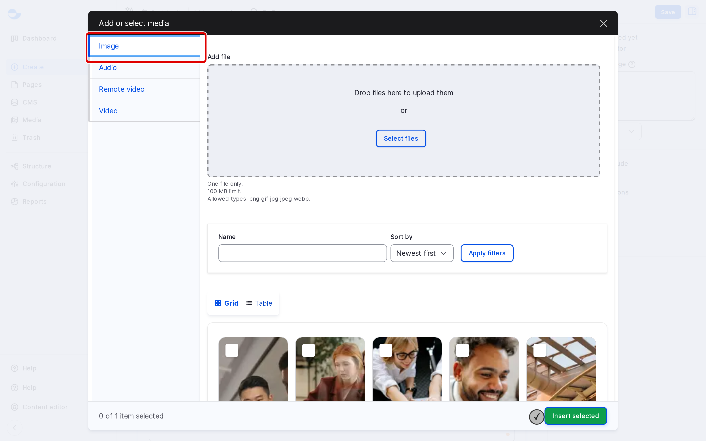

# Rich-Text Editor "WYSIWYG"

Varbase uses **CKEditor 5** for the body of your content. You format text with toolbar buttons and see the result as you type ("What You See Is What You Get"). This page explains the toolbar and the text formats that decide which buttons you get.

## Text Formats

The **Text format** list under the editor decides which tools you have.

| Format | Where it is used | What it offers |
| --- | --- | --- |
| **Rich editor** | **Blog post** content (the default) | The full toolbar, including media, tables, styles, the AI assistant and spell checking. |
| **Content** | **Utility page** content | A shorter toolbar: headings, bold, italic, quotes, links, lists, alignment, tables and media. |


Changing the format of text you already wrote can remove formatting the new format does not allow. Pick the format before you start writing.


## The Rich Editor Toolbar

<figure><figcaption>
The Rich Editor Toolbar
</figcaption></figure>

| Group | Buttons |
| --- | --- |
| **AI and history** | **AI** assistant (at the left end of the toolbar), **Undo**, **Redo** |
| **Media** | **Insert Media** (from the Media Library), **Insert media** (**Media embed**: a pasted link to a video or post on another site) |
| **Blocks** | **Block quote**, **Horizontal line**, **Insert table** |
| **Links** | **Link**, **Anchor** |
| **Code and view** | **Code**, **Code Block**, **Source**, **Show blocks**, **Full screen** |
| **Structure** | **Heading**, **Style** |
| **Text** | **Bold**, **Italic**, **Underline**, **Strikethrough**, **Subscript**, **Superscript**, **Remove Format** |
| **Characters** | **Special characters**, **Emoji** |
| **Lists** | **Numbered List**, **Bulleted List**, **Decrease indent**, **Increase indent** |
| **Layout** | **Text alignment**, **Text direction** (left to right or right to left) |
| **Checking** | **WProofreader** spelling and grammar, **Find and replace** |


Two **Media** buttons have almost the same tooltip. **Insert Media** (capital M) opens the **Media Library**, so the item can be reused. **Insert media** (small m) is **Media embed**: it embeds a pasted link without adding it to the library. Use **Insert Media** for anything you may reuse.


## Common Tasks

### Adding a Heading

1. Place the cursor in the line.
2. Open **Heading** (it shows the current style, such as **Paragraph**) and choose **Heading 2** for a main section, **Heading 3** for a sub-section.

The page title is the only **Heading 1**, so start your body text at **Heading 2**.

### Linking to a Page

1. Select the text, then click **Link** (or press **Ctrl + K**, **Cmd + K** on a Mac).
2. Start typing the title of a content item on your site, such as a blog post, and pick it from the suggestions, or paste a full web address.
3. Press **Enter**.

Links picked from the suggestions keep working when the page's address changes. The suggestions list content items only: **Drupal Canvas** pages, such as the search page, are not offered, so paste their address instead.

<figure><figcaption>
Linking to a Page on Your Site
</figcaption></figure>

### Inserting an Image or Video

1. Place the cursor where the media should go.
2. Click **Insert Media**. The **Add or select media** dialog opens, with a tab for each media type the text format allows.
3. Pick an existing item or upload a new one, then click **Insert selected**.


In the **Rich editor** format, **Insert Media** offers only **Image**, **Audio**, **Remote video** and **Video**. **Document**, **SVG Image** and **Remote audio** cannot be inserted there; the **Content** format, used by **Utility page**, offers all seven types.


<figure><figcaption>
Inserting Media From the Media Library
</figcaption></figure>

After inserting, click the media to change its alignment or alt text. See [Media Management](../../media-management/).

### Using a Style

**Style** applies a predefined look, such as **Callout Info**, **Alert warning** or **Table Striped**, so the content matches the site's design. Select the text or table first, then choose the style.

The **Styles** list also has display styles, such as **Display 1 (h2)**: larger, bolder versions of a heading for a statement line. The heading level stays the same underneath, so the page outline is not broken.

### Pasting From Word or Google Docs

Paste as usual. Varbase removes hidden formatting from Word and similar sources, so the text takes the site's own styles. Check the result, especially headings and lists.

## Using the AI Assistant

Select text and click **AI** at the left end of the toolbar. It offers **Generate with AI**, **Modify with a prompt**, **Reformat HTML**, **Fix spelling** and **Summarize**; an administrator can switch on more, such as changing the tone or translating. You see the result before you choose to use it, and you stay responsible for every word that is published. See [AI Tools in the Editor](../../ai-in-varbase/ai-tools-in-the-editor.md).

## Tips

- Use headings in order (**Heading 2**, then **Heading 3**) so screen readers and search engines understand the structure.
- Let the site's styles do the design: avoid underlining text that is not a link.
- Use **Find and replace** for a word that appears many times.
- Use **Full screen** for long texts.
