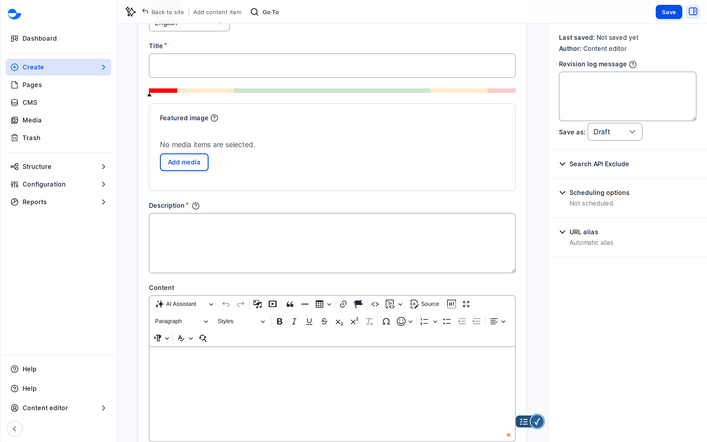
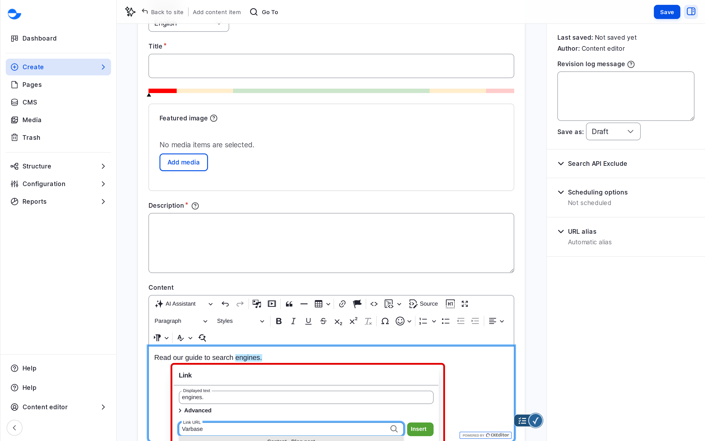
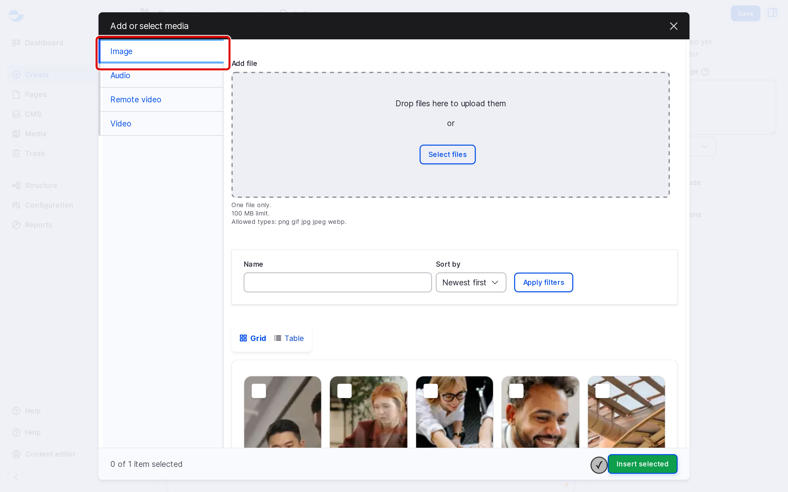

# Rich-Text Editor "WYSIWYG"

Varbase uses **CKEditor 5** for the body of your content. You format text with toolbar buttons and see the result as you type ("What You See Is What You Get"). This page explains the toolbar and the text formats that decide which buttons you get.

## Text Formats

The **Text format** list under the editor decides which tools you have.

| Format | Where it is used | What it offers |
| --- | --- | --- |
| **Rich editor** | **Blog post** content (the default) | The full toolbar, including media, tables, styles, the AI assistant and spell checking. |
| **Content** | **Utility page** content | A shorter toolbar: headings, bold, italic, quotes, links, lists, alignment, tables and media. |


Changing the format of text you already wrote can remove formatting the new format does not allow. Pick the format before you start writing.


## The Rich Editor Toolbar

<figure><figcaption>
The Rich Editor Toolbar
</figcaption></figure>

| Group | Buttons |
| --- | --- |
| **AI and history** | **AI** assistant, **Undo**, **Redo** |
| **Media** | **Insert Media** (from the Media Library), **Insert Media Embed** (a link to a video or post on another site) |
| **Blocks** | **Block quote**, **Horizontal line**, **Insert table** |
| **Links** | **Link**, **Anchor** |
| **Code and view** | **Code**, **Code Block**, **Source**, **Show blocks**, **Full screen** |
| **Structure** | **Heading**, **Style** |
| **Text** | **Bold**, **Italic**, **Underline**, **Strikethrough**, **Subscript**, **Superscript**, **Remove Format** |
| **Characters** | **Special characters**, **Emoji** |
| **Lists** | **Numbered List**, **Bulleted List**, **Decrease indent**, **Increase indent** |
| **Layout** | **Text alignment**, **Text direction** (left to right or right to left) |
| **Checking** | **WProofreader** spelling and grammar, **Find and replace** |

## Common Tasks

### Adding a Heading

1. Place the cursor in the line.
2. Open **Heading** and choose **Heading 2** for a main section, **Heading 3** for a sub-section.

The page title is the only **Heading 1**, so start your body text at **Heading 2**.

### Linking to a Page

1. Select the text, then click **Link** (or press **Ctrl + K**, **Cmd + K** on a Mac).
2. Start typing the title of a page on your site and pick it from the suggestions, or paste a full web address.
3. Press **Enter**.

Links picked from the suggestions keep working when the page's address changes.

<figure><figcaption>
Linking to a Page on Your Site
</figcaption></figure>

### Inserting an Image or Video

1. Place the cursor where the media should go.
2. Click **Insert Media**.
3. Pick an existing item or upload a new one, then click **Insert selected**.

<figure><figcaption>
Inserting Media From the Media Library
</figcaption></figure>

After inserting, click the media to change its alignment or alt text. See [Media Management](../../media-management/).

### Using a Style

**Style** applies a predefined look, such as **Callout Info**, **Alert warning** or **Table Striped**, so the content matches the site's design. Select the text or table first, then choose the style.

### Pasting From Word or Google Docs

Paste as usual. Varbase removes hidden formatting from Word and similar sources, so the text takes the site's own styles. Check the result, especially headings and lists.

## Using the AI Assistant

Select text and click **AI** to have it written, summarised, reworded, reformatted or its spelling fixed. See [AI Tools in the Editor](../../ai-tools-in-the-editor.md).

## Tips

- Use headings in order (**Heading 2**, then **Heading 3**) so screen readers and search engines understand the structure.
- Let the site's styles do the design: avoid underlining text that is not a link.
- Use **Find and replace** for a word that appears many times.
- Use **Full screen** for long texts.
