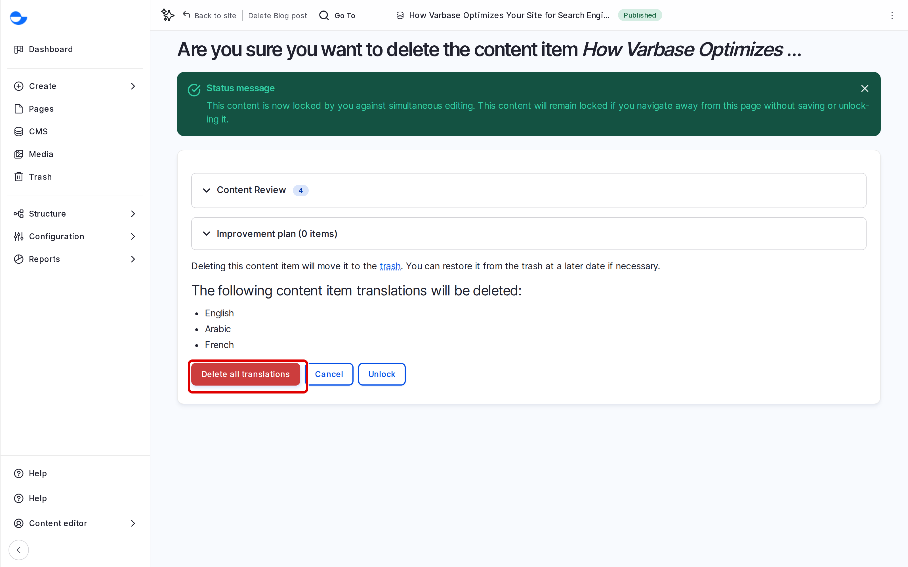

# Delete Content

When you delete a content item in Varbase, it goes to the **Trash** first, not away for good. You can restore it from there if you change your mind. This page shows how to delete one item or several.

## Deleting One Item

1. Click **CMS** in the **Navigation** sidebar (`/admin/content`).
2. In the **Operations** column of the item, open the list next to **Edit** and choose **Delete**.
3. Read the confirmation and click **Delete**.

<!-- <figure><figcaption>
Confirming the Deletion
</figcaption></figure> -->

You can also click **Delete** in the bar at the top of the item, or at the bottom of its edit form.

The item leaves the content list and the site, and appears in the **Trash**.

## Deleting Several Items

1. On the content list, tick the items.
2. In **Action**, choose **Delete content**.
3. Click **Apply to selected items**, then confirm.

See [Bulk Edit Content](bulk-edit-content.md).

## Restoring or Removing for Good

Open **Trash** in the **Navigation** sidebar (`/admin/content/trash`) to restore an item or delete it permanently. See [Trash](../content-workflow/trash.md).


Only a **Site Admin** or **Super Admin** can delete items permanently from the trash, and that cannot be undone.


## Tips

- If an item is only out of date, **Archive / Unpublish** it instead of deleting it. It stays in the content list for later. See [Publish Content](publish-content.md).
- Before deleting, check that no menu link or other page points to the item.
- Pages built with **Drupal Canvas** are deleted from **Pages** in the same way.
