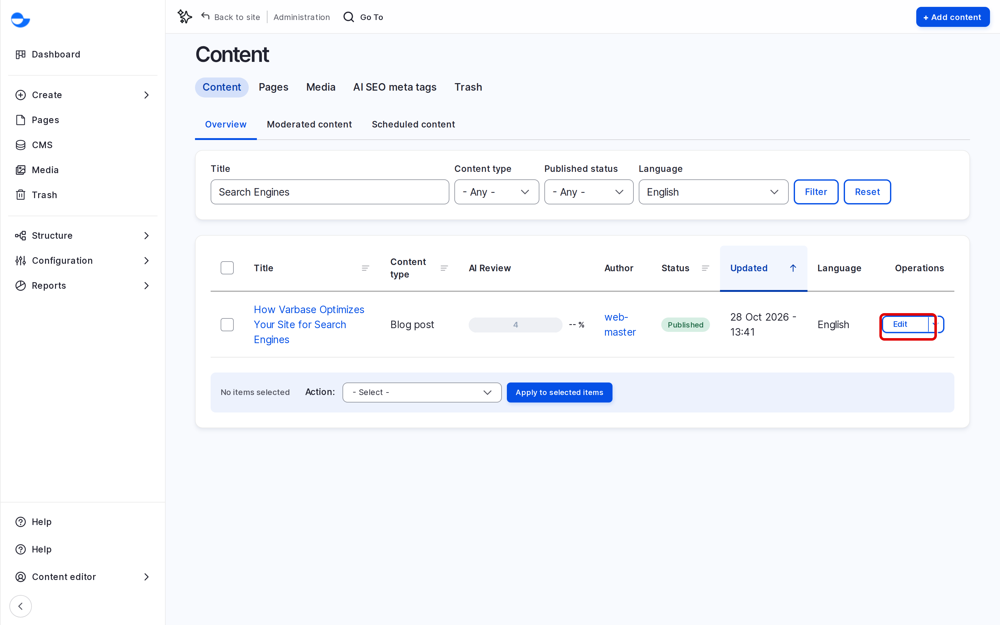
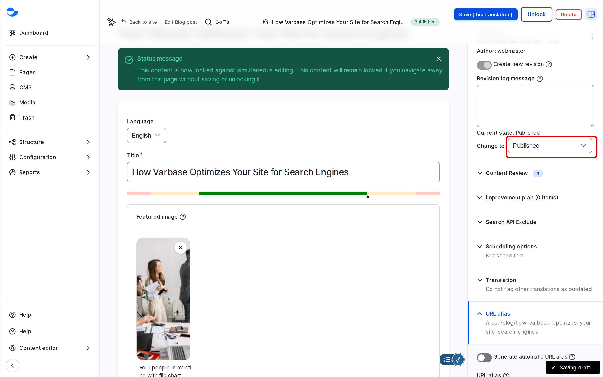
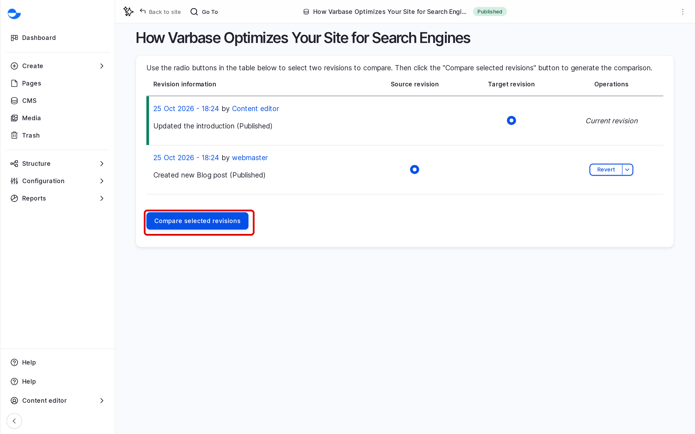

# Modify Content

You will often update content that already exists: fix a typo, add a paragraph, replace an image. This page shows how to find the item, edit it, and use revisions to see or undo changes.

## Finding the Content

### From the Content List

1. Click **CMS** in the **Navigation** sidebar (`/admin/content`).
2. Type part of the title in **Title**, or choose a **Content type**, then click **Filter**.
3. Click **Edit** in the **Operations** column of the item.

<figure><figcaption>
Finding an Item to Edit
</figcaption></figure>

### From the Site

1. While logged in, open the item on the site.
2. Click **Edit** in the bar at the top of the page.

## Editing

1. Change the fields you need.
2. In **Change to**, choose the state to save in. To change a published item without showing the change yet, choose **Draft**; the published version stays live until you publish again.
3. Write a **Revision log message** that says what changed, for example "Updated the opening hours".
4. Click **Save**.

<figure><figcaption>
Saving a Change as a Draft of a Published Item
</figcaption></figure>


While you have an item open, other editors cannot edit it; they see who is editing. Click **Save** or **Unlock** when you finish so the lock is released. See [Content Workflow](../content-workflow/#content-locking-and-autosave).


## Revisions

Each save keeps the previous version. Open the item and click the **Revisions** tab to see the list, with the date, the author and the log message of each.

<figure><figcaption>
The Revisions Tab
</figcaption></figure>

### Comparing Two Revisions

1. On the **Revisions** tab, choose the two revisions with the radio buttons.
2. Click **Compare selected revisions**.

Varbase shows the two versions side by side with the changes marked.

### Going Back to an Earlier Revision

1. On the **Revisions** tab, click **Revert** next to the revision you want.
2. Confirm.

Varbase saves a new revision that copies the old one, so nothing is lost.

## Tips

- Keep log messages short and specific; your team reads them when something goes wrong.
- For a large change to a published item, save as **Draft**, ask a colleague to check, then publish.
- If someone else holds the lock on an item, ask them to finish rather than breaking the lock.
