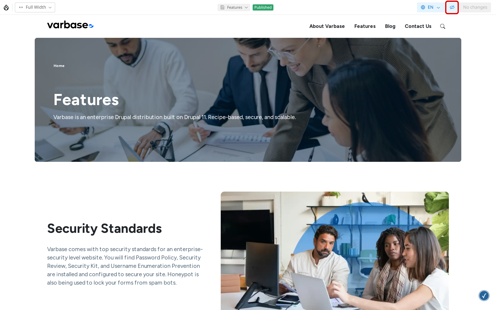
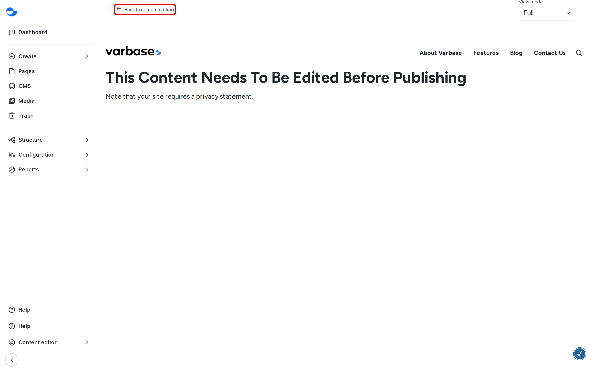

# Preview Content

Varbase allows you to preview how content will appear to site visitors before saving or publishing it. This helps ensure that formatting, media, and layout are correct before the content goes live.

How you preview depends on where the content is edited:

- **Drupal Canvas** pages and content types that use a **Drupal Canvas** content template are previewed inside the Canvas editor.
- Other content types are previewed with the **Preview** button on the content form.

## Previewing in Drupal Canvas

The Drupal Canvas editor shows the page as visitors will see it while you edit.

1. Open the page in the Drupal Canvas editor.
2. Click the **Preview** icon (the eye) in the top bar to hide the editing controls and see the page on its own. Click it again to return to editing.
3. Use the viewport selector above the page to check it at **Mobile**, **Tablet**, **Desktop** and **Large Desktop** sizes.

<!-- <figure><figcaption>
Previewing a Page in Drupal Canvas
</figcaption></figure> -->

Changes stay a draft until you click **Publish**, so you can preview as often as you need.

## Using the Preview Button

1. While creating or editing content, click the **Preview** button located near the Save button on the content form.
2. The preview opens in a new view showing how the content will look on the front end of the site.
3. Review the content for accuracy, formatting, and visual presentation.
4. Click **Back to content editing** to return to the edit form and make any necessary adjustments.

<!-- <figure><figcaption>
Previewing a Utility Page
</figcaption></figure> -->


The **Preview** button does not appear for content types whose full display uses a **Drupal Canvas** content template, such as **Blog post** in **Varbase Starter**. The **Disable preview when Canvas is enabled** workflow turns it off, because Canvas already provides a live preview. **Utility page** still has the **Preview** button. See [Disable Preview When Canvas Is Enabled](../../developers/varbase-eca/content-template-disable-preview.md).


## Responsive Preview


The **Responsive Preview** module is not included in Varbase 11. Use the Drupal Canvas viewport selector described above to check pages at different screen sizes. A developer can add Responsive Preview if your site needs a device previewer on the front end. See [Responsive Preview](../site-configuration/user-interface/responsive-preview.md).


## Tips for Previewing Content

- Always preview content before publishing, especially for content with complex layouts, embedded media, or custom formatting.
- Check the content at more than one screen size to ensure a good experience for all visitors.
- If the preview does not match your expectations, return to the editor to adjust the content, layout, or media settings.
- Remember that preview shows the content as it will appear to visitors. Some admin-only elements will not be visible in preview mode.
