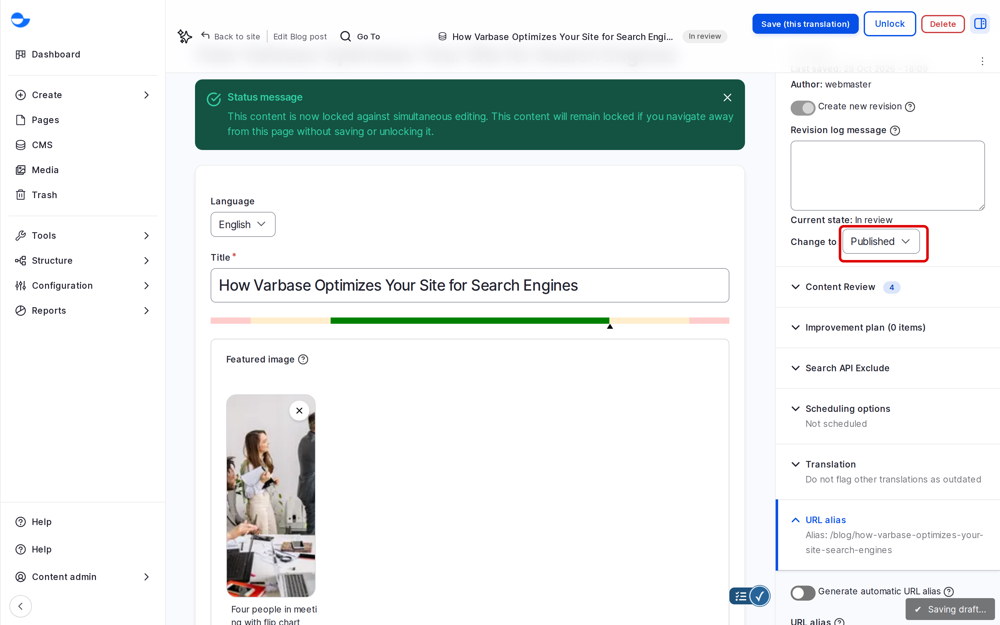

# Publish Content

Blog posts and utility pages are published through the content workflow: an item moves from **Draft** to **In review** to **Published**, and later to **Archived / Unpublished**. This page shows how to change an item's state and how to find content waiting for review.

## The States

| State | Who sees it |
| --- | --- |
| **Draft** | Editors only. |
| **In review** | Editors only. Waiting for someone to check it. |
| **Published** | Everyone. |
| **Archived / Unpublished** | Editors only. Kept for reference. |

See [Content Workflow](../content-workflow/) for the full workflow.

## Publishing a New Item

1. Fill in the item. See [Create Content](create-content/).
2. In **Save as**, choose **Published**.
3. Click **Save**.

## Changing the State of an Existing Item

1. Open the item and click **Edit**.
2. In the sidebar, **Current state** shows where the item is now. In **Change to**, choose the new state:
   - **Draft**: start a new draft. If the item is published, the published version stays live.
   - **In review**: ask a colleague to check it.
   - **Published**: make the current version live.
   - **Archived / Unpublished**: take it off the site.

   The list shows only the states the item can move to. A published item cannot go straight to **In review**: make a **Draft** first.
3. Write a **Revision log message**, for example "Approved for launch".
4. Click **Save**.

<!-- <figure><figcaption>
Publishing an Item That Is in Review
</figcaption></figure> -->

## Finding Content Waiting for Review

1. Go to `/admin/content/moderated`.
2. In **Moderation state**, choose **In review**, then click **Filter**.

<!-- <figure><figcaption>
Content Waiting for Review
</figcaption></figure> -->

The **My Drafts** panel on the [Dashboard](../dashboard/) lists your own drafts.

## Publishing Later

To publish or unpublish at a set date and time, use **Scheduling options** in the sidebar. See [Scheduling Content](../content-workflow/scheduling-content.md).

## Who Can Publish

The **Content editor**, **Content Admin**, **SEO Admin** and **Site Admin** roles can use every step of the workflow, including **Publish** and **Archive / Unpublish**. If your team wants a separate approval step, ask your site administrator to adjust the roles. See [Default Roles and Site Personas](../user-management/default-roles-and-site-persons/).

## Tips

- Use **In review** with a log message that says what needs checking.
- To take something off the site, archive it rather than deleting it.
- The **Publish content** bulk action does not work on workflow content. See [Bulk Edit Content](bulk-edit-content.md).
