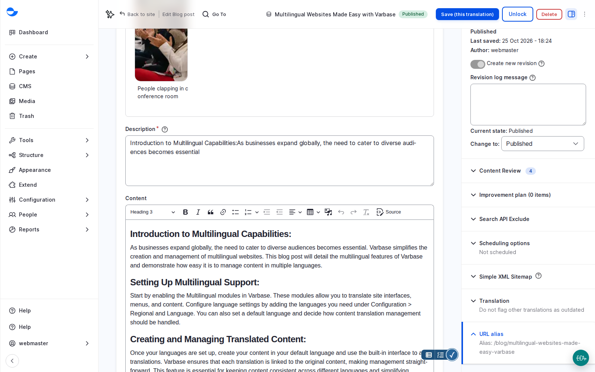

# Update a Live Post Safely

You can rework a published post without visitors seeing a half-finished version. Save your change as a draft: the published version stays live until the draft is published.

## Steps

1. Open the published post and click **Edit**. The post is locked for others while you work; **Unlock** releases it.
2. Make the change, add a revision log message, and set **Change to** to **Draft** (or **In review**).
3. Click **Save**. Visitors keep seeing the published version until the draft is published.

<figure><figcaption>
Editing a Published Post: Content on the Left, State and Options on the Right
</figcaption></figure>

4. When the draft is ready, publish it. See [Publish Content](../content-workflow/publish-content.md).


A small fix, such as a typo, can go straight to **Published**. Use a draft for anything a reviewer should see first.


## If Something Goes Wrong

Every save is kept as a revision. To undo a change that went live, open the **Revisions** tab and revert to the earlier version. See [Modify Content](modify-content.md#revisions).

## Related

- [Content Locking and Autosave](../content-workflow/#content-locking-and-autosave)
- [Take a Post Through Review](../content-workflow/take-a-post-through-review.md)
