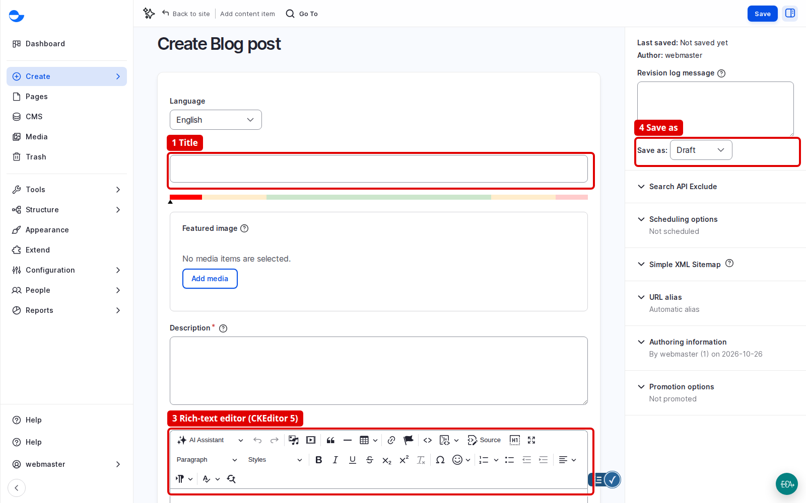
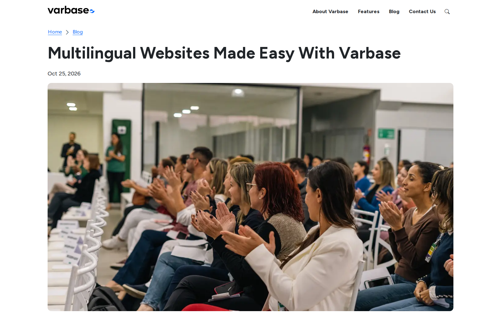

# Write a Blog Post

This takes a blog post from an empty form to a saved draft, with the habits that make it easy to find, read and reuse. For every field of the form, see [Create Content](create-content/).

## Steps

1. In the sidebar, click **Create** \ _**Blog post**_ (or **Add content** on the dashboard or the content list).
2. Check the **Language**, then write the **Title**: clear and specific, still meaningful alone in a list of search results. It also becomes the page heading and, by default, the web address.
3. Under **Featured image**, click **Add media** and pick an existing image from the library, or upload one. A reused image already has its alt text and focal point.
4. Write the **Description**: one or two sentences for someone scanning a list of cards.
5. Write the **Content**. Start sub-sections with **Heading 2**, then **Heading 3**, without skipping levels. Make link text describe where it leads. Use **Insert Media** for images and videos.
6. Pick **Categories** and **Tags**. Search for an existing tag before typing a new one.
7. Leave the SEO fields empty unless you need them: Varbase uses sensible defaults. See [Search Engine Optimization](../search-engine-optimization/).
8. Write a one-line **Revision log message**, such as "First draft for the launch campaign".
9. Set **Save as** to **Draft** and click **Save**. Read the message at the top. The post now appears in **My Drafts** on the dashboard.

<figure><figcaption>
The Blog Post Form
</figcaption></figure>

## After Publishing

When the post is published, it also appears on the blog listing, the latest updates on the home page, related content and search. Search updates when the site's scheduled tasks run, so a new post may take a few minutes to appear there. For an important post, tour those places and check it on a phone.

<figure><figcaption>
The Post as Visitors See It
</figcaption></figure>

## Questions Clients Ask

- **Can editors paste from Word?** Yes. The editor keeps headings, lists and links and drops hidden styling. Check headings and links after pasting.

## Next Steps

- [Take a Post Through Review](../content-workflow/take-a-post-through-review.md)
- [Share a Draft With a Temporary Link](share-a-draft-with-a-temporary-link.md)
