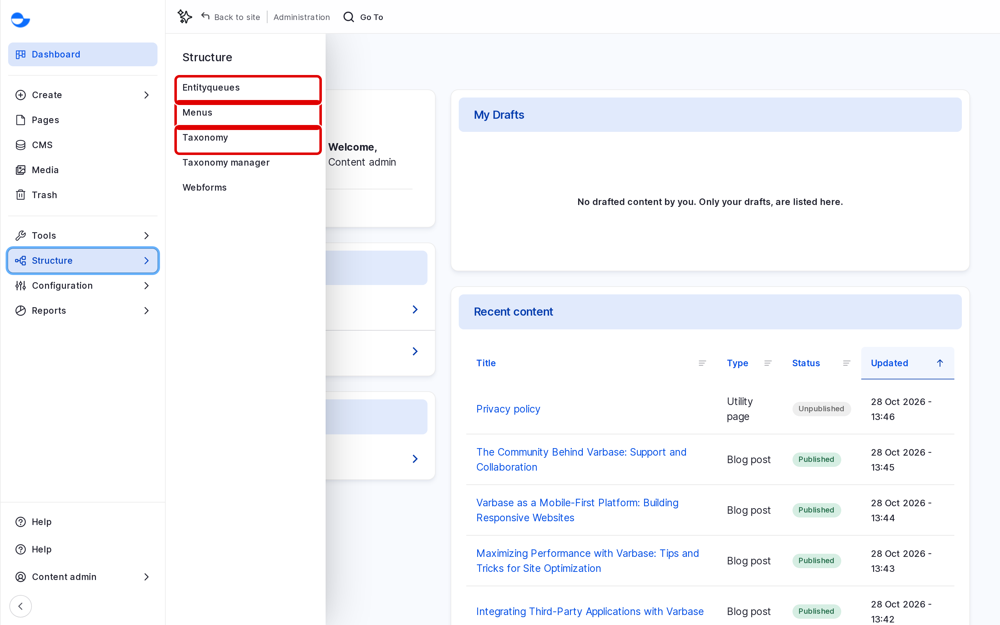

# Content Structure

Content structure covers the tools that organise content rather than create it: menus for navigation, taxonomies for categories and tags, and EntityQueues for hand-picked lists. This section shows how to use each one.

## In This Section

| Tool | What it does | Where to find it |
| --- | --- | --- |
| [Menu Management](menu-management/) | Builds the site navigation, such as the main menu and footer links. | **Structure** \ **Menus** (`/admin/structure/menu`) |
| [Taxonomies](taxonomies/) | Groups content with categories and tags. | **Structure** \ **Taxonomy** (`/admin/structure/taxonomy`) |
| [EntityQueues](entityqueues/) | Keeps a list of content in an order you choose. | **Structure** \ **Entityqueues** (`/admin/structure/entityqueue`) |

All three are in the **Administration** menu of the **Navigation** sidebar, under **Structure**.

<!-- <figure><figcaption>
Content Structure Tools Under Structure
</figcaption></figure> -->

Other items under **Structure**, such as **Content types** and **Views**, are for site builders and developers.
