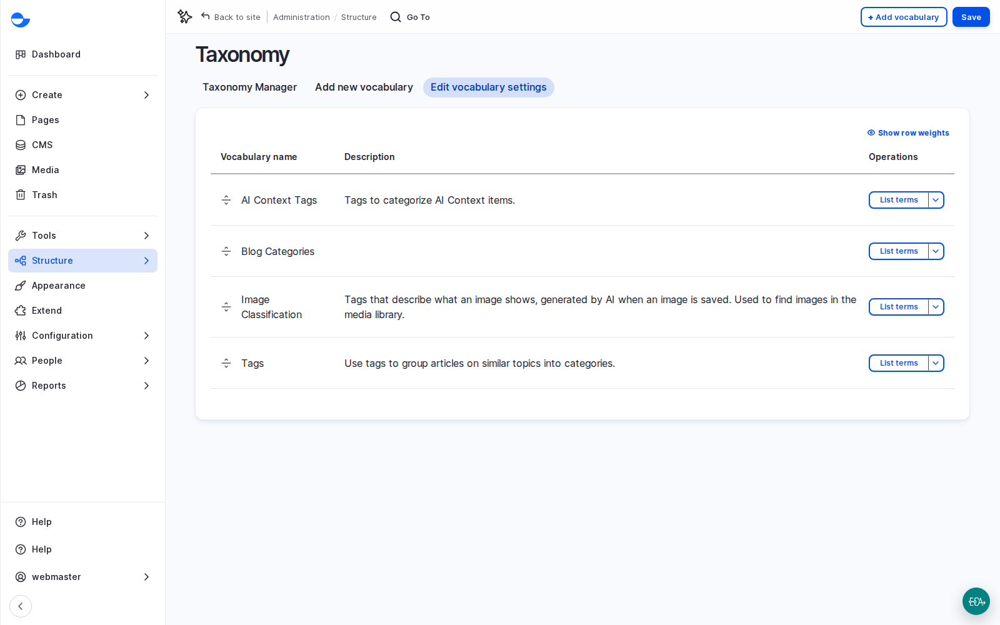

# The Content Model

The content model is the client's information architecture expressed in the site: the **content types** it has, the **fields** they carry, and the **taxonomies** that organise them. It sounds technical, but it is a set of business decisions, and it shapes listings, search, templates, translation and AI. Time spent on it early is the cheapest time in a project.


Lesson 4: The Content Model (Video)


## What It Is

- **Content types** are kinds of content with a fixed shape. A new Varbase Starter site has **Blog post** and **Utility page**. See [Content Types and Fields](content-types-and-fields.md).
- **Fields** are the slots on a content type, such as the title, featured image, description, content, categories, tags and the SEO fields.
- **Drupal Canvas pages** are a separate kind of content: designed one at a time, listed under **Pages**. See [Building Pages With Drupal Canvas](../building-pages-with-drupal-canvas/).
- **Taxonomies** are controlled lists of terms. Tags are open and grow while editors write; categories are a short, stable list a few people manage. See [Taxonomies](taxonomies/).
- **EntityQueues** keep a hand-picked list of content in an order you choose. See [EntityQueues](entityqueues/).

A simple rule: if the client will publish **many** of something, it is a content type; if they will **design each one by hand**, it is a Canvas page.

<figure><figcaption>
Taxonomy Vocabularies on a Varbase Starter Site
</figcaption></figure>

| Vocabulary | What it is for |
| --- | --- |
| **Tags** | Open list for the details of blog posts. Editors add new tags while writing. |
| **Blog Categories** | Controlled list for the main ways visitors browse posts. Empty until the client decides it. |
| **Image Classification** | Tags for images, filled by the AI features. |
| **AI Context Tags** | Organises the brand and editorial guidance the AI features read. |

## Why It Matters

- Structured content can be reused in listings, search filters, related content, feeds and AI answers.
- A missing field shows up later as a listing that cannot be filtered or a page that cannot be translated cleanly.
- Migration effort scales with the number of content types and fields, not the number of pages.

## Scenario: Model a Client's Content in One Meeting

1. **Inventory.** List every kind of content the client publishes today and plans to publish. For each: how many items, how often, who writes them, who approves them. A spreadsheet is enough.
2. **Sort.** Things published often with a common shape become content types. One-off designed pages become Canvas pages. Some things turn out to be a field on something else, or not needed at all.
3. **Reuse before you build.** Varbase has recipes for **News**, **Events** and **Podcasts**, and the site templates add types such as **Program** and **Country**. A new content type should be a conscious choice.
4. **Agree each field** with the questions in [Content Types and Fields](content-types-and-fields.md#fields-with-a-purpose).
5. **Name an owner** for every vocabulary.

**Worked example: a research centre.** It publishes news, events, research papers and staff profiles, and has about and history pages. News and events come from the Varbase recipes (configuration). Research papers become a new content type with authors, a date, a topic category and a file. Staff profiles become a content type, because there are many and papers point to their authors. About and history are Canvas pages. The real build work is one new content type and the link between papers and people.

## Common Mistakes

- **Too many content types**, such as one per department, when one type with a department field would do.
- **Design in fields**, such as a field for a background colour, which makes consistency harder.
- **A vocabulary nobody owns**, which slowly fills with near-duplicates such as AI and artificial intelligence.

## Questions Clients Ask

- **Can editors add fields themselves?** Administrators technically can, but treat new fields as change requests: they affect templates, search and migration. Adding a field is easy; removing it once content depends on it is not.
- **Do we need News or Events?** They are add-on recipes with their own listings and Canvas templates. Add them only if the client publishes that content.

## Planning Notes

- Run a content modelling workshop before design sign-off. List every content type, its fields, and which vocabularies drive filters.
- If there is an old site, map each old content kind to a new content type and each old field to a new field. Content that does not fit needs a decision: reshape, move by hand, or leave behind.
- Taxonomy terms get no automatic URL alias. If term pages matter, plan their addresses (see [Navigation and Web Addresses](../url-management/)).
- Plan a vocabulary review before launch, especially after a migration.


**Check Yourself**

1. A client publishes about two hundred events a year, and a yearly gala page with a custom design. What is each one?
2. What is the difference between a tag and a category, and who should own each?
3. Name two questions you would ask before adding a new field.

