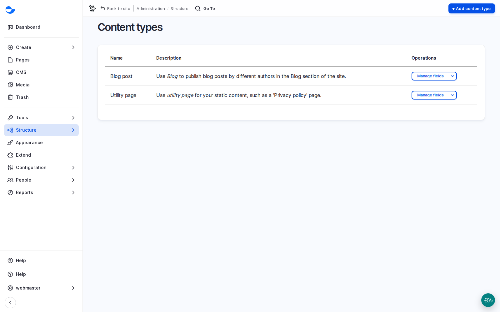
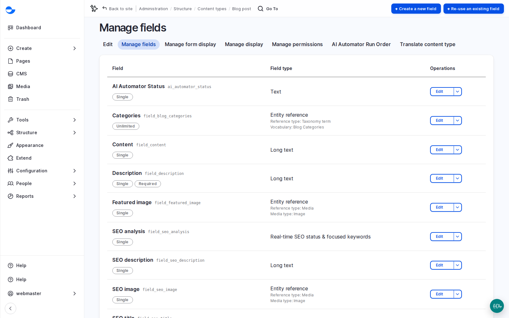

# Content Types and Fields

A content type gives many items one shape, so every item can be listed, searched, filtered and displayed the same way. This page shows how to read a content type, its fields, its form and its displays, so you can review the model with a client and spot what is missing.

## Content Types on the Site

Go to **Structure** \ _**Content types**_ (`/admin/structure/types`). A new Varbase Starter site has two:

- **Blog post**: articles, listed on the blog and in search.
- **Utility page**: simple text pages such as a privacy policy.

Real client sites often have five to fifteen. Each one has a cost to design, build, fill and maintain.

<figure><figcaption>
Content Types on a Varbase Starter Site
</figcaption></figure>

## Reading the Fields

Click **Manage fields** next to **Blog post** (`/admin/structure/types/manage/blog/fields`). Each row is a field with its label and type:

- **Title**, **Featured image**, **Description**, **Content**, **Categories** and **Tags**.
- The SEO group: **SEO title**, **SEO description**, **SEO image** and **SEO analysis**. SEO is part of the model, not an afterthought.

<figure><figcaption>
The Fields of the Blog Post Content Type
</figcaption></figure>

### Field Types

The type decides what an editor can enter:

| Type | Example | Holds |
| --- | --- | --- |
| Plain text | **Description** | A short line or paragraph |
| Formatted text | **Content** | Rich text with headings, links and images |
| Media reference | **Featured image** | An item from the media library |
| Taxonomy reference | **Tags** | Terms from a vocabulary |

Other common types are dates, links, numbers, files, and references to other content.

### Adding a Field

**Create a new field** on **Manage fields** lists the field types to choose from; you then give the field a label and a few settings, and it appears on the form. **Re-use an existing field** adds a field that another content type already has, which keeps the model consistent. Adding a field is configuration, not programming, but treat it as a change request: removing a field once content depends on it is not easy.

## The Form and Its Widgets

The **Manage form display** tab decides the order of fields on the editor's form, how they are grouped, and the **widget** each one uses. On **Blog post**, the SEO fields sit together in **Search Engine Optimization (SEO) Information**, and the publishing settings have their own groups in the sidebar, such as **Scheduling options**, **URL alias** and **Authoring information**. **Tags** use a widget that suggests existing tags as you type; **Featured image** uses the media library. Changes here affect only the form, not the content, so they are safe to adjust after the first month of use. Ask editors which fields they never use and which they keep looking for.

## Displays and View Modes

A **view mode** is one way of showing an item to visitors: the full page, a card in a list, or a search result. The **Manage display** tab of **Blog post** has a tab for each one, such as **Default**, **Card**, **Featured card - large**, **Full content** and **Search result**, and **Structure** \ _**Display modes**_ (`/admin/structure/display-modes`) lists them all. A Varbase Starter site has many card sizes (small, medium and large featured cards, overlay cards, text cards). On Varbase, the layout of each view mode is designed in Drupal Canvas as a content template. See [Content Templates](../building-pages-with-drupal-canvas/content-templates.md).

## Settings on Every Field

Open a field's settings, for example **Description** (`/admin/structure/types/manage/blog/fields/node.blog.field_description`, **Description settings for Blog post**):

- **Required field**: use it for what every item truly needs, not for what is sometimes useful.
- **Help text**: one line under the field, such as "A one-sentence summary shown on cards, about 150 characters". It is the cheapest training tool there is. Write it with the client's content lead.
- **Users may translate this field**: on multilingual sites, text is usually translated; a date or a price usually is not.
- **Enable AI Automator** and **AI Automator Settings**: with the AI recipes, a field can be filled from other fields, for example an SEO description from the main text. AI help can be added to a field later without changing the model.

## Fields With a Purpose

Agree every field with the same questions:

1. Who fills it in, and do they always have the information?
2. Is it required, or only useful sometimes?
3. Does it need a translation?
4. Where does it appear: the page, cards, search results, or only search engine tags?
5. Will visitors filter or sort by it?

A field that fails all of these is usually not needed.

## Tips

- Use **Re-use an existing field** to keep the same field on several content types.
- Do not change fields on a live site without testing: listings, search and templates depend on them.
- Site templates show good content types: **Educare** adds **Program**, **Horizon Aid** adds **Country** and **Program**. See [Site Templates](../../developers/understanding-varbase/site-templates/).
