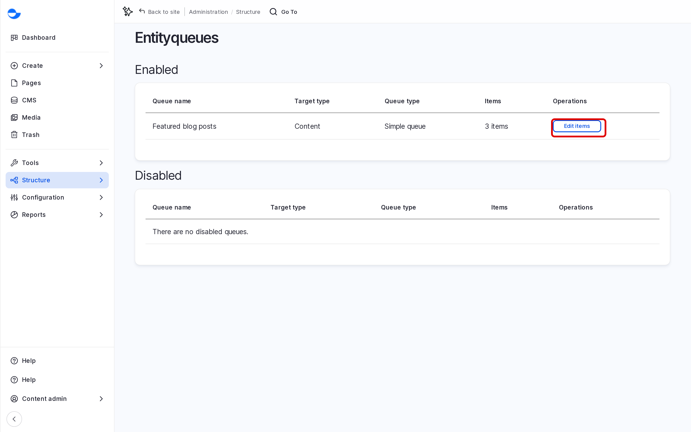
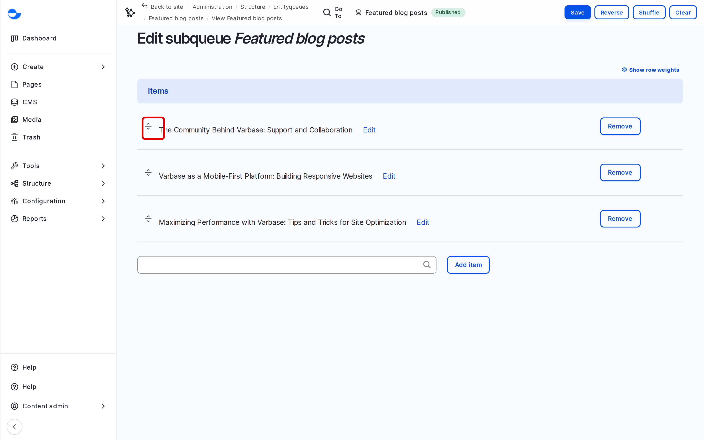

# EntityQueues

An EntityQueue is a list of content kept in an order you choose, such as the featured posts on the home page. Unlike a list sorted by date or title, a queue shows exactly the items you pick, in your order. This page explains how queues work and how to manage one.

## Queues on Your Site

A new Varbase site has no queues. Your development team adds a queue when a part of the site needs a hand-picked list, and places it on the page. Once a queue exists, editors keep its items up to date.

## Opening a Queue

1. Go to **Structure** \ **Entityqueues** (`/admin/structure/entityqueue`).
2. Find the queue and click **Edit items**.

<figure><figcaption>
The Entityqueues List
</figcaption></figure>

## Managing the Items

On the queue form, the **Items** list shows the content in its current order.

- **Reorder**: drag an item by its handle, then click **Save**.
- **Remove**: click **Remove** next to an item, then click **Save**. The content itself is not deleted.
- **Add**: see [Add Items to a Queue](add-items-to-a-queue.md).

<figure><figcaption>
The Items of a Queue
</figcaption></figure>

The form also has **Reverse** (flip the order), **Shuffle** (random order) and **Clear** (remove all items). They take effect when you click **Save**.

## Who Can Manage Queues

The **Content Admin**, **Site Admin** and **Super Admin** roles can edit queue items.

## Tips

- Keep queues short: a home page feature usually shows three to six items.
- Removing an item from a queue is safe; it only takes it off that list.
